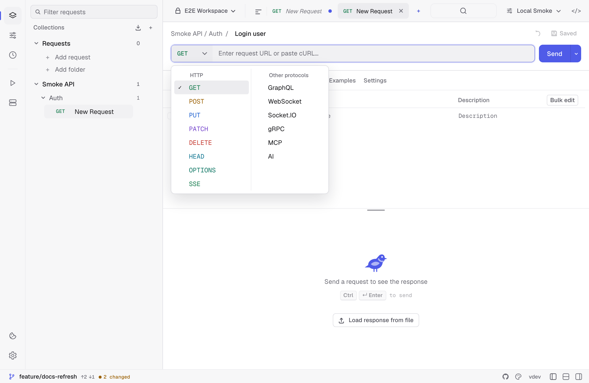
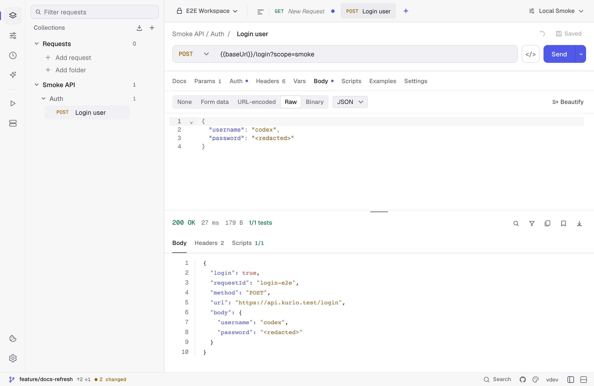
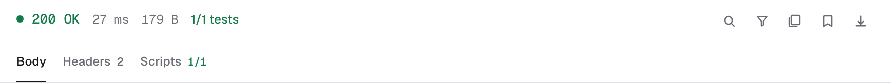
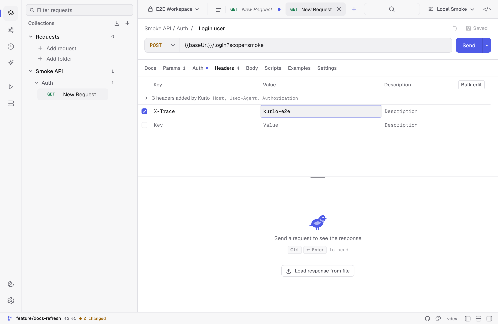

This walkthrough takes about five minutes. By the end you'll have:

1. A workspace with one collection.
2. A saved `GET` request against a public API.
3. An environment with a base URL variable.
4. A test script asserting the response.

## 1. Create a workspace

Workspaces are top-level containers — think one per project or per client. On first launch Kurlo creates a **Default** workspace; you can rename it or add more from the workspace switcher in the top-left.

## 2. Send an ad-hoc request

- Press `Cmd/Ctrl N` or click `+` in the tab bar — a new HTTP request opens right away. Other protocols live in the picker at the start of the address bar.
- Paste `https://httpbin.org/get?lang=go&runtime=wails` into the URL bar.
- Hit `Cmd/Ctrl Enter` (or click **Send**).



The response panel shows the JSON body with syntax highlighting, response headers, timing, and size.





The URL bar is always one line high. A URL longer than the bar scrolls sideways as you type or move the cursor with the arrow keys, `Home` and `End`. Swipe sideways on the trackpad or turn the mouse wheel over the URL to see the rest of it without moving the cursor. The bar shows the start of the URL again when you click elsewhere.

> Tip: you can paste a `curl ...` command into the URL field — Kurlo will parse method, headers, params, and body automatically.

### Bulk edit

**Params**, **Headers**, and the form body types each have a **Bulk edit** toggle that swaps the table for its text form — one `key:value` per line, with `//` in front of a line to disable it:

```
Content-Type:application/json
Authorization:Bearer {{token}}
//X-Debug:1
```

It is the quickest way to paste a block of headers from somewhere else, or to add and reorder a dozen rows at once. Switching back rebuilds the table. Descriptions and attached files stay with their key, so a round trip through bulk edit does not lose them.

## 3. Save it to a collection

- Click **Save** (or `Cmd/Ctrl S`).
- Pick **+ New collection**, name it `Examples`, and save the request as `Get with query`.

The request now lives in the sidebar tree. Drag-and-drop reorders requests within their collection or folder.

## 4. Parameterize with an environment

Hard-coded URLs don't survive across staging and prod. Replace the host with a variable:

- Open **Environments** in the side panel, click **+** to create `Local`.
- Add `baseUrl = https://httpbin.org`.
- Activate `Local` from the environment switcher.
- Edit the request URL to `{{baseUrl}}/get?lang=go&runtime=wails`.
- Send again — same result, but now portable.

See the [environments guide](/docs/guides/environments/) for active environments, collection variables, and script-created values.

Use the **Headers** tab for API-specific metadata such as trace IDs, content negotiation, or custom client headers:



`Host` works here: set it to reach a virtual host or a service behind a load balancer, and the connection still goes to the URL's address. A handful of others — `Content-Length`, `Transfer-Encoding`, `Connection`, `Upgrade`, `Keep-Alive`, `TE`, `Trailer`, and the `Proxy-*` pair — control how the request is framed on the connection, so Kurlo sets them itself and does not send yours. When you have one enabled, the response panel says which ones were left off rather than letting you wonder why the server ignored them.

## 5. Assert with a test script

Open the **Scripts** tab on the request and paste:

```js
pm.test("status is 200", () => pm.response.to.have.status(200))

const body = pm.response.json()
pm.test("query is echoed back", () => {
  pm.expect(body.args.lang).to.equal("go")
})
```

Send the request again. Your tests show green in the response **Scripts** panel.

## Next steps

- [Configure auth](/docs/guides/authentication/) — Bearer, OAuth2, AWS SigV4, etc.
- [Import an existing collection](/docs/guides/import-export/).
- [Full scripting API](/docs/reference/scripting-api/).
