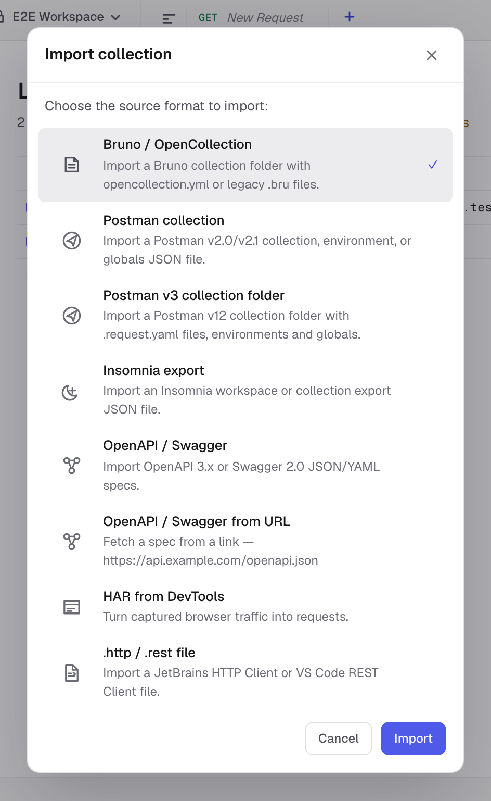

For a collection with native gRPC, WebSocket, Socket.IO, or MCP requests, use a [Postman v3 Native Git folder](/docs/guides/import-export/postman/#postman-v3-folders). In Kurlo choose **Postman v3 collection folder**, or drop the folder into the window. These steps cover Postman's v2.0 and v2.1 collection JSON.

## Export from Postman

1. Open Postman.
2. Right-click the collection → **Export**.
3. Choose **Collection v2.1** → **Export**.
4. Save the `.json` file somewhere you'll remember.

If you have environments too: Postman left sidebar → **Environments** → `⋯` next to each environment → **Export**. Save those `.json` files alongside the collection.

## Import into Kurlo

In Kurlo's sidebar header, click **Import collection** next to **+**. Select **Postman collection**, click **Import**, then pick the exported `.json`. Kurlo creates a collection with the same name and restores its folder tree.

You can also drop the file into the Kurlo window.

Use the **Postman collection** picker for exported Postman environments or globals as well. Kurlo recognises them from the JSON.

## What carries over

| Postman concept | Maps to in Kurlo |
|-----------------|------------------|
| Collection name + folder tree | Collection with nested folders, including empty folders |
| Request name, method, URL, params, headers, body (raw / form-data / urlencoded / binary / GraphQL) | Imported as request fields. File bodies keep their file paths. |
| Authentication: Basic, Bearer, API Key, Digest, OAuth 2.0 | Request auth stays on the request. Collection and folder auth become [defaults](/docs/guides/collection-defaults/). |
| AWS Signature v4 | Preserved with region / service / access keys |
| OAuth 1.0 | Preserved: keys, secrets, signature method, realm, callback, verifier and the header/query choice |
| Pre-request and test scripts | Imported into Kurlo's sandboxed script fields — see compatibility notes below |
| Environments (variables) | One Kurlo environment per Postman environment |
| `{{variable}}` syntax everywhere | Preserved literally — Kurlo resolves them the same way |

## Pre-request / test script compatibility

Postman scripts are JavaScript with Postman's `pm.*` API. Kurlo runs imported scripts in a JavaScript sandbox. Its `pm.*` API mirrors the common Postman surface for headers, variables, environments, response JSON, tests, and logs.

Most simple Postman scripts import with minimal edits:

| Postman | Kurlo equivalent |
|---------|------------------|
| `pm.request.headers.add({key, value})` | `pm.request.headers.set("key", "value")` |
| `pm.response.json()` | `pm.response.json()` ✓ same |
| `pm.test("name", function () { ... })` | `pm.test("name", () => { ... })` or `pm.test("name", expr)`; see [Scripting API](/docs/reference/scripting-api/) |
| `pm.environment.set("k", "v")` | `pm.environment.set("k", "v")` ✓ same |
| `pm.collectionVariables.set(...)` / `pm.globals.set(...)` | ✓ same; see [Variable scopes](/docs/reference/scripting-api/variables/) |
| `pm.info.requestName`, `pm.info.iteration` | ✓ same |
| `pm.cookies.get(...)` / `.has(...)` | ✓ same (read-only) |
| `pm.execution.skipRequest()` | ✓ same |
| `CryptoJS.HmacSHA256(...)` | ✓ works via the [CryptoJS shim](/docs/reference/scripting-api/crypto/#cryptojs), or use `pm.crypto.hmacSha256(...)` |
| `pm.sendRequest(...)` | ✓ same, once **Allow pm.sendRequest** is enabled in the request's Settings tab |
| `tests["name"] = ...`, `responseBody`, `postman.setEnvironmentVariable(...)` (legacy) | ✓ same; see [Postman legacy globals](/docs/reference/scripting-api/compatibility/#postman-legacy-globals) |
| `pm.variables.replaceIn("{{baseUrl}}/x")`, `xml2Json(...)` | ✓ same |
| `postman.setNextRequest(...)` | Not supported — Kurlo's Collection Runner runs in declared order |
| `require("lodash")`, `ajv`, `tv4`, `uuid`, `crypto-js`, `chai` | ✓ works via Kurlo's [bundled stand-ins](/docs/reference/scripting-api/compatibility/#require) |
| `require("...")` of any other Node.js library (`xml2js`, `moment`, `cheerio`, …) | Not supported — the sandbox has no filesystem, process access or real npm modules. Hashing and HMAC are covered by `pm.crypto` / `CryptoJS`, XML by `xml2Json`, HTTP calls by `pm.sendRequest`. |
| `setTimeout` / `async` / `await` | Not supported — the sandbox has no event loop. `pm.sendRequest` is synchronous, and its callback runs immediately. |

After import, open the *Scripts* tab on a request and run a smoke request. If a script fails, the response panel shows a script-error block with the line number.

## What doesn't import

- **Postman monitors** — a server-side feature with no direct equivalent; the [CLI runner](/docs/guides/cli-runner/) on a schedule covers the same ground.
  Postman **mocks** do have an equivalent, and it runs locally: imported saved responses become [examples](/docs/guides/examples/), which the [mock server](/docs/guides/mock-server/) serves over HTTP without an account.
- **Postman Flows / workflows** — same.
- **Personal teams / sharing** — Kurlo is local-only.

To send a collection back to Postman, open its **⋯** menu and choose **Export…**. Choose **Postman collection v2.1** for a single JSON file or **Postman collection v3 (YAML folder)** to open native gRPC requests with [Postman Local Files](/docs/guides/import-export/postman/#export-to-postman-v3). See [protocol support by format](/docs/guides/request-types/portability/) for details.
