The agent works inside Kurlo on the open workspace. Ask it in plain words to run a request, find out why one failed, run a collection and explain the failures, or add a request with tests, and it does the work with Kurlo's own tools: the same ones [`kurlo mcp`](/docs/guides/mcp-server/) gives to Claude Code or Cursor, called directly inside the app.

It runs on a model you connect in [Settings → AI](/docs/guides/settings/#ai): OpenRouter, your own Anthropic, OpenAI or compatible key, or a local Ollama or LM Studio model. Kurlo has no account and no credits of its own; you pay the provider, or nothing at all for a local model.

## Open the agent

Click the sparkle icon in the activity bar on the left, or press `Alt Cmd/Ctrl 4`. Until you open it for the first time, the icon carries a small blue dot. The sidebar has **New chat** at the top and your chats below it, newest first under **Today** and **Earlier**; type in **Filter chats** to find one by its name. Each chat is marked with the agent it runs on: the Kurlo bird for the Kurlo agent, the Codex and Claude Code marks for those agents; an amber dot instead of the time means the chat waits for your approval. **New** beside **Chats** starts a new chat. The main area opens the **Agent** tab. When you switch to another tab, such as a request the agent opened, the sidebar goes back to what it showed before, and returns to your chats when you come back to **Agent**.

Without a connected model the tab offers four ways to connect one: **Connect OpenRouter** signs you in through the browser, **Your API key** opens the key form, **Local model** looks for Ollama and LM Studio on this computer, and **Codex on this computer** opens the Codex connection in Settings → AI.

An empty chat offers four starting tasks, such as **Why did my request fail?** and **Run and check the collection**. Clicking one puts its text in the message box.

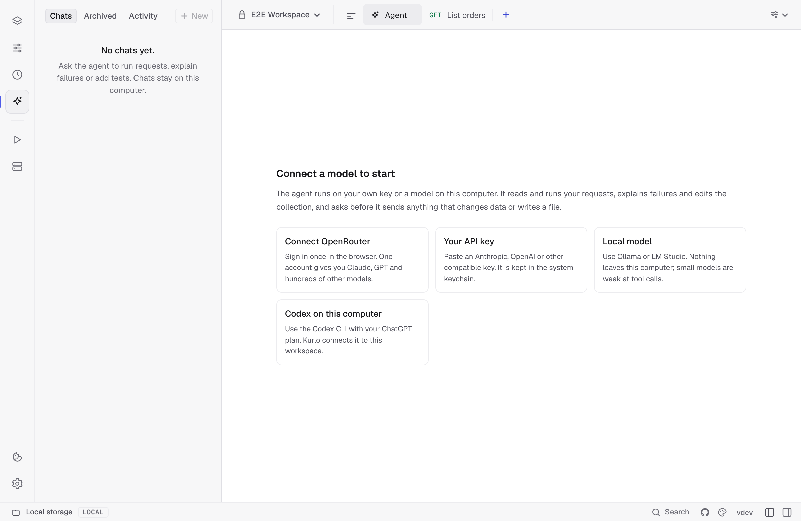

## Local agents

The agent picker in the message box chooses who answers. **On this computer** lists installed coding agents that run with their own account, such as Codex, with their models. Effort has its own menu beside the picker. **Kurlo agent · any model** lists your model connections, such as OpenRouter or an API key. Both share one chat list.

To connect Codex:

1. Open **Settings → AI → Your agents**, or click **Connect** next to Codex in the agent picker.
2. Kurlo checks for Codex CLI. If it is missing, install it with `npm install -g @openai/codex`, then click **Check again**. Use **Choose executable** or enter its full path if Kurlo cannot find it.
3. If Codex is already signed in, click **Use this account**. Otherwise click **Sign in** and complete the official Codex sign-in in your browser. **Reopen browser** opens the same pending sign-in; **Cancel sign-in** stops it.
4. Choose an available model and connect. ChatGPT sign-in uses your plan's available usage; an existing API-key login uses API billing.

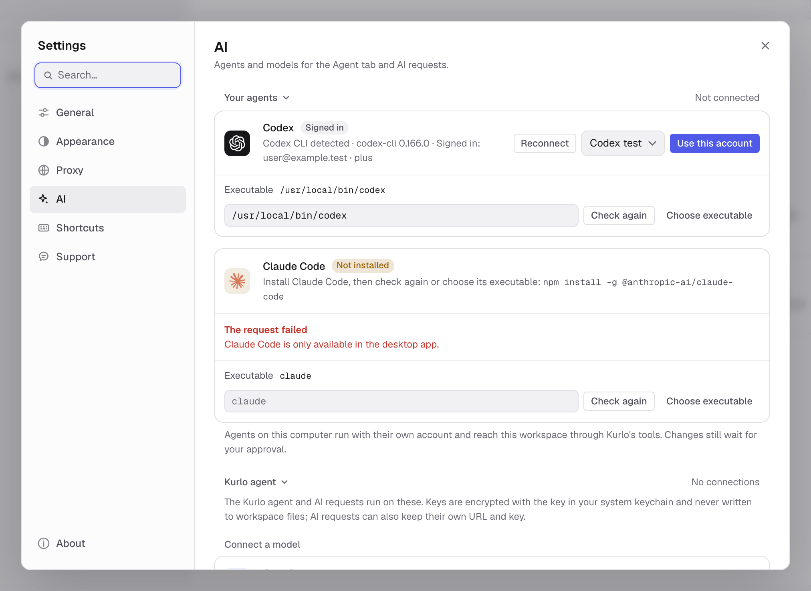

Choose a Codex model in the agent picker, then use the separate **Effort** menu beside it. It lists the reasoning levels the model supports and highlights the model's default until you choose another. An explicit choice is saved with the chat; choosing the highlighted default again goes back to the CLI's own default on the next turn, including in an existing session. Changing to a model that does not support the chosen effort returns to its default. Codex calls Kurlo's tools through its local app-server connection. Reads run immediately; requests that may change server data and workspace edits use the same approval cards as the Kurlo agent. Shell execution and inherited external integrations are disabled, and Codex runs with a read-only sandbox. The active request editor is not attached automatically.

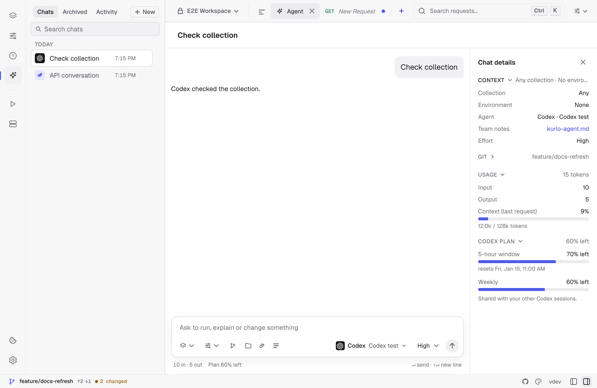

**Stop** cancels the active work and closes its process. The next message resumes the native Codex session. If that session is unavailable, Kurlo shows an error; start a new chat rather than silently losing the conversation. A chat stays with the agent it started on; to switch agent, start a new chat. In a new chat, switching agent keeps what you typed and the chosen collection and environment.

**Manage connections** in the agent picker opens the connection settings. **Remove connection** stops active Codex work and removes the connection from Kurlo; it does not sign you out of Codex or delete its native sessions. The CLI manages its own credentials. Kurlo stores the executable path, default model and native session ID, not your subscription tokens. Codex also keeps its own conversation data in its profile, governed by its settings, separately from Kurlo's encrypted chat copy. Removing a chat in Kurlo does not delete that native copy.

To connect Claude Code:

1. Open **Settings → AI → Your agents**, or click **Connect** next to Claude Code in the agent picker.
2. Kurlo checks for the Claude Code CLI and shows its version. If it is missing, install it with `npm install -g @anthropic-ai/claude-code`, then click **Check again**. Use **Choose executable** or enter its full path if Kurlo cannot find it.
3. If the CLI is already signed in, its account and plan show under **Signed in** (or **API key** / **Cloud provider**); choose a model and click **Use this account**. Otherwise click **Sign in** and complete the official Claude sign-in in your browser.

The card then shows **Connected**. **Reconnect** checks the CLI again, the model menu changes the default model at once, and **Remove connection** stops active Claude Code work and removes the connection from Kurlo without signing the CLI out. Select **Claude Code** under **On this computer** in the agent picker; its models are listed below it by full name (Fable 5.1, Opus 5.5, Sonnet 5.5, Haiku 5.5), and the one the CLI uses by default is preselected and marked **default**. The **Effort** menu beside the picker offers Low, Medium, High, Extra high and Max; High is preselected, and Kurlo always passes the chosen level to the CLI. Some models, such as Fable, may need usage credits on your Claude plan; the CLI's reason then shows in the chat. **Chat details** shows the chat's tokens, the cost at API prices (a subscription is not billed per token), the last request's context against the model's window, and the Claude plan's 5-hour and weekly limits with their reset times; Kurlo reads the limits and the default model with the CLI's `/usage` command, which uses no tokens, whenever it checks the connection, and updates them after each turn; they also appear in Settings → AI. **Stop** ends the current turn, and your next message resumes the same native session. Workspace edits use Kurlo’s approval cards.

Claude Code keeps its native conversation separately from Kurlo’s encrypted chat copy. Deleting the chat in Kurlo removes the Kurlo copy.

## Ask

Type in the box at the bottom and press `Enter` (`Shift Enter` adds a line). The header shows the chat's name, which you can click to rename. Chips at the left of the message box choose the collection and environment it works on:

- **Collection.** The collection to work in unless you name another. **Any collection** leaves it to the agent.
- **Environment.** The environment its requests use. A protected environment is listed, but the agent cannot send with it; run those requests yourself.

The agent picker at the right of the message box chooses the agent and model. Choose **Claude Code**, **Codex** or a Kurlo agent connection to see its models and a search field. The one marked **default** is the model set in Settings → AI. Picking another model changes it for this chat only: the connection, its default model and AI requests that use **Kurlo connection** stay as they are. `↑` and `↓` move between options, `Enter` picks one and `Escape` closes the menu. The choice applies to your next message and is locked while the agent works.

For Codex, a separate **Effort** menu sits beside the model picker. It offers the levels supported by the selected model. New chats keep your effort choice; switching to a model that does not support it uses that model's default.

**Templates** in the message box offers ready requests: why the last request failed, run and check the collection, write tests for a request, cover an endpoint, and explain a request. Choosing one puts its text in the box with the part to fill in, such as `REQUEST NAME`, selected; edit it and press `Enter`. Templates your team keeps in [`kurlo-agent.md`](#team-notes-in-kurlo-agentmd) appear above the built-in ones under **From kurlo-agent.md**.

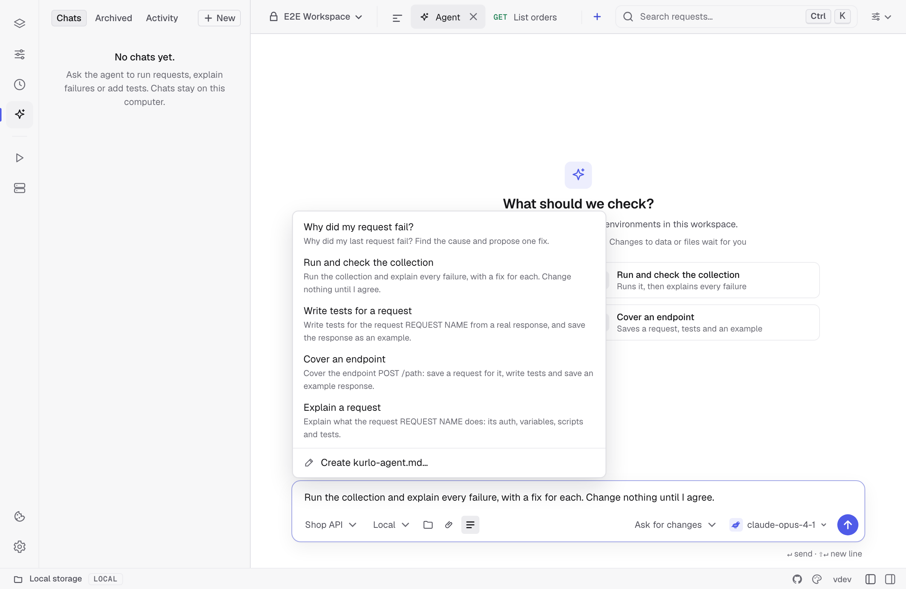

The answer streams in as the agent works. The tool calls of a turn sit in one card, one line each, such as **Ran a request** or **Saved a request**, with a check when done, a cross when it failed and a shield while it waits for you; a run also shows the request line, status code and time. Click a line to see the arguments and the result, and click **Open request**, **Open entry** or **Open environment** to jump to what it touched. **Stop** ends the turn, including while the first response or a confirmation is pending. An unanswered confirmation stops the turn after 30 minutes; retry when you are ready. If sending your decision fails, the card keeps its buttons available to try again. Messages and answers can be selected and copied like any text; hovering one also shows a copy button, and **Retry** sends your last message again when a turn failed or stopped before answering. Hover a message you sent to **Edit message**: its text goes back into the box and sending replaces it and everything after it. **Branch from here** instead starts a new chat, named after this one with **(branch)**, that holds the conversation up to that message, so the original chat stays as it was. A long chat initially loads its latest 40 exchanges. Scroll to the top or click **Load earlier messages** to fetch another 40 without losing your reading position. Only messages near the viewport are rendered.

Each chat runs on its own: start a task, open another chat or **New**, and send there while the first one keeps working. A pulsing dot in the sidebar marks every chat that is working, and **Stop** in a chat stops only that chat's turn. Codex and Claude Code still run one turn at a time.

A saved chat has its name at the top; click it to rename the chat. Archive, export and delete are in the chat's **•••** menu in the sidebar. **Chat details**, the panel button at the right of the status bar, opens a side panel with the chat's collection, environment, agent and effort, token usage and the last request's context size, the files the agent changed or wants to change, its recent runs with their status codes and, for Codex, each plan limit with its reset time. Each part of the panel folds: click its title to open or close it, and a closed part shows a short summary on the right, such as the collection and environment, the budget used or the token count and cost. Kurlo remembers which parts are open. It sits beside the conversation; in a narrow window it takes the conversation's place until you close it with `Escape`, the close button or the status bar button. Kurlo remembers whether the panel is open.

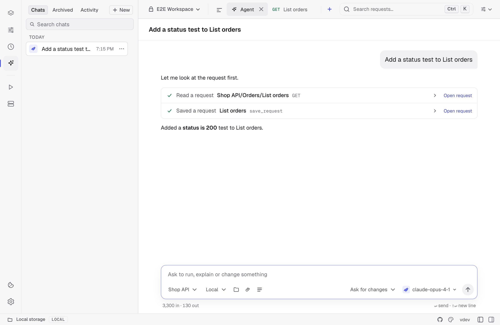

## Running requests and tests

Name a saved request, folder or collection in the chat. The agent can run HTTP, GraphQL, unary gRPC, MCP and AI requests. For an MCP endpoint, ask it to list available tools or call one with specific arguments. HTTP results include timings, redirect hops and the negotiated TLS details when available.

For WebSocket, Socket.IO, SSE or streaming gRPC, ask the agent to connect, exchange messages and report what it receives. SSE only receives events. A server-streaming gRPC call sends its saved message when it opens. For client-streaming and bidirectional gRPC, ask the agent to send each message and finish sending when ready. **Stop** and the end of the turn close the connections.

For a collection run, name the number of iterations, a delay between requests and whether to stop at the first failure. To use test data, put a CSV or JSON file in the workspace and give the agent its relative path. Each row drives one iteration. The agent reports per-request results, assertions, skips and elapsed time.

Ask the agent to save a load test and run it with the installed k6. The run continues in the background. Ask for its progress, summary or a comparison with an earlier run of the same test or another saved test. To serve saved examples, ask it to start a mock for a collection and inspect the request log. The mock stays up until you or the agent stops it.

Ask for cookies that apply to a domain to see their names, paths, expiry and flags. Clearing the workspace's jar requires a fresh approval each time.

## Project folders, files and imports

Use the folder button in the message box to connect a source directory. The connection is saved with the chat when you send a message. The agent can list files, search for text and read lines inside that directory. Project access skips symlinks, hidden configuration and common credential files. Remove the **Project** chip and send a message to disconnect it.

Ask the agent to find the routes in the project and sync your collection, or ask it to cover one endpoint such as `POST /pets`. It can use the source to build a request, example and tests. Workspace changes go through the usual approval card.

Drop files onto the message box or use **Attach file** to add a specification, proto, CSV, text file or image to the next message. Ask the agent to import an attached OpenAPI file, read a proto or run a collection with attached CSV or JSON data. PNG, JPEG and WebP go to the selected model as images. The agent reads SVG as source text. Attach the file again to use it in another turn.

Click a file above a sent message to open it. For images, use **+** or **−** to zoom and **Fit** to return to the initial view. Kurlo keeps an encrypted local copy with the chat so you can open the file after moving or deleting the source.

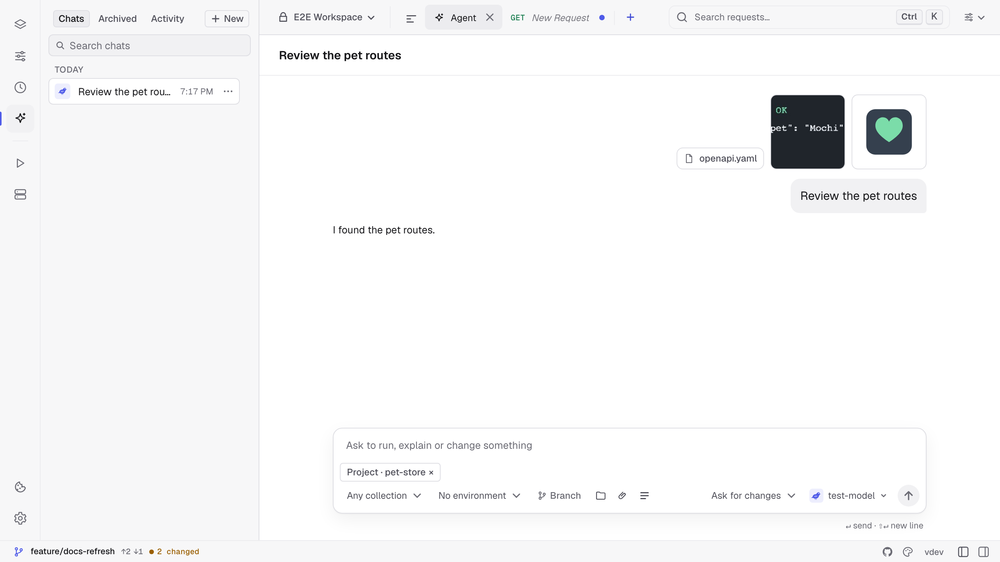

Ask for an import from a file in the connected folder, an attachment, a pasted cURL command or an OpenAPI URL. The agent previews the changes before showing **Apply this import?** with the list of requests it adds or changes. Approve to write the files or reject to leave the workspace as it was. The same Go importers work through the MCP server without a desktop window. [MCP import tools](/docs/guides/mcp-server/#import-requests-and-read-project-source)

You can also ask the agent to read or update the Markdown docs of a request or collection, or generate a code snippet for an HTTP or GraphQL request. Give the request name and your language, for example, “Show me the Python snippet for Get pet.”

## Usage, context and limits

Below the message box, input and output token counts show usage recorded for this chat. Codex can also report account quota windows and the context window size. Codex stops a turn after five minutes without progress, excluding time spent waiting for your confirmation, and after 50 tool calls. It manages its model context through the CLI and can compact it automatically; Kurlo shows **Compacting context…** while this happens. Compaction changes what the model retains in its working context, while the conversation remains available in Kurlo.

Below the message box, **Plan N% left** shows the tightest Codex quota window and turns amber below 30%; click it to open **Chat details**, which lists every window, such as the 5-hour and weekly ones, with a bar and its reset time. Click it to see reset times when available. These are account limits, shared with other Codex sessions, rather than a per-chat token budget. Kurlo updates them from the CLI's account snapshot and live notifications. Missing quota information is hidden.

For the Kurlo agent, **Chat details** also shows the cost of the chat when the provider reports it (OpenRouter does) and the context of the last request against the model's window, which Kurlo takes from the provider's model list or assumes to be 128,000 tokens (32,000 for local models). Within one turn, when the conversation would take more than 70% of that window, Kurlo shortens the oldest tool results, keeps the last two in full and tells you how many it shortened; the saved chat keeps everything. With an Anthropic connection the stable start of every request, the instructions, tools and earlier messages, is marked for prompt caching, so later steps of a turn are read from the cache at a lower price.

**Budget** in **Chat details** caps a chat, up to 1,000,000,000 tokens and 100,000 requests, by tokens, counted over the whole chat, and by sent requests, counted as every request the agent sends with `run_request`, `send_request`, `run_collection` or `generate_tests`. Leave a field empty for no limit. The agent stops when the chat reaches either one and tells you, and a call that would go over the request budget does not run. Raise the budget to continue.

When a Kurlo agent chat gets long, open **Chat details → History** and choose **Compact chat**. Kurlo asks the chat's model for a summary of the conversation so far: what you asked for, what was created or changed, results that matter later and what is still open. From your next message on, the agent works from that summary instead of the earlier messages, so each request is smaller. The messages stay in the chat for you, under a line that marks where the compacted part ends, and **Show summary** shows what the agent sees. Compact again after more messages to fold them into the summary too. Editing or branching from a message inside the compacted part drops the summary. Codex and Claude Code manage their own history and do not offer this.

In **Chat details**, **Context (last request)** compares the last reported request's token count with the reported model window. It is a snapshot, not cumulative token usage or a prediction of the next request after compaction. The last reported snapshot is retained with the chat; if the CLI does not report a window, no percentage is invented.

## What it may do without asking

**Approvals**, next to the model in the message box, sets how much the Kurlo agent asks in this chat:

- **Ask always.** Only reading runs on its own. Every request, even a `GET`, and every change waits for you.
- **Ask for changes.** The default, as in the table below.
- **Auto.** Requests and changes to the workspace files run on their own. A `POST`, `PUT`, `PATCH` or `DELETE` to a host that is not trusted, a one-off call to a host the workspace does not use, starting k6, clearing cookies, OAuth sign-in and `git push` still wait for you.

**Chat details → Permissions → Trusted hosts** lists hosts where `POST`, `PUT`, `PATCH` and `DELETE` run without asking, such as `localhost` or `*.staging.example.com`; new chats start with `localhost` and `127.0.0.1`. Kurlo resolves the request's URL with the chosen environment before it checks the host, and asks when the host contains a variable it cannot resolve. An environment marked as a [sandbox](/docs/guides/environments/#sandbox-environments-for-the-agent) lets every request sent with it run without asking. The settings are saved with the chat when you send a message.

| The agent wants to | What happens |
|--------------------|--------------|
| List or read requests, environments or history, or diagnose a failure | Runs at once |
| Run a request, a collection or a one-off call that only sends `GET`, `HEAD` or `OPTIONS` | Runs at once |
| Send a one-off call to a host that no saved request or variable of the workspace uses | Asks first, even for `GET`, unless the host is trusted |
| Send any other method, such as `POST` or `DELETE` | Asks first, showing the call |
| Run a saved unary gRPC, MCP or AI request, or open a live connection | Asks before contacting the configured server |
| Send a live message or start or stop the mock server | Asks first |
| Start k6 or clear the cookie jar | Asks every time |
| Fetch an OpenAPI URL | Asks before fetching |
| Apply an import or edit Markdown docs | Shows the changes for approval |
| Check k6 progress, compare results, read the mock log or list cookie metadata | Runs at once |
| Change the workspace: save or delete a request, save an example, set a variable, create a collection, write tests or save a load test | Asks first, showing the change file by file |
| Read the Git status or diff of the workspace, or build a pull request link | Runs at once |
| Create a Git branch or commit workspace files | Asks first; a commit shows the files it includes |
| Push the current branch | Asks every time, and only when you asked it to push |

Before a task with several changes the agent shows **Follow this plan?** with its steps and, under **Runs without asking again**, the exact calls it intends to make, each with its target such as a request path, a variable or a URL. **Approve plan** lets exactly those calls run without asking for the rest of the turn; a call listed without a target runs once. Anything else still waits for you, and `git push` never joins a plan.

An approval card lists what would change in plain terms: each request, environment, collection or the globals, where it lives, such as `Shop API / Orders`, whether it is new, changed or deleted, and which fields change, such as **Tests added** or the old and new URL. Internal details such as ids are left out; a change that touches only them says so. **Show file changes** opens the exact lines of the YAML file. With one or two changes every item is open; with more, the card shows a short count such as **9 new requests** and a folded list you open item by item or with **Expand all**, and the list scrolls inside the card so the buttons stay close. **Apply** writes the changes, **Reject** tells the agent no and it asks what you want instead, and **Allow for this chat** applies this change and lets the same tool run without asking for the rest of the chat.

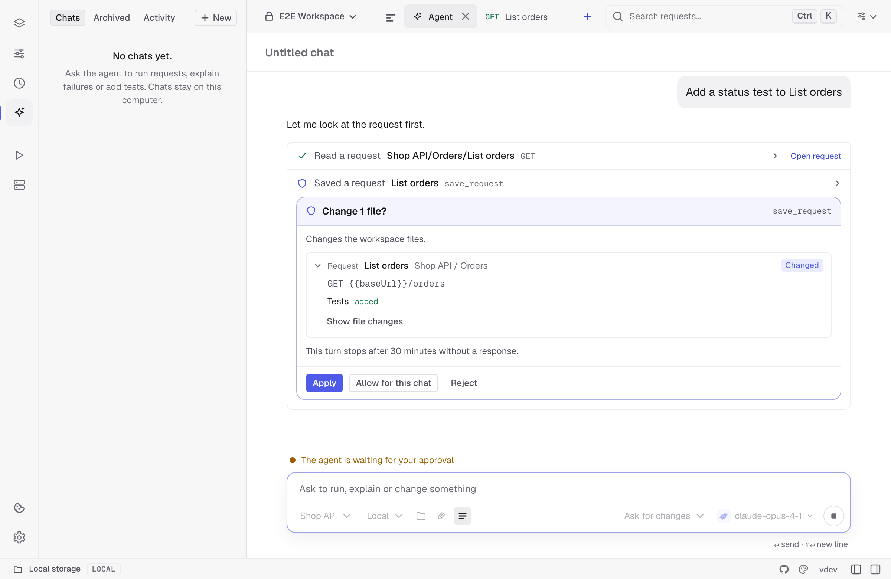

Nothing is written while the card waits, and Kurlo keeps saving your own edits in the meantime. If you change one of those files before you click **Apply**, the change is dropped and the agent is told to try again, so it never overwrites your edit. The agent never writes a secret into the workspace: it uses a `{{variable}}` and asks you to set the value. Secret values reach it only as `[secret]`.

## Team notes in kurlo-agent.md

Keep conventions for the agent in `kurlo-agent.md` at the root of the workspace folder: which environment to use for tests, naming rules, tags, what never to touch. The file is plain Markdown and lives in Git with the workspace, so the whole team shares it. The Kurlo agent reads it at the start of every turn and follows it, without letting it override the rules on this page. When the agent learns a convention that is missing, it offers to add it; the change shows as a diff and always waits for your approval, even after **Allow for this chat**.

To edit the file in Kurlo, choose **Edit kurlo-agent.md…** at the bottom of **Templates** in the message box, or select **kurlo-agent.md** next to **Team notes** under **Chat details → Context**. When the workspace has no such file yet, the menu reads **Create kurlo-agent.md…** and the editor starts from an example with conventions and one template; **Create file** writes it. **Preview** shows the rendered Markdown, and the bottom line shows the size against the 32 KB limit and how many templates the file has. Press `Cmd+S` (`Ctrl+S` on Windows and Linux) or **Save** to save; closing with unsaved changes asks first. If the file changed on disk after you opened it, for example in another editor or through `git pull`, Kurlo does not overwrite it: **Load newer version** replaces your text with the copy on disk, and **Replace it** saves your text over it. A file over 32 KB is not opened here; shorten it in another editor first.

Kurlo treats `kurlo-agent.md` as one of the workspace's files in Git: it shows under Changes on the Git screen, **Commit** includes it, and with **Branch** on, a change the agent makes to it is committed to the agent's branch like any other.

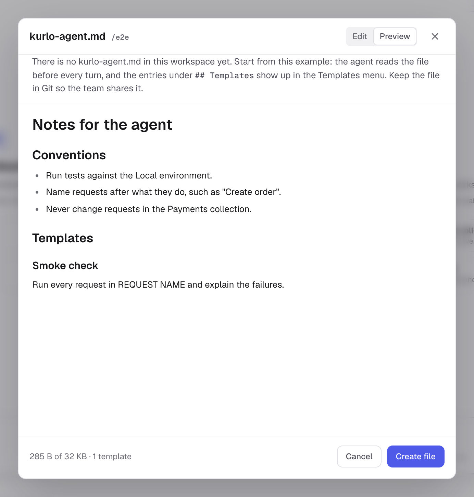

Under a `## Templates` heading, each `### Title` with the text below it becomes a template in the message box:

```markdown
# Team notes

Use the Staging environment for tests and tag smoke requests with `smoke`.

## Templates

### Smoke check
Run the Smoke collection against Staging and explain every failure.
```

## MCP servers for the agent

**Settings → AI → MCP servers for the agent** connects other MCP servers, such as GitHub, Jira, a database or your own service, to the Kurlo agent. Add an **HTTP** server with its URL and headers, or a **Local command** that Kurlo starts, such as `npx` with `-y` and `@modelcontextprotocol/server-github`, with its environment variables. **Test** connects and lists the tools, and says whether the server also has resources and prompts. Header and environment values are encrypted on this computer; to keep a saved value when you edit a server, leave its line as `NAME=`.

For an HTTP server that asks you to sign in, such as Linear or Notion, set **Sign-in** to **OAuth sign-in** and save. **Sign in** in the list reads the server's metadata to find its authorization server, registers Kurlo there and opens the sign-in page in your browser; when you approve, the server shows **Signed in**. If the authorization server does not let apps register themselves, create an app there and enter its **Client ID**. Kurlo uses PKCE and asks for a token for that server only. The tokens are encrypted on this computer and renewed when they expire; when that fails, the agent tells you to sign in again. **Sign out** forgets them.

Each turn the agent sees the tools of every server that is on, named `server__tool`. Every call waits for your approval, showing the server, the tool and its arguments, unless you choose **Allow for this chat** or an approved plan lists it as `server.tool`. A server that offers resources or prompts also gets `server__resources_list`, `server__resource_read`, `server__prompts_list` and `server__prompt_get`, so the agent can read its documents or fill in its prompt templates. These only read, so they run without asking. Answers from these servers are treated as data, not instructions. **Turn off** keeps a server without offering its tools. Calls appear in the [activity log](#agent-activity) under the server and tool name.

## Git

Git works on the whole folder, not on one workspace: when a folder holds several workspaces, a branch or commit made from one chat applies to all of them, and **Chat details → Git** says so. When the workspace is in a Git repository, the agent can check `git status` and the diff of the workspace files, create a branch, commit and push. Creating a branch and committing wait for your approval; a commit card lists every file with its diff and a **Commit** button. A push asks every time, even after **Allow for this chat**, and the agent pushes only when you ask it to. Only Kurlo workspace files are ever committed: other files in the repository are left alone.

To keep the agent's work apart from yours, turn on **Branch** in the message box before you send. Kurlo then commits each change you approve to a branch of its own, named after the chat, such as `kurlo-agent/cover-orders-1a2b3c`. The branch is created from the current commit on the first change and the workspace switches to it, so uncommitted edits you had in a file the agent changes go into that commit too. A change you reject is not committed. **Chat details → Git** shows the current branch and the agent branch.

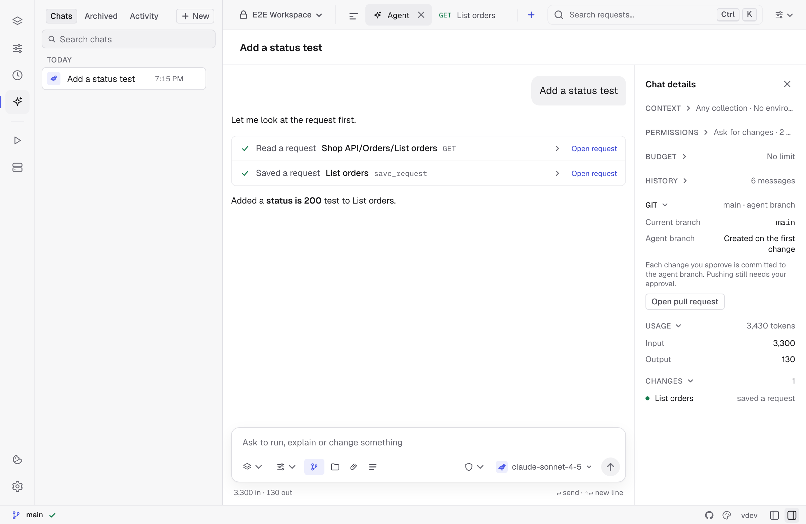

**Open pull request** in **Chat details** opens the page that starts a pull request for the current branch on GitHub, or a merge request on GitLab and Bitbucket, against the remote's default branch. Push the branch first. Kurlo builds the link from the remote URL and sends nothing; for other hosts it says it cannot build one.

## Chats and the activity log

Chats are kept on this computer in Kurlo's profile, encrypted like the [request history](/docs/guides/history/), and not in the workspace files, so they never end up in Git. Each chat belongs to the workspace selected in the top bar when you start it. The agent in that chat sees and changes only that workspace: its collections, requests and environments. Other workspaces in the same folder are out of its reach, and new collections and environments go into the chat's workspace. Switching workspaces shows that workspace's chats and restores its open chat and selected agent when you return. Every chat, and the new chat, keeps its own unsent draft on this computer: it stays when you switch chats or workspaces, close the Agent tab or restart Kurlo, and disappears once you send it or clear the message box. A new chat is named after its first message; rename it by clicking its name in the header, double-clicking it in the sidebar, pressing `F2`, or choosing **Rename** in its **•••** menu, where **Delete** removes it. Kurlo keeps up to 200 unarchived chats across the local profile and removes them after 90 days of inactivity.

Use `Cmd/Ctrl K` to find a chat by its name alongside requests and commands. **Chats in this workspace** includes unarchived chats from the selected workspace. Selecting a result opens its agent and chat. Prefix the query with `>` to search commands only.

To keep a chat, choose **Archive** from its **•••** menu in the sidebar. Open **Archived** to read saved chats for the current workspace. Archived chats stay encrypted and are kept until you delete them. Choose **Restore** in the chat menu to move a chat back to **Chats** and continue it. For Codex and Claude Code, continuing also requires the original session to be available in the connected agent.

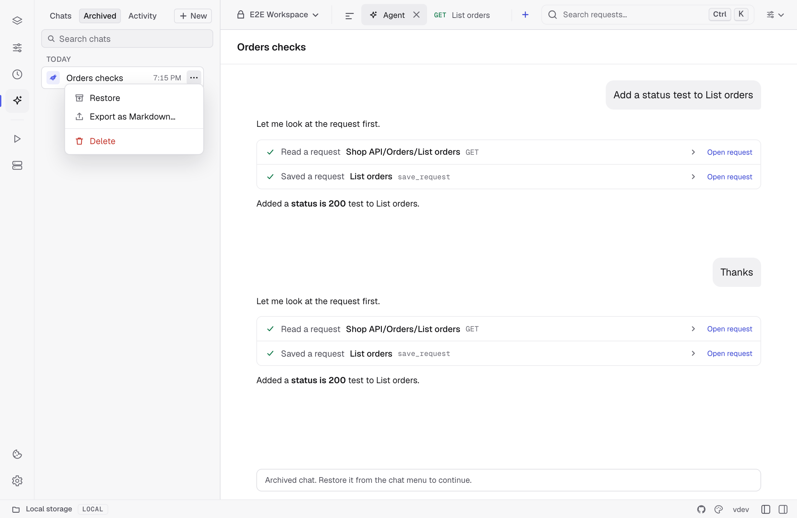

Choose **Export as Markdown…** in either list to save the full stored conversation, including saved tool calls and results. Review the warning and choose where to save the file. The Markdown copy is unencrypted and can contain sensitive information.

### Agent activity

Every tool call, by the Kurlo agent, Codex, Claude Code or an assistant connected through `kurlo mcp`, is also written to a local activity log with the files it changed, before and after. Open **Activity** at the top of the agent sidebar to see it. It shows the calls made in the workspace selected in the top bar; choose **All workspaces** to see calls from every workspace and folder, each marked with where it happened. A call from a `kurlo mcp` client belongs to the workspace whose files it changed; a call that only read belongs to none and shows only under **All workspaces**. Calls are listed newest first under **Today**, **Yesterday** and **Earlier**; search by tool, file, branch or commit, or narrow the list to one client. A grey dot marks a declined or restored call, a red one an error. The list updates by itself when an agent turn ends and when you come back to Kurlo.

With no call selected, the screen sums up the calls of today and the last 7 days, the errors among them and the calls that changed files. **Recent changes** lists the latest calls that changed files, and **Errors and declined** the calls that failed or that you declined; select a row to open the call.

Select a call to see its client, time, arguments and result, the branch and commit it made, and the diff of each file it changed. The close button at the top right returns to the summary. **Restore** puts a file back to its version from before the call, and **Restore all** does it for every file of the call. Kurlo refuses when the file has changed since, so it never overwrites later work; restore that file from Git instead. Files over 512 KB are listed without their content and cannot be restored here. **Open chat** opens the chat the call came from when that chat is in the current workspace; for a call from another workspace, switch to that workspace in the top bar first.

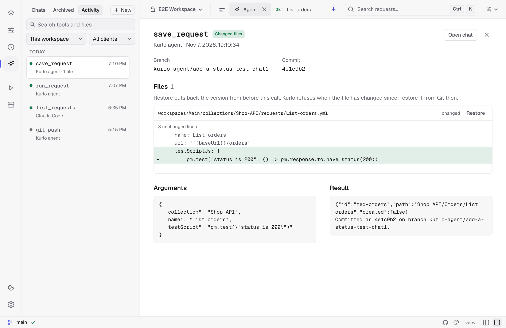

The log is encrypted, kept for 30 days or 2,000 calls, and stores arguments and results with secrets masked and cut at 16 KB. In the **•••** menu of the summary, **Pause recording** stops logging new calls and **Clear activity…** deletes the whole log.

## Limits

- The agent sees the workspace, its environments and Kurlo's history. Source access is limited to the read-only folder you connect to the chat.
- One turn runs at a time in each chat, and a turn stops after 50 model steps. Reading tools called in the same step run together.
- For the Kurlo agent using an API connection, the model gets the last two exchanges in full. Tool results from earlier ones are shortened to about 500 tokens, and when the chat outgrows 70% of the model's context window its oldest exchanges are left out; the agent is told so and asks if you refer to them. Very large tool results are kept in the chat up to 64 KB.
- Small local models often call tools badly. Models marked **Recommended** in Settings → AI handle them well.
