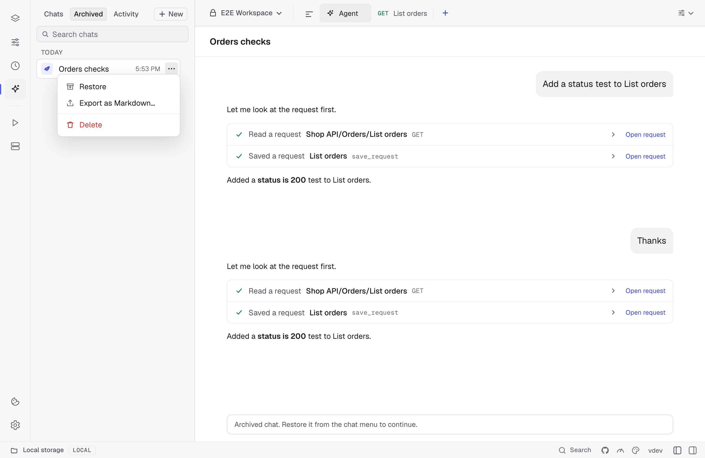
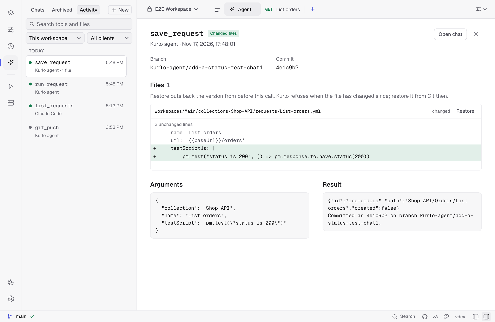

Chats are kept on this computer in Kurlo's profile, encrypted like the [request history](/docs/guides/history/), and not in the workspace files, so they never end up in Git. Each chat belongs to the workspace selected in the top bar when you start it. The agent in that chat sees and changes only that workspace: its collections, requests and environments. Other workspaces in the same folder are out of its reach, and new collections and environments go into the chat's workspace. Switching workspaces shows that workspace's chats and restores its open chat and selected agent when you return. Every chat, and the new chat, keeps its own unsent draft on this computer: it stays when you switch chats or workspaces, close the Agent tab or restart Kurlo, and disappears once you send it or clear the message box. A new chat is named after its first message; rename it by clicking its name in the header, double-clicking it in the sidebar, pressing `F2`, or choosing **Rename** in its **•••** menu, where **Delete** removes it. Kurlo keeps up to 200 unarchived chats across the local profile and removes them after 90 days of inactivity. A long chat opens at its latest messages; earlier ones load as you scroll up, with the mouse or with `Page Up` after `Tab` moves focus into the conversation.

Use `Cmd/Ctrl K` to find a chat by its name alongside requests and commands. **Chats in this workspace** includes unarchived chats from the selected workspace. Selecting a result opens its agent and chat. Prefix the query with `>` to search commands only.

To keep a chat, choose **Archive** from its **•••** menu in the sidebar. Open **Archived** to read saved chats for the current workspace. Archived chats stay encrypted and are kept until you delete them. Choose **Restore** in the chat menu to move a chat back to **Chats** and continue it. For Codex and Claude Code, continuing also requires the original session to be available in the connected agent.

Choose **Export as Markdown…** in either list to save the full stored conversation, including saved tool calls and results. Review the warning and choose where to save the file. The Markdown copy is unencrypted and can contain sensitive information.

## Agent activity

Every tool call, by the Kurlo agent, Codex, Claude Code or an assistant connected through `kurlo mcp`, is also written to a local activity log with the files it changed, before and after. Open **Activity** at the top of the agent sidebar to see it. It shows the calls made in the workspace selected in the top bar; choose **All workspaces** to see calls from every workspace and folder, each marked with where it happened. A call from a `kurlo mcp` client belongs to the workspace whose files it changed; a call that only read belongs to none and shows only under **All workspaces**. Calls are listed newest first under **Today**, **Yesterday** and **Earlier**; search by tool, file, branch or commit, or narrow the list to one client. The search covers the whole log, not only the calls on screen, and older calls load as you scroll to the end. The summary counts every call of the last seven days. A grey dot marks a declined or restored call, a red one an error. The list updates by itself when an agent turn ends and when you come back to Kurlo.

With no call selected, the screen sums up the calls of today and the last 7 days, the errors among them and the calls that changed files. **Recent changes** lists the latest calls that changed files, and **Errors and declined** the calls that failed or that you declined; select a row to open the call.

Select a call to see its client, time, arguments and result, the branch and commit it made, and the diff of each file it changed. The close button at the top right returns to the summary. **Restore** puts a file back to its version from before the call, and **Restore all** does it for every file of the call. Kurlo refuses when the file has changed since, so it never overwrites later work; restore that file from Git instead. Files over 512 KB are listed without their content and cannot be restored here. **Open chat** opens the chat the call came from when that chat is in the current workspace; for a call from another workspace, switch to that workspace in the top bar first.

The log is encrypted, kept for 30 days or 2,000 calls, and stores arguments and results with secrets masked and cut at 16 KB. In the **•••** menu of the summary, **Pause recording** stops logging new calls and **Clear activity…** deletes the whole log.

## Limits

- The agent sees the workspace, its environments and Kurlo's history. Source access is limited to the read-only folder you connect to the chat.
- One turn runs at a time in each chat, and a turn stops after 50 model steps. Reading tools called in the same step run together.
- For the Kurlo agent using an API connection, the model gets the last two exchanges in full. Tool results from earlier ones are shortened to about 500 tokens, and when the chat outgrows 70% of the model's context window its oldest exchanges are left out; the agent is told so and asks if you refer to them. Very large tool results are kept in the chat up to 64 KB.
- Small local models often call tools badly. Models marked **Recommended** in Settings → AI handle them well.
