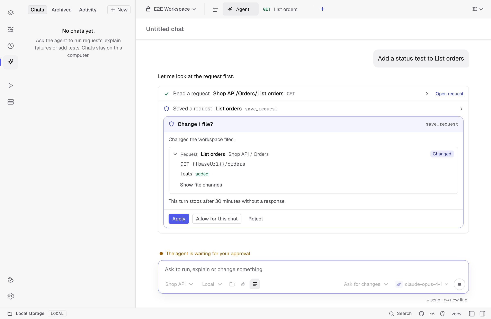

## What it may do without asking

**Approvals**, next to the model in the message box, sets how much the Kurlo agent asks in this chat:

- **Ask always.** Only reading runs on its own. Every request, even a `GET`, and every change waits for you.
- **Ask for changes.** The default, as in the table below.
- **Auto.** Requests and changes to the workspace files run on their own. A `POST`, `PUT`, `PATCH` or `DELETE` to a host that is not trusted, a one-off call to a host the workspace does not use, starting k6, clearing cookies, OAuth sign-in and `git push` still wait for you.

**Chat details → Permissions → Trusted hosts** lists hosts where `POST`, `PUT`, `PATCH` and `DELETE` run without asking, such as `localhost` or `*.staging.example.com`; new chats start with `localhost` and `127.0.0.1`. Kurlo resolves the request's URL with the chosen environment before it checks the host, and asks when the host contains a variable it cannot resolve. An environment marked as a [sandbox](/docs/guides/environments/secrets/#sandbox-environments-for-the-agent) lets every request sent with it run without asking. The settings are saved with the chat when you send a message.

| The agent wants to | What happens |
|--------------------|--------------|
| List or read requests, environments or history, or diagnose a failure | Runs at once |
| Run a request, a collection or a one-off call that only sends `GET`, `HEAD` or `OPTIONS` | Runs at once |
| Send a one-off call to a host that no saved request or variable of the workspace uses | Asks first, even for `GET`, unless the host is trusted |
| Send any other method, such as `POST` or `DELETE` | Asks first, showing the call |
| Run a saved unary gRPC, MCP or AI request, or open a live connection | Asks before contacting the configured server |
| Send a live message or start or stop the mock server | Asks first |
| Start k6 or clear the cookie jar | Asks every time |
| Fetch an OpenAPI URL | Asks before fetching |
| Apply an import or edit Markdown docs | Shows the changes for approval |
| Check k6 progress, compare results, read the mock log or list cookie metadata | Runs at once |
| Change the workspace: save or delete a request, save an example, set a variable, create a collection, write tests or save a load test | Asks first, showing the change file by file |
| Read the Git status or diff of the workspace, or build a pull request link | Runs at once |
| Create a Git branch or commit workspace files | Asks first; a commit shows the files it includes |
| Push the current branch | Asks every time, and only when you asked it to push |

Before a task with several changes the agent shows **Follow this plan?** with its steps and, under **Runs without asking again**, the exact calls it intends to make, each with its target such as a request path, a variable or a URL. **Approve plan** lets exactly those calls run without asking for the rest of the turn; a call listed without a target runs once. Anything else still waits for you, and `git push` never joins a plan.

An approval card lists what would change in plain terms: each request, environment, collection or the globals, where it lives, such as `Shop API / Orders`, whether it is new, changed or deleted, and which fields change, such as **Tests added** or the old and new URL. Internal details such as ids are left out; a change that touches only them says so. **Show file changes** opens the exact lines of the YAML file. With one or two changes every item is open; with more, the card shows a short count such as **9 new requests** and a folded list you open item by item or with **Expand all**, and the list scrolls inside the card so the buttons stay close. **Apply** writes the changes, **Reject** tells the agent no and it asks what you want instead, and **Allow for this chat** applies this change and lets the same tool run without asking for the rest of the chat.

Nothing is written while the card waits, and Kurlo keeps saving your own edits in the meantime. If you change one of those files before you click **Apply**, the change is dropped and the agent is told to try again, so it never overwrites your edit. The agent never writes a secret into the workspace: it uses a `{{variable}}` and asks you to set the value. Secret values reach it only as `[secret]`.
