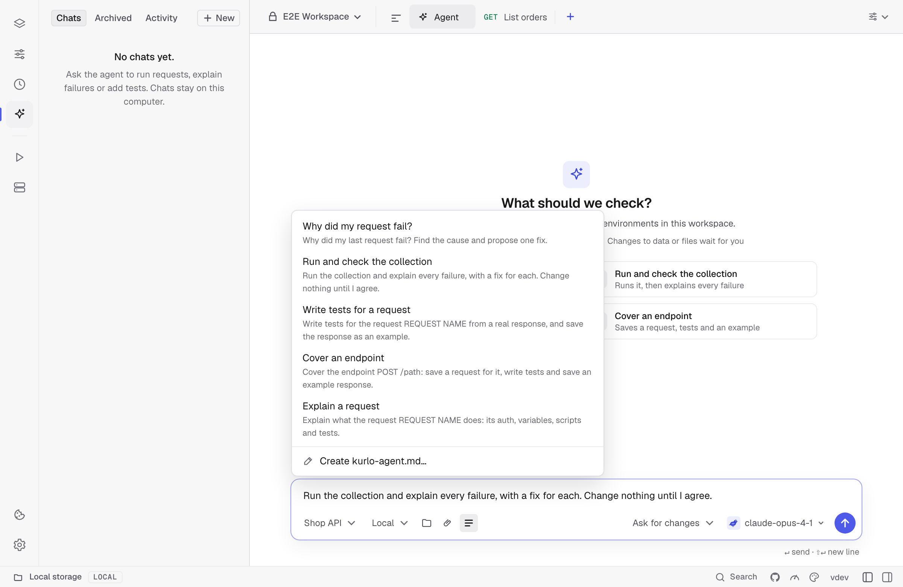
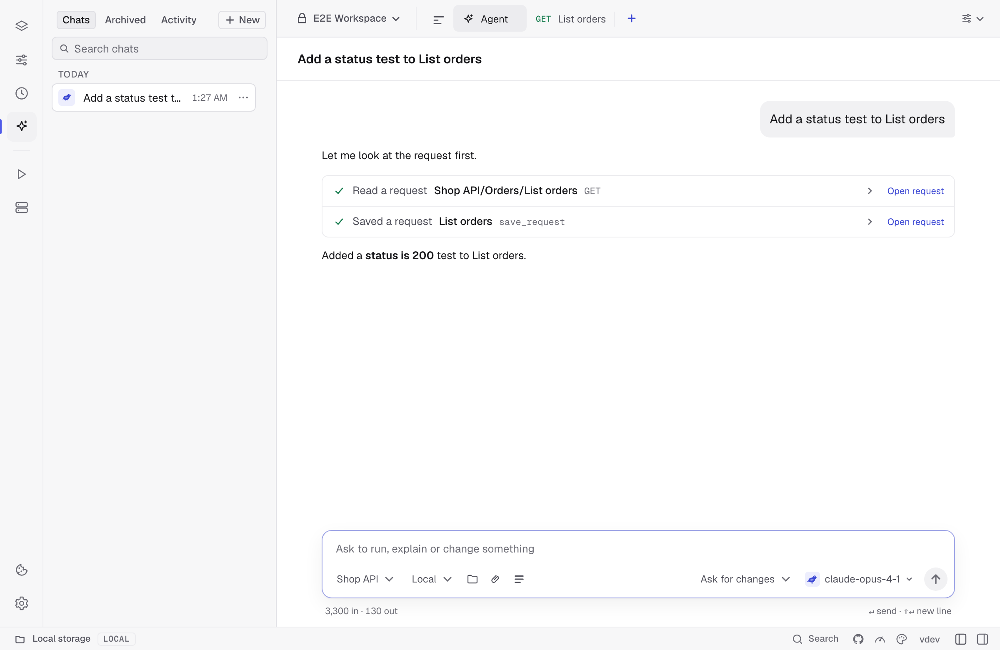

## Ask

Type in the box at the bottom and press `Enter` (`Shift Enter` adds a line). The header shows the chat's name, which you can click to rename. Chips at the left of the message box choose the collection and environment it works on:

- **Collection.** The collection to work in unless you name another. **Any collection** leaves it to the agent.
- **Environment.** The environment its requests use. A protected environment is listed, but the agent cannot send with it; run those requests yourself.

The agent picker at the right of the message box chooses the agent and model. Choose **Claude Code**, **Codex** or a Kurlo agent connection to see its models and a search field. The one marked **default** is the model set in Settings → AI. Picking another model changes it for this chat only: the connection, its default model and AI requests that use **Kurlo connection** stay as they are. `↑` and `↓` move between options, `Enter` picks one and `Escape` closes the menu. The choice applies to your next message and is locked while the agent works.

For Codex, a separate **Effort** menu sits beside the model picker. It offers the levels supported by the selected model. New chats keep your effort choice; switching to a model that does not support it uses that model's default.

**Templates** in the message box offers ready requests: why the last request failed, run and check the collection, write tests for a request, cover an endpoint, and explain a request. Choosing one puts its text in the box with the part to fill in, such as `REQUEST NAME`, selected; edit it and press `Enter`. Templates your team keeps in [`kurlo-agent.md`](/docs/guides/agent/team-notes/#team-notes-in-kurlo-agentmd) appear above the built-in ones under **From kurlo-agent.md**.

The answer streams in as the agent works. The tool calls of a turn sit in one card, one line each, such as **Ran a request** or **Saved a request**, with a check when done, a cross when it failed and a shield while it waits for you; a run also shows the request line, status code and time. Click a line to see the arguments and the result, and click **Open request**, **Open entry** or **Open environment** to jump to what it touched. **Stop** ends the turn, including while the first response or a confirmation is pending. An unanswered confirmation stops the turn after 30 minutes; retry when you are ready. If sending your decision fails, the card keeps its buttons available to try again. Messages and answers can be selected and copied like any text; hovering one also shows a copy button, and **Retry** sends your last message again when a turn failed or stopped before answering. Hover a message you sent to **Edit message**: its text goes back into the box and sending replaces it and everything after it. **Branch from here** instead starts a new chat, named after this one with **(branch)**, that holds the conversation up to that message, so the original chat stays as it was. A long chat initially loads its latest 40 exchanges. Scroll to the top or click **Load earlier messages** to fetch another 40 without losing your reading position. Only messages near the viewport are rendered.

Each chat runs on its own: start a task, open another chat or **New**, and send there while the first one keeps working. A pulsing dot in the sidebar marks every chat that is working, and **Stop** in a chat stops only that chat's turn. Codex and Claude Code still run one turn at a time.

A saved chat has its name at the top; click it to rename the chat. Archive, export and delete are in the chat's **•••** menu in the sidebar. **Chat details**, the panel button at the right of the status bar, opens a side panel with the chat's collection, environment, agent and effort, token usage and the last request's context size, the files the agent changed or wants to change, its recent runs with their status codes and, for Codex, each plan limit with its reset time. Each part of the panel folds: click its title to open or close it, and a closed part shows a short summary on the right, such as the collection and environment, the budget used or the token count and cost. Kurlo remembers which parts are open. It sits beside the conversation; in a narrow window it takes the conversation's place until you close it with `Escape`, the close button or the status bar button. Kurlo remembers whether the panel is open.

