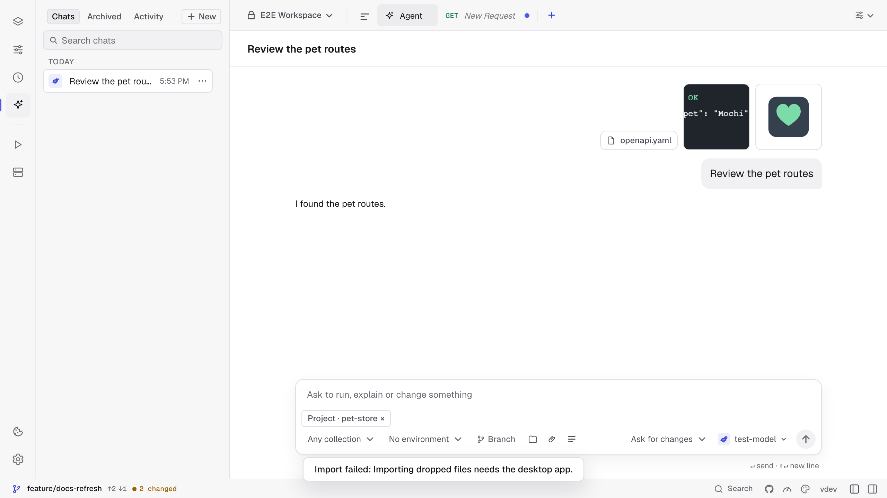

## Project folders, files and imports

Use the folder button in the message box to connect a source directory. The connection is saved with the chat when you send a message. The agent can list files, search for text and read lines inside that directory. Project access skips symlinks, hidden configuration and common credential files. Remove the **Project** chip and send a message to disconnect it.

Ask the agent to find the routes in the project and sync your collection, or ask it to cover one endpoint such as `POST /pets`. It can use the source to build a request, example and tests. Workspace changes go through the usual approval card.

Drop files onto the message box or use **Attach file** to add a specification, proto, CSV, text file or image to the next message. Ask the agent to import an attached OpenAPI file, read a proto or run a collection with attached CSV or JSON data. PNG, JPEG and WebP go to the selected model as images. The agent reads SVG as source text. Attach the file again to use it in another turn.

Click a file above a sent message to open it. For images, use **+** or **−** to zoom and **Fit** to return to the initial view. Kurlo keeps an encrypted local copy with the chat so you can open the file after moving or deleting the source.

Ask for an import from a file in the connected folder, an attachment, a pasted cURL command or an OpenAPI URL. The agent previews the changes before showing **Apply this import?** with the list of requests it adds or changes. Approve to write the files or reject to leave the workspace as it was. The same Go importers work through the MCP server without a desktop window. [MCP import tools](/docs/guides/mcp-server/tools/#import-requests-and-read-project-source)

You can also ask the agent to read or update the Markdown docs of a request or collection, or generate a code snippet for an HTTP or GraphQL request. Give the request name and your language, for example, “Show me the Python snippet for Get pet.”

## Usage, context and limits

Below the message box, input and output token counts show usage recorded for this chat. Codex can also report account quota windows and the context window size. Codex stops a turn after five minutes without progress, excluding time spent waiting for your confirmation, and after 50 tool calls. It manages its model context through the CLI and can compact it automatically; Kurlo shows **Compacting context…** while this happens. Compaction changes what the model retains in its working context, while the conversation remains available in Kurlo.

Below the message box, **Plan N% left** shows the tightest Codex quota window and turns amber below 30%; click it to open **Chat details**, which lists every window, such as the 5-hour and weekly ones, with a bar and its reset time. Click it to see reset times when available. These are account limits, shared with other Codex sessions, rather than a per-chat token budget. Kurlo updates them from the CLI's account snapshot and live notifications. Missing quota information is hidden.

For the Kurlo agent, **Chat details** also shows the cost of the chat when the provider reports it (OpenRouter does) and the context of the last request against the model's window, which Kurlo takes from the provider's model list or assumes to be 128,000 tokens (32,000 for local models). Within one turn, when the conversation would take more than 70% of that window, Kurlo shortens the oldest tool results, keeps the last two in full and tells you how many it shortened; the saved chat keeps everything. With an Anthropic connection the stable start of every request, the instructions, tools and earlier messages, is marked for prompt caching, so later steps of a turn are read from the cache at a lower price.

**Budget** in **Chat details** caps a chat, up to 1,000,000,000 tokens and 100,000 requests, by tokens, counted over the whole chat, and by sent requests, counted as every request the agent sends with `run_request`, `send_request`, `run_collection` or `generate_tests`. Leave a field empty for no limit. The agent stops when the chat reaches either one and tells you, and a call that would go over the request budget does not run. Raise the budget to continue.

When a Kurlo agent chat gets long, open **Chat details → History** and choose **Compact chat**. Kurlo asks the chat's model for a summary of the conversation so far: what you asked for, what was created or changed, results that matter later and what is still open. From your next message on, the agent works from that summary instead of the earlier messages, so each request is smaller. The messages stay in the chat for you, under a line that marks where the compacted part ends, and **Show summary** shows what the agent sees. Compact again after more messages to fold them into the summary too. Editing or branching from a message inside the compacted part drops the summary. Codex and Claude Code manage their own history and do not offer this.

In **Chat details**, **Context (last request)** compares the last reported request's token count with the reported model window. It is a snapshot, not cumulative token usage or a prediction of the next request after compaction. The last reported snapshot is retained with the chat; if the CLI does not report a window, no percentage is invented.
