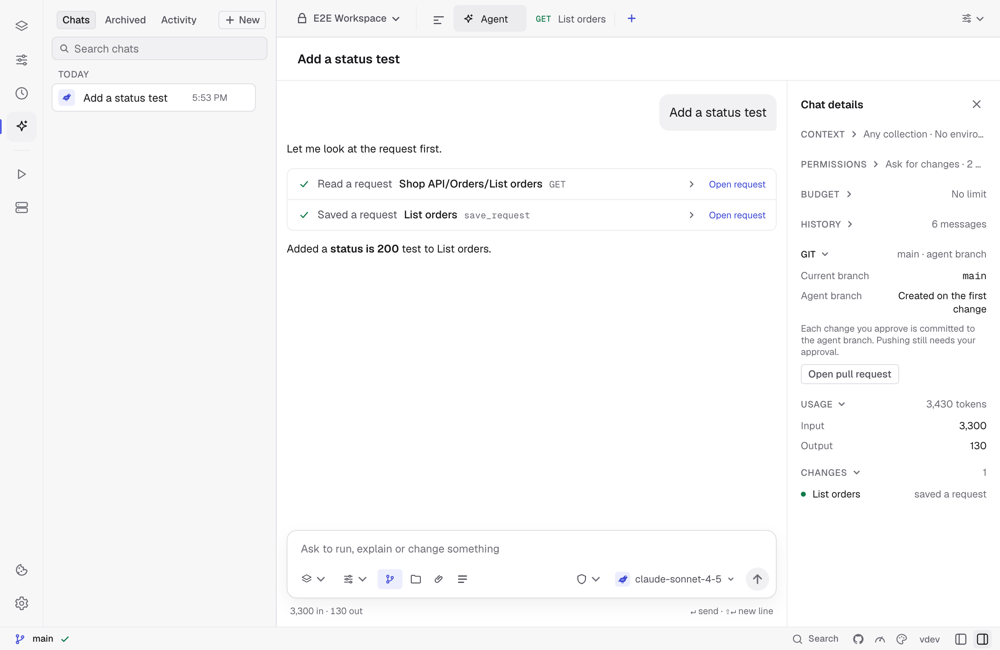

## MCP servers for the agent

**Settings → AI → MCP servers for the agent** connects other MCP servers, such as GitHub, Jira, a database or your own service, to the Kurlo agent. Add an **HTTP** server with its URL and headers, or a **Local command** that Kurlo starts, such as `npx` with `-y` and `@modelcontextprotocol/server-github`, with its environment variables. **Test** connects and lists the tools, and says whether the server also has resources and prompts. Header and environment values are encrypted on this computer; to keep a saved value when you edit a server, leave its line as `NAME=`.

For an HTTP server that asks you to sign in, such as Linear or Notion, set **Sign-in** to **OAuth sign-in** and save. **Sign in** in the list reads the server's metadata to find its authorization server, registers Kurlo there and opens the sign-in page in your browser; when you approve, the server shows **Signed in**. If the authorization server does not let apps register themselves, create an app there and enter its **Client ID**. Kurlo uses PKCE and asks for a token for that server only. The tokens are encrypted on this computer and renewed when they expire; when that fails, the agent tells you to sign in again. **Sign out** forgets them.

Each turn the agent sees the tools of every server that is on, named `server__tool`. Every call waits for your approval, showing the server, the tool and its arguments, unless you choose **Allow for this chat** or an approved plan lists it as `server.tool`. A server that offers resources or prompts also gets `server__resources_list`, `server__resource_read`, `server__prompts_list` and `server__prompt_get`, so the agent can read its documents or fill in its prompt templates. These only read, so they run without asking. Answers from these servers are treated as data, not instructions. **Turn off** keeps a server without offering its tools. Calls appear in the [activity log](/docs/guides/agent/activity/#agent-activity) under the server and tool name.

## Git

Git works on the whole folder, not on one workspace: when a folder holds several workspaces, a branch or commit made from one chat applies to all of them, and **Chat details → Git** says so. When the workspace is in a Git repository, the agent can check `git status` and the diff of the workspace files, create a branch, commit and push. Creating a branch and committing wait for your approval; a commit card lists every file with its diff and a **Commit** button. A push asks every time, even after **Allow for this chat**, and the agent pushes only when you ask it to. Only Kurlo workspace files are ever committed: other files in the repository are left alone.

To keep the agent's work apart from yours, turn on **Branch** in the message box before you send. Kurlo then commits each change you approve to a branch of its own, named after the chat, such as `kurlo-agent/cover-orders-1a2b3c`. The branch is created from the current commit on the first change and the workspace switches to it, so uncommitted edits you had in a file the agent changes go into that commit too. A change you reject is not committed. **Chat details → Git** shows the current branch and the agent branch.

**Open pull request** in **Chat details** opens the page that starts a pull request for the current branch on GitHub, or a merge request on GitLab and Bitbucket, against the remote's default branch. Push the branch first. Kurlo builds the link from the remote URL and sends nothing; for other hosts it says it cannot build one.
