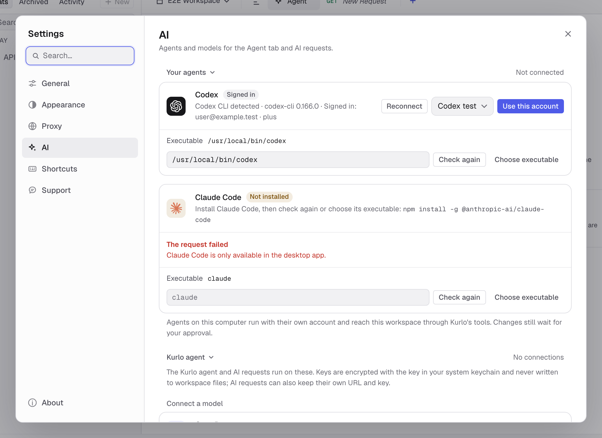
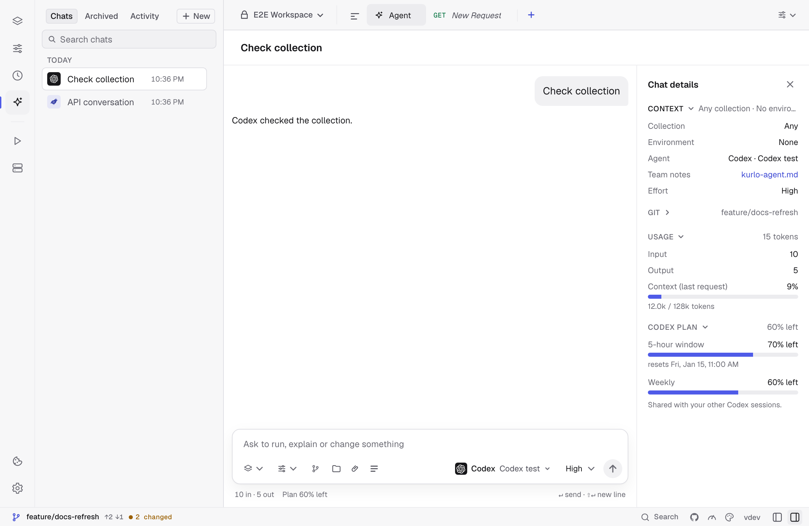

The agent picker in the message box chooses who answers. **On this computer** lists installed coding agents that run with their own account, such as Codex, with their models. Effort has its own menu beside the picker. **Kurlo agent · any model** lists your model connections, such as OpenRouter or an API key. Both share one chat list.

To connect Codex:

1. Open **Settings → AI → Your agents**, or click **Connect** next to Codex in the agent picker.
2. Kurlo checks for Codex CLI. If it is missing, install it with `npm install -g @openai/codex`, then click **Check again**. Use **Choose executable** or enter its full path if Kurlo cannot find it.
3. If Codex is already signed in, click **Use this account**. Otherwise click **Sign in** and complete the official Codex sign-in in your browser. **Reopen browser** opens the same pending sign-in; **Cancel sign-in** stops it.
4. Choose an available model and connect. ChatGPT sign-in uses your plan's available usage; an existing API-key login uses API billing.

Choose a Codex model in the agent picker, then use the separate **Effort** menu beside it. It lists the reasoning levels the model supports and highlights the model's default until you choose another. An explicit choice is saved with the chat; choosing the highlighted default again goes back to the CLI's own default on the next turn, including in an existing session. Changing to a model that does not support the chosen effort returns to its default. Codex calls Kurlo's tools through its local app-server connection. Reads run immediately; requests that may change server data and workspace edits use the same approval cards as the Kurlo agent. Shell execution and inherited external integrations are disabled, and Codex runs with a read-only sandbox. The active request editor is not attached automatically.

**Stop** cancels the active work and closes its process. The next message resumes the native Codex session. If that session is unavailable, Kurlo shows an error; start a new chat rather than silently losing the conversation. A chat stays with the agent it started on; to switch agent, start a new chat. In a new chat, switching agent keeps what you typed and the chosen collection and environment.

**Manage connections** in the agent picker opens the connection settings. **Remove connection** stops active Codex work and removes the connection from Kurlo; it does not sign you out of Codex or delete its native sessions. The CLI manages its own credentials. Kurlo stores the executable path, default model and native session ID, not your subscription tokens. Codex also keeps its own conversation data in its profile, governed by its settings, separately from Kurlo's encrypted chat copy. Removing a chat in Kurlo does not delete that native copy.

To connect Claude Code:

1. Open **Settings → AI → Your agents**, or click **Connect** next to Claude Code in the agent picker.
2. Kurlo checks for the Claude Code CLI and shows its version. If it is missing, install it with `npm install -g @anthropic-ai/claude-code`, then click **Check again**. Use **Choose executable** or enter its full path if Kurlo cannot find it.
3. If the CLI is already signed in, its account and plan show under **Signed in** (or **API key** / **Cloud provider**); choose a model and click **Use this account**. Otherwise click **Sign in** and complete the official Claude sign-in in your browser.

The card then shows **Connected**. **Reconnect** checks the CLI again (if the CLI has signed out since, the card shows **Signed out** and a **Sign in** button), the model menu changes the default model at once, and **Remove connection** stops active Claude Code work and removes the connection from Kurlo without signing the CLI out. Select **Claude Code** under **On this computer** in the agent picker; its models are listed below it by full name (Fable 5.2, Fable 5.1, Opus 5.5, Sonnet 5.5, Haiku 5.5), and the one the CLI uses by default is preselected and marked **default**. The **Effort** menu beside the picker offers Low, Medium, High, Extra high and Max; High is preselected, and Kurlo always passes the chosen level to the CLI. Some models, such as Fable, may need usage credits on your Claude plan; the CLI's reason then shows in the chat. **Chat details** shows the chat's tokens, the cost at API prices (a subscription is not billed per token), the last request's context against the model's window, and the Claude plan's 5-hour and weekly limits with their reset times; Kurlo reads the limits and the default model with the CLI's `/usage` command, which uses no tokens, whenever it checks the connection, and updates them after each turn; they also appear in Settings → AI. **Stop** ends the current turn, and your next message resumes the same native session. Workspace edits use Kurlo’s approval cards.

Claude Code keeps its native conversation separately from Kurlo’s encrypted chat copy. Deleting the chat in Kurlo removes the Kurlo copy.
