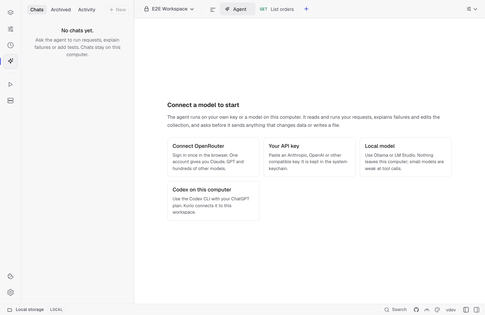

Click the sparkle icon in the activity bar on the left, or press `Alt Cmd/Ctrl 4`. Until you open it for the first time, the icon carries a small blue dot. The sidebar has **New chat** at the top and your chats below it, newest first under **Today** and **Earlier**; type in **Filter chats** to find one by its name. Each chat is marked with the agent it runs on: the Kurlo bird for the Kurlo agent, the Codex and Claude Code marks for those agents; an amber dot instead of the time means the chat waits for your approval. **New** beside **Chats** starts a new chat. The main area opens the **Agent** tab. When you switch to another tab, such as a request the agent opened, the sidebar goes back to what it showed before, and returns to your chats when you come back to **Agent**.

Without a connected model the tab offers four ways to connect one: **Connect OpenRouter** signs you in through the browser, **Your API key** opens the key form, **Local model** looks for Ollama and LM Studio on this computer, and **Codex on this computer** opens the Codex connection in Settings → AI.

An empty chat offers four starting tasks, such as **Why did my request fail?** and **Run and check the collection**. Clicking one puts its text in the message box.

