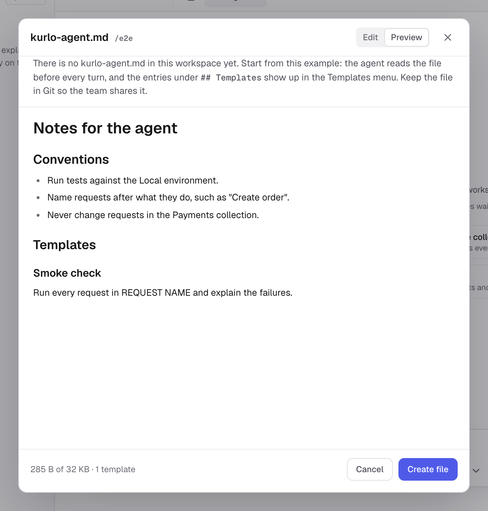

## Team notes in kurlo-agent.md

Keep conventions for the agent in `kurlo-agent.md` at the root of the workspace folder: which environment to use for tests, naming rules, tags, what never to touch. The file is plain Markdown and lives in Git with the workspace, so the whole team shares it. The Kurlo agent reads it at the start of every turn and follows it within its [permissions](/docs/guides/agent/approvals/). When the agent learns a convention that is missing, it offers to add it; the change shows as a diff and always waits for your approval, even after **Allow for this chat**.

To edit the file in Kurlo, choose **Edit kurlo-agent.md…** at the bottom of **Templates** in the message box, or select **kurlo-agent.md** next to **Team notes** under **Chat details → Context**. When the workspace has no such file yet, the menu reads **Create kurlo-agent.md…** and the editor starts from an example with conventions and one template; **Create file** writes it. **Preview** shows the rendered Markdown, and the bottom line shows the size against the 32 KB limit and how many templates the file has. Press `Cmd+S` (`Ctrl+S` on Windows and Linux) or **Save** to save; closing with unsaved changes asks first. If the file changed on disk after you opened it, for example in another editor or through `git pull`, Kurlo does not overwrite it: **Load newer version** replaces your text with the copy on disk, and **Replace it** saves your text over it. A file over 32 KB is not opened here; shorten it in another editor first.

Kurlo treats `kurlo-agent.md` as one of the workspace's files in Git: it shows under Changes on the Git screen, **Commit** includes it, and with **Branch** on, a change the agent makes to it is committed to the agent's branch like any other.



Under a `## Templates` heading, each `### Title` with the text below it becomes a template in the message box:

```markdown
# Team notes

Use the Staging environment for tests and tag smoke requests with `smoke`.

## Templates

### Smoke check
Run the Smoke collection against Staging and explain every failure.
```
