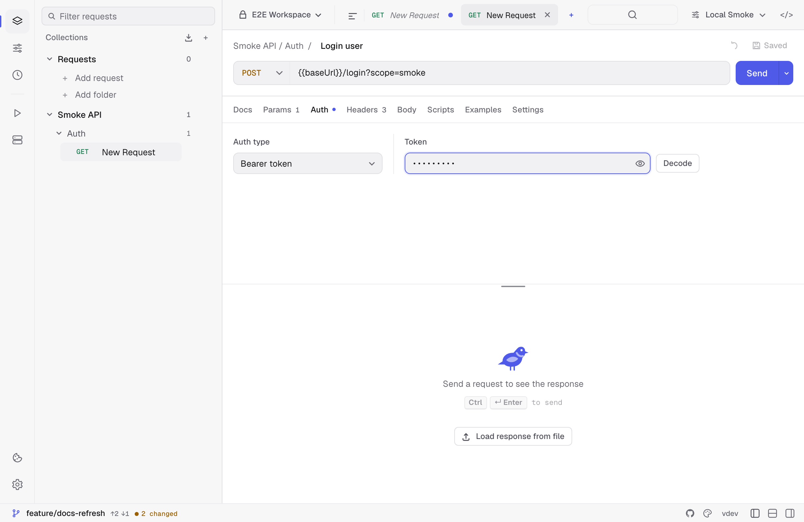
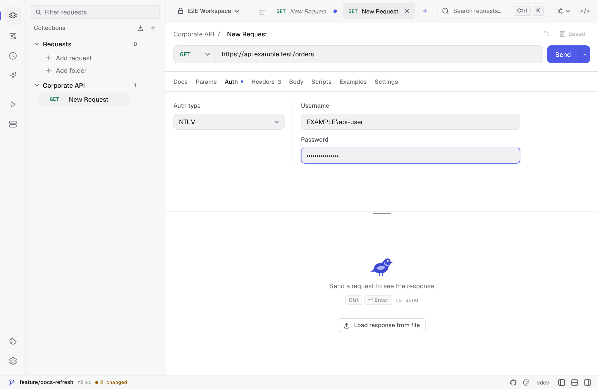
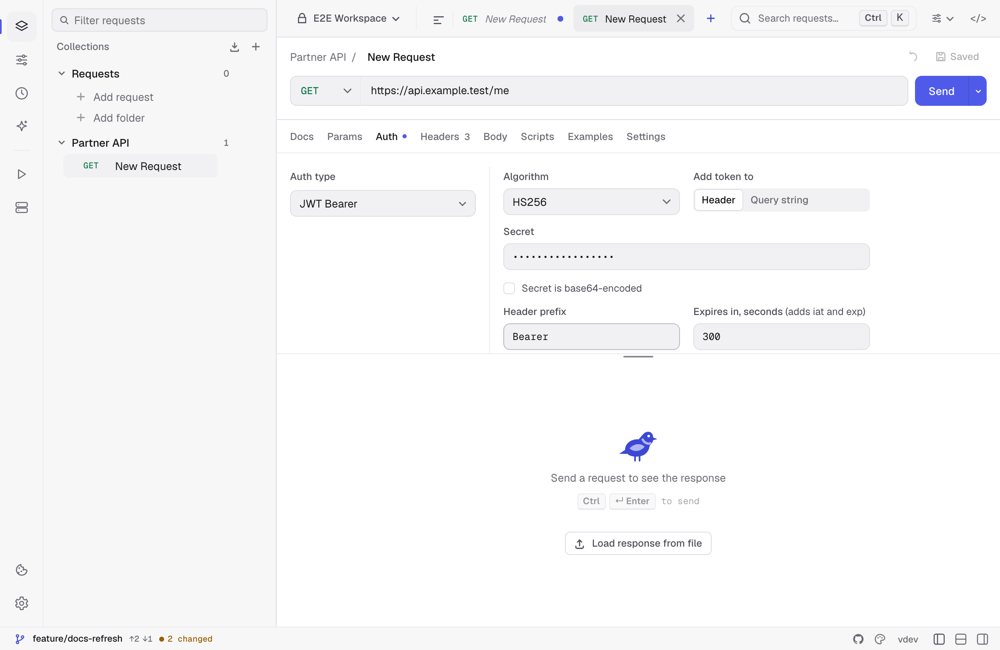
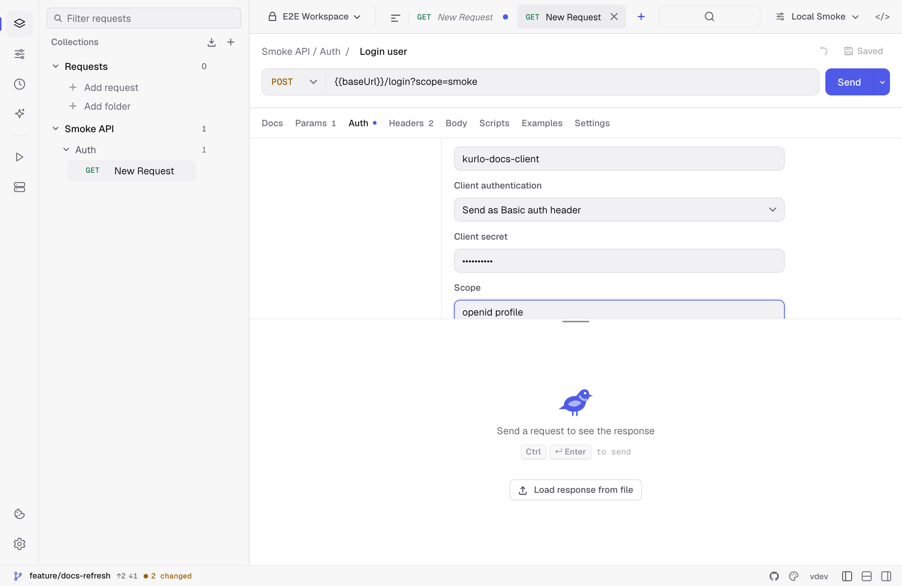

Auth is configured per request on the **Auth** tab. Collections can also define default auth; requests set to **Inherit auth** use the collection default, while requests with an explicit auth type override it.

## Bearer token

The simplest case: paste the token, Kurlo sends `Authorization: Bearer <token>`. Use `{{tokenVar}}` to pull from an environment.

## Basic Auth

Username + password. Kurlo base64-encodes for you.

## Digest Auth

Kurlo sends the first request unauthenticated, parses the `WWW-Authenticate` header, and replays with the digest. No configuration beyond username/password.

Supported algorithms (RFC 7616): `MD5`, `SHA-256`, `SHA-512-256`, and their `-sess` session variants. Kurlo echoes the algorithm token back exactly as the server named it. Both `qop=auth` and `qop=auth-int` work — when a server offers both, plain `auth` is used so the body never has to be buffered. Servers that advertise `userhash=true` get a hashed username. A challenge with no `qop` falls back to the legacy RFC 2069 form.

`qop=auth-int` signs the entity body, so the whole body has to be hashed before the request goes out; a body over 32 MB, or one that cannot be re-read, fails with a clear message instead.

## NTLM

Choose **NTLM** in the Auth tab of an HTTP, GraphQL or SSE request. Enter a username such as `DOMAIN\user` or `user@example.com`, then enter the password or reference an environment variable such as `{{ntlmPassword}}`. Kurlo negotiates NTLMv2 over one HTTP/1.1 connection and keeps the credentials scoped to the request origin.

## API Key

- **In header** — choose the header name (`X-API-Key`, `apikey`, etc.).
- **In query string** — appended on send, not stored in the URL.

## JWT Bearer

Choose **JWT Bearer** when an API expects a JSON Web Token that you sign yourself, for example a service-to-service call or a gateway that checks a shared secret. Kurlo signs a fresh token on every send, so you no longer paste a token that expires.

- **Algorithm**: `HS256`, `HS384`, `HS512` with a shared **Secret**, or `RS256`–`RS512`, `PS256`–`PS512`, `ES256`–`ES512` with a **Private key** in PEM form (PKCS#1, PKCS#8 or SEC1). Tick **Secret is base64-encoded** when the secret you were given is base64. Both fields accept a `{{variable}}`, so the key can stay in a secret environment variable.
- **Payload**: the claims as a JSON object, such as `{ "sub": "{{userId}}", "role": "admin" }`. `{{variables}}` and [dynamic variables](/docs/guides/environments/#dynamic-variables) are resolved on send.
- **Expires in, seconds** adds `iat` (now) and `exp` (now plus the lifetime) unless the payload already sets them. Leave it empty to send the payload as written.
- **Add token to**: the `Authorization` header with a **Header prefix** (`Bearer` by default), or a **Query string** parameter (`token` by default). gRPC requests send it as `authorization` metadata.
- **Advanced → Extra header fields** adds JSON fields to the token header, such as `{ "kid": "key-1" }`. `alg` always follows the chosen algorithm.

**Preview token** signs a token the way the next send would: with the active environment's variables, dynamic variables and `iat`/`exp` filled in. It shows the encoded token, which **Copy token** puts on the clipboard for use in another tool, and below it the header and the claims that ended up in it. A token without `exp` is marked **No expiry**. A payload that is not valid JSON, or a key that does not match the algorithm, stops the send with the reason in the response panel.

The same signing runs in `kurlo run` and `kurlo mcp`. Generated code and **Copy as cURL** cannot sign, so they write a `{{jwtToken}}` placeholder; replace it with a token from **Preview token**. Postman's JWT Bearer auth imports and exports with every setting except **Expires in**, which Postman does not have. A k6 load test sends these requests without auth and says so in the export warnings.

## OAuth 2.0

Kurlo supports four grant types, picked from **Grant type**:

- **Client credentials** — enter the token URL, client ID, client secret, and optional scope, then click **Get access token**.
- **Authorization code** — enter the authorization URL, token URL, client ID, optional client secret, and scope, then click **Authorize in browser**. Kurlo opens the system browser and receives the callback through a temporary loopback listener on `127.0.0.1`.
- **Device code** (RFC 8628) — enter the device authorization URL, token URL, and client ID, then click **Start device sign-in**. Kurlo shows the user code, opens the verification page, and polls the token endpoint until you approve. It honours the server's `interval` and backs off on `slow_down`. This is the grant to use where a loopback redirect cannot work — a headless machine or a remote session.
- **Password** — the RFC 6749 resource-owner grant: token URL, username, and password. Legacy by design, but still required by some internal token endpoints.

For Authorization Code, **Use PKCE** is enabled as the recommended option for public clients. Kurlo uses S256 PKCE. A client secret is optional when PKCE is used.

**Client authentication** selects how the client identifies itself at the token endpoint:

- **Send as Basic auth header** — HTTP Basic, the RFC 6749 default when a secret is set.
- **Send client credentials in body** — `client_id` + `client_secret` as form fields (`client_secret_post`), which some providers require instead.
- **Client secret JWT** — an RFC 7523 assertion signed with the client secret (HS256).
- **Private key JWT** — an RFC 7523 assertion signed with an RSA or ECDSA private key. Paste the key in PEM form (PKCS#1, PKCS#8, or SEC1); the algorithm is inferred from the key unless you set it. The key field accepts a `{{variable}}`, so it can live in workspace secrets rather than in the YAML.

For both assertion methods the audience defaults to the token URL, which is what providers expect; override it if yours differs. Assertions are minted fresh per request with a random `jti` and a five-minute lifetime.

**Audience** sends an `audience` parameter alongside the token request. It is not part of RFC 6749 but Auth0 requires it and several other providers accept it.

The acquired `access_token` is injected as `Authorization: Bearer ...` on send. If the provider returns a refresh token, Kurlo exposes **Refresh token** and automatically refreshes an expired access token before sending a request.

## OAuth 1.0

Sign each request with OAuth 1.0a ([RFC 5849](https://www.rfc-editor.org/rfc/rfc5849)), the scheme of older APIs such as Twitter/X v1.1, Trello, Flickr or Jira Server.

- **Consumer key** and **consumer secret**, plus the **access token** and **token secret** when you act for a user. Use `{{variables}}` for the secrets.
- **Signature method**: `HMAC-SHA1` (the default), `HMAC-SHA256`, `HMAC-SHA512`, `RSA-SHA1`, `RSA-SHA256`, `RSA-SHA512` or `PLAINTEXT`. The RSA methods take a PEM private key instead of the two secrets.
- **Add parameters to**: the `Authorization: OAuth …` header (the default), the query string, or the body. The body works only with a form-urlencoded body, or with no body, which then becomes one.

Kurlo generates a fresh **timestamp** and **nonce** on every send and signs the method, the URL and its query, and the fields of a form-urlencoded body. **Advanced** holds the realm, the callback URL and the verifier of the three-legged flow, the version, fixed timestamp and nonce values for debugging a signature, **Include body hash** (`oauth_body_hash` for bodies that are not form-urlencoded) and **Sign empty parameters**.

## AWS Signature v4

Sign requests to AWS APIs (S3, API Gateway, etc.).

- Access key + secret key (use environment variables, never hard-code).
- Service name (e.g. `s3`, `execute-api`).
- Region (e.g. `us-east-1`).
Kurlo computes the canonical request, derives the signing key, and adds `Authorization`, `x-amz-date`, and `x-amz-content-sha256` headers automatically.

**Session token** covers temporary credentials from STS, an assumed role, or AWS SSO. Kurlo sends it as `x-amz-security-token` and includes it in `SignedHeaders`, which is what AWS requires — a token that is sent but not signed is rejected.

## Inheriting auth

A request set to **Inherit auth** uses the auth of the nearest enclosing folder that sets one, or the collection's when none does. This is useful when an entire collection, or one part of it, talks to the same API. See [Folder defaults](/docs/guides/collection-defaults/#folder-defaults).

Postman and Bruno folders that have their own auth keep it as folder auth. Insomnia folder auth is flattened into request-level or collection-level settings where Kurlo can represent it. After a large import, spot-check the Auth tab for the most sensitive requests.

## The Auth tab wins over a hand-written header

Auth is applied after your header rows, so a request that has both bearer auth configured **and** an `Authorization` header typed by hand sends the one from the Auth tab. The same goes for whatever header name an API key is configured under.

That precedence has not changed, but Kurlo now says so: the response panel names the header that was replaced, instead of leaving you looking at a row that never went out. To send your own header, set Auth to **No auth**.

## Secrets and storage

Auth fields in Kurlo's local profile are encrypted at rest with AES-256-GCM. Kurlo writes the key to the OS credential store when available and keeps a `0600` recovery-key file in its app-data directory. In Git-backed workspaces, shared YAML receives `{{kurloSecret:...}}` placeholders while the real values remain in the encrypted local profile.

Never paste secrets into request URLs or committed YAML. Prefer secret environment variables or local auth fields.
