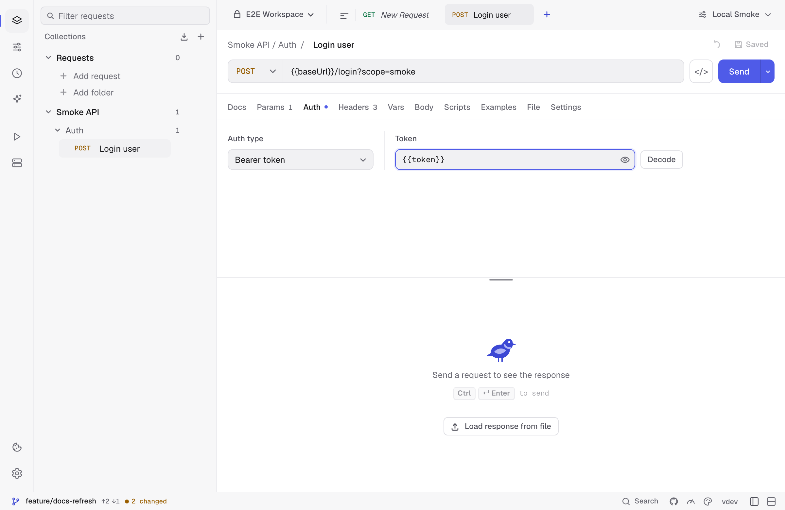

The simplest case: paste the token, Kurlo sends `Authorization: Bearer <token>`. Use `{{tokenVar}}` to pull from an environment.

Every field on the Auth tab, at request and collection level, takes `{{variables}}`: type `{{` to pick one from the active environment, and an undefined variable is underlined in red. A secret field shows a value made only of variables, such as `{{token}}`, as plain text, and hides anything else behind dots.

