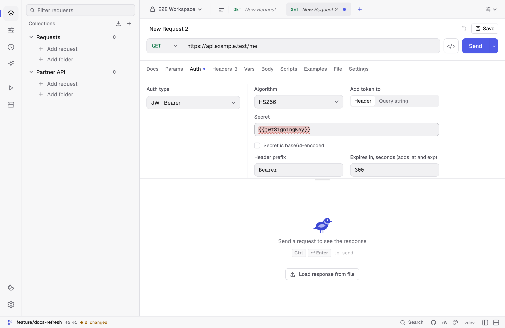

Choose **JWT Bearer** when an API expects a JSON Web Token that you sign yourself, for example a service-to-service call or a gateway that checks a shared secret. Kurlo signs a fresh token on every send, so you no longer paste a token that expires.

- **Algorithm**: `HS256`, `HS384`, `HS512` with a shared **Secret**, or `RS256`–`RS512`, `PS256`–`PS512`, `ES256`–`ES512` with a **Private key** in PEM form (PKCS#1, PKCS#8 or SEC1). Tick **Secret is base64-encoded** when the secret you were given is base64. Both fields accept a `{{variable}}`, so the key can stay in a secret environment variable.
- **Payload**: the claims as a JSON object, such as `{ "sub": "{{userId}}", "role": "admin" }`. `{{variables}}` and [dynamic variables](/docs/guides/environments/dynamic-variables/) are resolved on send.
- **Expires in, seconds** adds `iat` (now) and `exp` (now plus the lifetime) unless the payload already sets them. Leave it empty to send the payload as written.
- **Add token to**: the `Authorization` header with a **Header prefix** (`Bearer` by default), or a **Query string** parameter (`token` by default). gRPC requests send it as `authorization` metadata.
- **Advanced → Extra header fields** adds JSON fields to the token header, such as `{ "kid": "key-1" }`. `alg` always follows the chosen algorithm.

**Preview token** signs a token the way the next send would: with the active environment's variables, dynamic variables and `iat`/`exp` filled in. It shows the encoded token, which **Copy token** puts on the clipboard for use in another tool, and below it the header and the claims that ended up in it. A token without `exp` is marked **No expiry**. A payload that is not valid JSON, or a key that does not match the algorithm, stops the send with the reason in the response panel.

The same signing runs in `kurlo run` and `kurlo mcp`. Generated code and **Copy as cURL** cannot sign, so they write a `{{jwtToken}}` placeholder; replace it with a token from **Preview token**. Postman's JWT Bearer auth imports and exports with every setting except **Expires in**, which Postman does not have. A k6 load test sends these requests without auth and says so in the export warnings.
