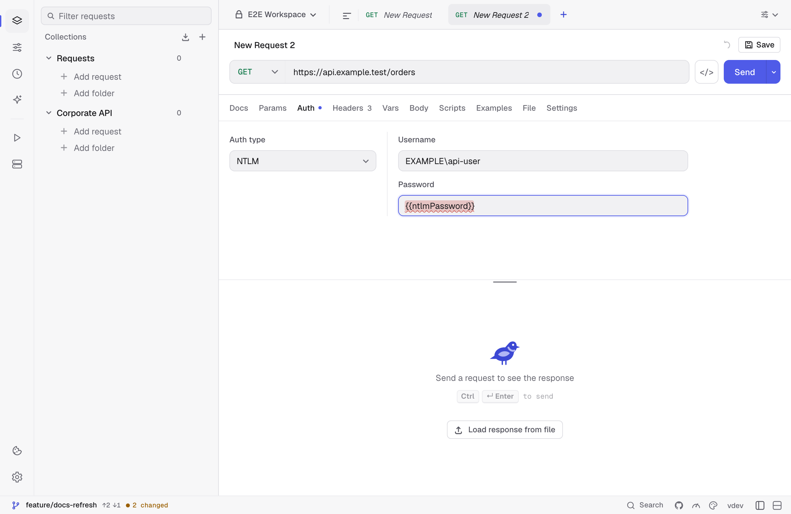

Choose **NTLM** in the Auth tab of an HTTP, GraphQL or SSE request. Enter a username such as `DOMAIN\user` or `user@example.com`, then enter the password or reference an environment variable such as `{{ntlmPassword}}`. Kurlo negotiates NTLMv2 over one HTTP/1.1 connection and keeps the credentials scoped to the request origin.

