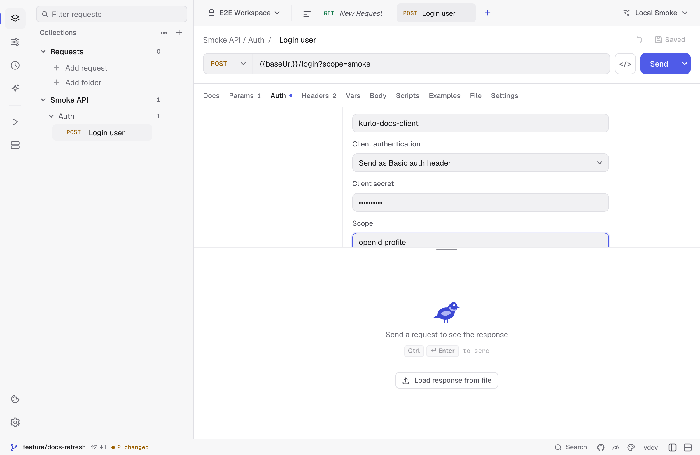

Kurlo supports four grant types, picked from **Grant type**:

- **Client credentials** — enter the token URL, client ID, client secret, and optional scope, then click **Get access token**.
- **Authorization code** — enter the authorization URL, token URL, client ID, optional client secret, and scope, then click **Authorize in browser**. Kurlo opens the system browser and receives the callback through a temporary loopback listener on `127.0.0.1`.
- **Device code** (RFC 8628) — enter the device authorization URL, token URL, and client ID, then click **Start device sign-in**. Kurlo shows the user code, opens the verification page, and polls the token endpoint until you approve. It honours the server's `interval` and backs off on `slow_down`. This is the grant to use where a loopback redirect cannot work — a headless machine or a remote session.
- **Password** — the RFC 6749 resource-owner grant: token URL, username, and password. Legacy by design, but still required by some internal token endpoints.

For Authorization Code, **Use PKCE** is enabled as the recommended option for public clients. Kurlo uses S256 PKCE. A client secret is optional when PKCE is used.

**Client authentication** selects how the client identifies itself at the token endpoint:

- **Send as Basic auth header** — HTTP Basic, the RFC 6749 default when a secret is set.
- **Send client credentials in body** — `client_id` + `client_secret` as form fields (`client_secret_post`), which some providers require instead.
- **Client secret JWT** — an RFC 7523 assertion signed with the client secret (HS256).
- **Private key JWT** — an RFC 7523 assertion signed with an RSA or ECDSA private key. Paste the key in PEM form (PKCS#1, PKCS#8, or SEC1); the algorithm is inferred from the key unless you set it. The key field accepts a `{{variable}}`, so it can live in workspace secrets rather than in the YAML.

For both assertion methods the audience defaults to the token URL, which is what providers expect; override it if yours differs. Assertions are minted fresh per request with a random `jti` and a five-minute lifetime.

**Audience** sends an `audience` parameter alongside the token request. It is not part of RFC 6749 but Auth0 requires it and several other providers accept it.

The acquired `access_token` is injected as `Authorization: Bearer ...` on send. If the provider returns a refresh token, Kurlo exposes **Refresh token** and automatically refreshes an expired access token before sending a request.
