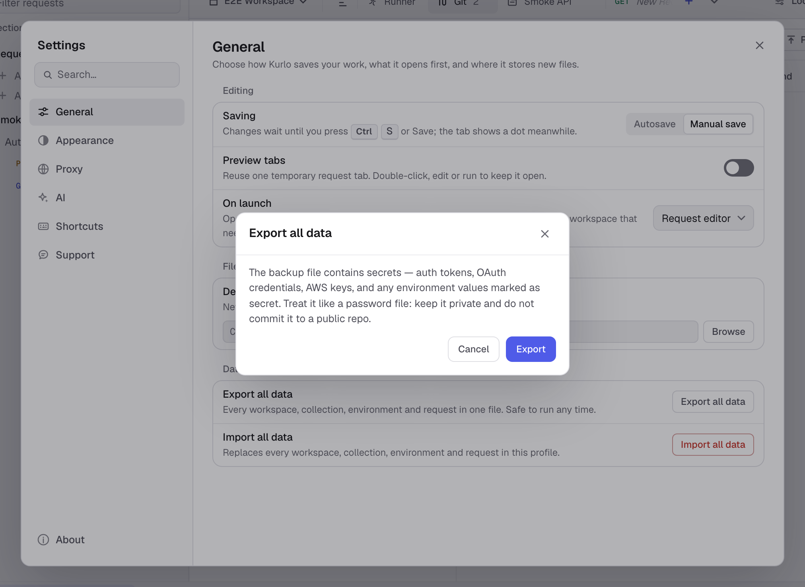

Open **Settings -> General -> Data -> Export all data**.

The JSON backup includes:

- Workspaces, collections, folders, environments, and saved requests.
- Request history and workspace cookie jars.
- Collection defaults and request settings.
- Theme, autosave mode, shortcut overrides, and request-default preferences.
- Global proxy configuration except its password.

It does not include:

- Unsaved request edits in manual-save mode.
- The global proxy password.
- External folder or Git repository contents and Git history.
- Other local UI preferences, including the selected script engine, default workspace location, and automatic-update preference.

:::caution
The exported JSON is not encrypted. It can contain auth tokens, OAuth credentials, AWS keys, cookies, and environment values marked secret. Store it like a password file and never commit it to a public repository.
:::
