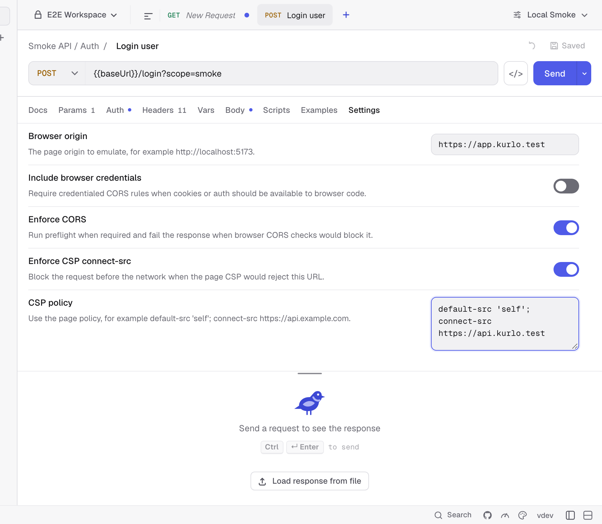

import DocsTopicIndex from "../../../../components/DocsTopicIndex.astro";

Kurlo normally behaves like an API client, so it is not restricted by browser CORS or CSP rules. Browser security settings let you reproduce the result that frontend code would see without moving the request into a browser.

Configure them in a request's **Settings** tab or as [collection defaults](/docs/guides/collection-defaults/).

<DocsTopicIndex />
