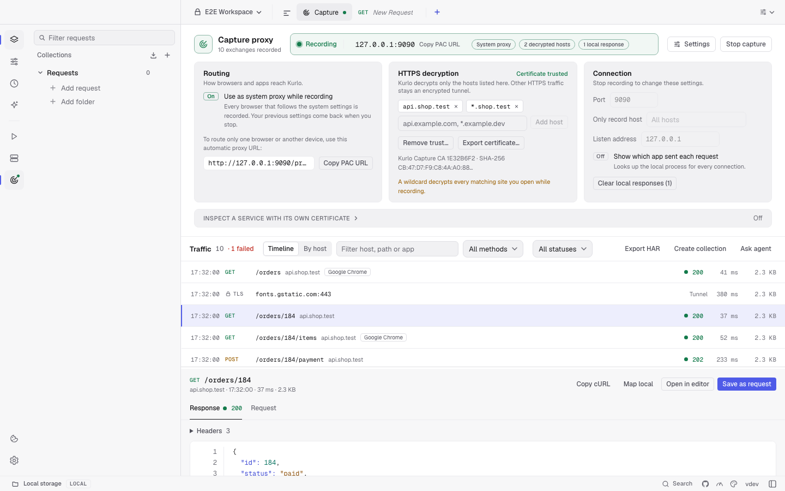
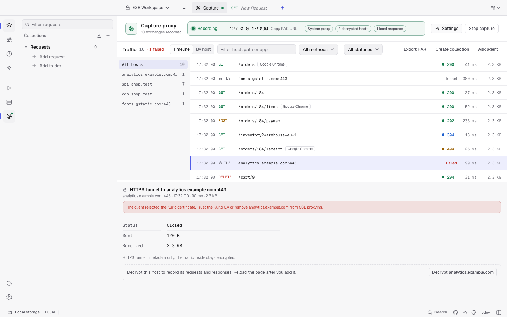
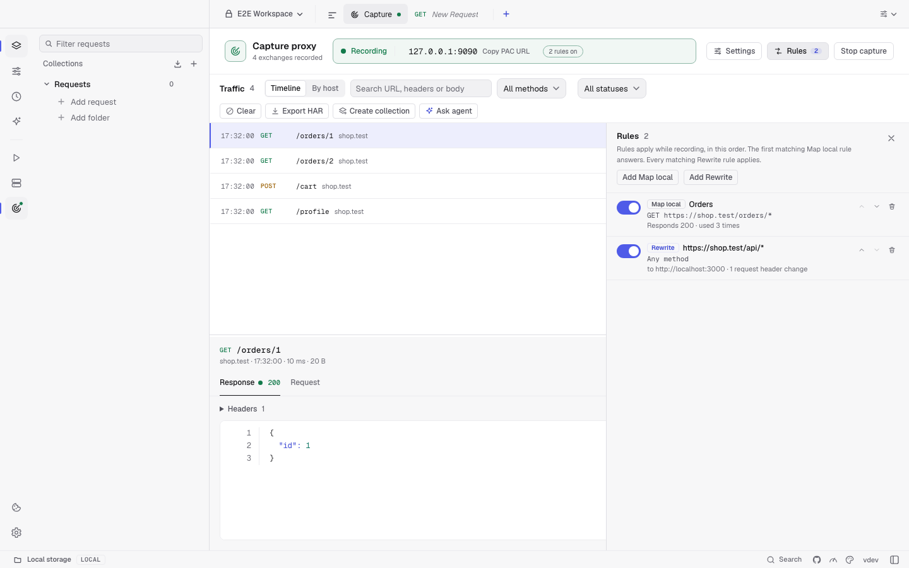

Open **Capture proxy** and click **Record**, then open a site in any browser. Kurlo records the traffic of every browser and app that follows your system proxy settings.

## Use Kurlo as the system proxy

On macOS and Windows, **Settings → Routing → Use as system proxy while recording** is on by default. On Linux with GNOME, enable it in Routing to capture from applications using the system proxy. While recording, the option shows **On** or **Off**.

1. Click **Record**. Kurlo sets its automatic proxy configuration (PAC) URL in your system network settings. The header shows **System proxy** while it is active. On macOS, the system may ask for an administrator password.
2. Open or reload a site in Safari, Chrome, Edge or another app that uses the system settings. Browsers pick up the change without a restart. Connections that were already open may need a reload.
3. Click **Stop capture**. Kurlo restores your previous proxy settings. It also restores them when you quit Kurlo, and on the next launch if Kurlo did not close normally. Kurlo preserves manual changes made during recording. If two recorders set the system proxy, the most recent one controls it until it stops.

The PAC file allows a direct connection when Kurlo is not running, so the internet keeps working even if Kurlo stops unexpectedly.



## Connect a single browser or device

Turn off **Use as system proxy while recording** to route only one client through Kurlo.

1. In **Settings → Routing**, click **Copy PAC URL**. While recording, the address in the header copies the same URL. The default is `http://127.0.0.1:9090/proxy.pac`.
2. Paste it into the automatic proxy configuration setting of that browser or device. Keep the listening port consistent across sessions.
3. Open or reload the site. HTTP requests appear with their responses. For HTTPS, **CONNECT** shows the destination and connection metadata. To see individual HTTPS requests and responses, [decrypt the host](#decrypt-https-for-selected-hosts).
4. Click **Stop capture** to stop listening and keep the recorded entries. The PAC file offers a direct connection if the proxy is unavailable. Browser retry and PAC caching behavior can affect how quickly routing changes.

To start a separate Chrome window that uses Kurlo without changing system settings:

```sh
open -na "Google Chrome" --args --user-data-dir=/tmp/kurlo-chrome --proxy-server=http://127.0.0.1:9090
```

For manual configuration, point both the HTTP and HTTPS proxy settings to the host and port shown in Kurlo. Disable a manual proxy when you stop Kurlo.


## Inspect traffic

**Timeline** shows requests in capture order. **By host** adds a list of hosts with their request counts. Filter by method or status. **Failed** shows requests that did not get a response, and **Tunnels** shows HTTPS connections that Kurlo did not decrypt.

The search field matches the URL including its query string, the app name, headers, bodies and WebSocket or SSE messages. Kurlo searches the first 16 KiB of each body, after removing gzip, Brotli or zstd compression. A row found by its content shows where the text was found, such as **in response body**. Search ignores letter case.

**Clear** removes the recorded entries and their temporary files. Recording continues.

Select a row, or move through the list with the arrow keys. The details below the list show the **Response** and **Request**, each with its headers and a formatted body. Drag the line between the list and the details to resize them. For HTTP/1.1 WebSocket upgrades and SSE responses, open **Messages** or **Events** while the stream is running. **Events** also shows events from gzip, Brotli and zstd streams. Previews keep the first 16 KiB per direction.

The line under the path shows the duration and the protocol the client used, such as **HTTP/2**. Hover over the duration to see where the time went: preparing the request, waiting for a connection, DNS lookup, TCP and TLS handshakes with the server, waiting for the first byte and downloading the response. A request that reused an open connection has no handshake time. Responses from a **Map local** rule never reach the network, so they show only the total.

On macOS, **Settings → Connection → Show which app sent each request** adds the app name to each row.

## Decrypt HTTPS for selected hosts

Kurlo can decrypt HTTPS for the hosts you list, the way Charles or Proxyman do. Every other HTTPS destination stays an encrypted tunnel.

1. Open **Settings** and find **HTTPS decryption**. Enter a host such as `api.example.com` and click **Add host**. You can also select a **TLS** row and click **Decrypt** with its host name. The list applies to new connections immediately, also while recording, and Kurlo remembers it for the next session.
2. Click **Trust Kurlo certificate…** once. Kurlo creates a certificate authority for this computer and adds it to your login keychain on macOS or your user certificate store on Windows. The system asks you to confirm. On Linux, click **Export certificate…** and add the file to your system and browser trust stores.
3. Reload the page in your browser. Requests to the listed hosts appear with their headers and bodies.

Kurlo offers HTTP/2 and HTTP/1.1 to the client on decrypted connections and on a service inspected with its own certificate, so browsers keep the protocol they would use without the proxy. Kurlo talks to the server over HTTP/1.1.



Host patterns:

- `api.example.com` matches that host on port 443.
- `*.example.com` matches its subdomains on port 443, but not `example.com` itself.
- `local.test:8443` matches one port. `local.test:*` matches every port.

Kurlo verifies the real server's certificate with your system's trusted authorities. If verification fails, the request is recorded with **Upstream connection failed** and nothing is sent.

Some apps accept only their own certificate (certificate pinning) and refuse the connection. Kurlo records a **TLS** row marked **Failed** that says the client rejected the Kurlo certificate. Remove that host from the list to let the app work through the tunnel again. Firefox follows the system proxy by default, but it uses its own certificate store unless `security.enterprise_roots.enabled` is on. In that case, import the exported certificate in Firefox settings.

The certificate and its private key are stored in Kurlo's configuration folder, in `capture-ca`. Anyone with the key could intercept HTTPS traffic on a computer that trusts the certificate. Do not share the key file. Use **Remove trust…** when you no longer need decryption.

## Inspect an HTTPS development service

If you do not want to trust a Kurlo certificate, you can decrypt one development service with its own certificate instead.

1. Stop recording and open **Settings → Inspect a service with its own certificate**. Enter the service hostname and port, including `:443` when it uses the default HTTPS port.
2. Choose the PEM certificate and private key that your development server uses. The certificate must be current, cover that hostname and match the certificate the upstream server presents.
3. Start capture and connect with a client that already trusts the development service. The client can negotiate HTTP/2 or HTTP/1.1. Other HTTPS destinations appear as CONNECT tunnels with connection metadata.

For a second device, choose your computer's private LAN interface address in **Settings → Connection → Listen address** and enter it in **Allowed device**. Then enter the device's private IPv4 address. Set the device's proxy to the displayed address and port. The QR code contains the proxy address. Clients supporting automatic configuration can use `http://<address>:<port>/proxy.pac`.

## Reuse a request

- **Save as request** saves the request and its response example in the collection and folder you choose. The default folder is **Captured**. Examples require a complete text response. For a binary or incomplete response, choose **Export HAR** to keep the captured bytes. **Open in editor** opens the request on its own. You can serve saved examples from the [mock server](/docs/guides/mock-server/).
- **Open in editor** opens an editable draft. Check its URL, environment and authentication before pressing **Send**.
- **Create collection** makes a collection from the filtered HTTP entries and groups repeated method and URL pairs into one request.
- **Export HAR** writes the filtered HTTP exchanges with their HTTP version and timings. Kurlo adds failed requests, the process, the rule that answered and stream messages as `_kurlo` fields, so **Open HAR** restores them. **Ask agent** opens a chat draft that lists the exchanges by id. The agent reads their headers, bodies and messages with `get_captured`, so it can suggest request bodies, variables and assertions on response fields. You review and send the draft.

Kurlo retains the latest 1,000 entries. Stopping preserves the session for inspection. Starting another session clears it. Body previews show up to 16 KiB. Larger HTTP bodies can be exported in full up to 8 MiB per body and 64 MiB of temporary file storage per session. When a limit is reached, the HAR marks the preview incomplete. Check bodies and paths before sharing a HAR. They can contain application data.

## Open a saved session

**Open HAR** loads a HAR file into the traffic list, so you can go back to a session you exported or inspect one recorded elsewhere. Kurlo reads HAR files from its own export and from browser developer tools, Charles and Proxyman. The header shows the file name. Search, filters, rules, **Save as request**, **Create collection** and **Export HAR** work as they do for a live recording. WebSocket messages open in **Messages** and server-sent events in **Events**. Multipart form fields, the HTTP version and the original status text are restored too. HAR keeps the transfer size and decoded response size separately, along with time spent sending the request and waiting for the response. Bodies marked incomplete in the archive stay marked when you export again.

Kurlo opens the latest 1,000 HTTP entries of a file up to 256 MiB. Encrypted tunnels have no requests to restore, so they are skipped. Stop recording before you open a file. **Record** starts a new session and replaces the opened one.

When the list is empty, **Recent sessions** shows the HAR files you opened or exported recently. Click a file to open it again. The list is stored on this device, not in the workspace.

## Change traffic with rules

Click **Rules** in the header to open the rule list. Rules are saved on this computer and apply whenever Kurlo records. Turn a rule off with its switch to keep it for later.

- **Map local** answers matching requests with your own status, content type and body. Nothing is sent to the server. Load the body from a text file or a saved response example. Under **Network conditions**, add a delay, limit the speed in KiB/s, return HTTP 503 at a chosen rate, or pause before sending. Paused responses appear above the traffic list. Open one, edit it, and click **Release response** within 60 seconds. Optional JavaScript functions `onRequest(request, response)` and `onResponse(request, response)` can read `request.method` and `request.path` and set `response.status` or `response.body`.
- **Rewrite** changes matching requests before Kurlo sends them. **Send to** moves them to another server, such as `http://localhost:3000`. **Replace in path** swaps the first occurrence of a path part, such as `/v1/` for `/v2/`. Add, replace or remove request headers and response headers.

To start from a recorded request, select it and click **Map local** or **Rewrite**. The rule takes its method and URL. Map local also copies the response status and the full text body up to 1 MiB. If the full response is unavailable, binary or too large, the editor explains why the body field is empty.



**URL patterns** use `*` for any characters. They match the scheme, host, port and path. Host names ignore letter case, paths do not.

| Pattern | Matches |
|---|---|
| `https://api.example.com/orders/*` | Every path under `/orders/` on that host, with any query |
| `https://api.example.com` | Every path on that host |
| `*://api.example.com/*` | HTTP and HTTPS |
| `https://*.example.com/*` | Every subdomain of `example.com` |
| `http://localhost:*/api/*` | Any local port |
| `https://api.example.com/search?q=*` | Only requests with that query |

While you type a pattern, the editor shows how many recorded requests it matches. Leave **Method** at **Any method** to match every method.

Kurlo checks rules from top to bottom. The first matching Map local rule answers the request, and then no Rewrite rule applies. Otherwise every matching Rewrite rule applies in order. Use the arrows to change the order. Rows show **Map local** or **Rewrite** when a rule changed them, and the details name the rule and the new address. Each rule counts how often it was used since Kurlo started.

HTTPS requests need [decryption](#decrypt-https-for-selected-hosts) for rules to see them.

## Work with several requests

Shift-click to select a range of rows, and Cmd-click on macOS or Ctrl-click to add or remove one row. Cmd+A or Ctrl+A selects every row that matches the filters, and Escape returns to one row. With several rows selected, save them as requests in one collection and folder, export them as HAR, send them to the agent, or delete them. Delete or Backspace removes the selected rows from the list.

## Record from a terminal

```sh
kurlo proxy --port 9090 --include api.dev.test --out session.har
```

Point the client at the proxy while the command runs, or add `--system-proxy` to set Kurlo as the system proxy until the command exits. Press Ctrl+C to stop and write the HAR. Add `--rules rules.json` to apply rules from a file with the same format Kurlo saves in its configuration folder as `capture-rules.json`. Add `--ssl-host api.dev.test` to decrypt HTTPS for a host with the Kurlo certificate. Repeat the flag or separate hosts with commas. `kurlo proxy ca` shows the certificate path, fingerprint and whether this system trusts it, and `kurlo proxy ca --pem` prints the certificate. Use `--service api.dev.test:443 --cert service.pem --key service-key.pem` to inspect a service with its own certificate instead. Run `kurlo proxy --help` for LAN and process options.

To share a recorded session with an MCP client, start `kurlo mcp /path/to/workspace --capture-har /path/to/session.har`. `list_captured` exposes method, host, path, status and duration, and `get_captured` adds headers and bodies of one exchange. Credential headers are left out, and secrets saved in Kurlo appear as `[secret]`. Share only a HAR you are ready to show the client. Use `check_captured_openapi` with a synced collection and host to compare observed methods and paths with its saved specification.

With write access, `create_captured_collection` accepts a collection name and host. It saves one request template per observed method and path, with a status assertion from the first matching response. Set the `baseUrl` environment variable to your development service before using those templates.

## Platform support

Recording, HTTPS decryption, local responses and HAR export work on macOS, Windows and Linux. A few options depend on the system. When an option is not available, Kurlo disables it in **Settings** and explains why, so recording still works.

| Option | macOS | Windows | Linux |
|---|---|---|---|
| Use as system proxy while recording | Yes | Yes | GNOME only. Elsewhere, paste the PAC URL into your network or browser settings. |
| Trust Kurlo certificate | Yes, in the login keychain | Yes, in your user certificate store | No. Use **Export certificate…** and add it to your system and browser trust stores. |
| Show which app sent each request | Yes | No | No |
