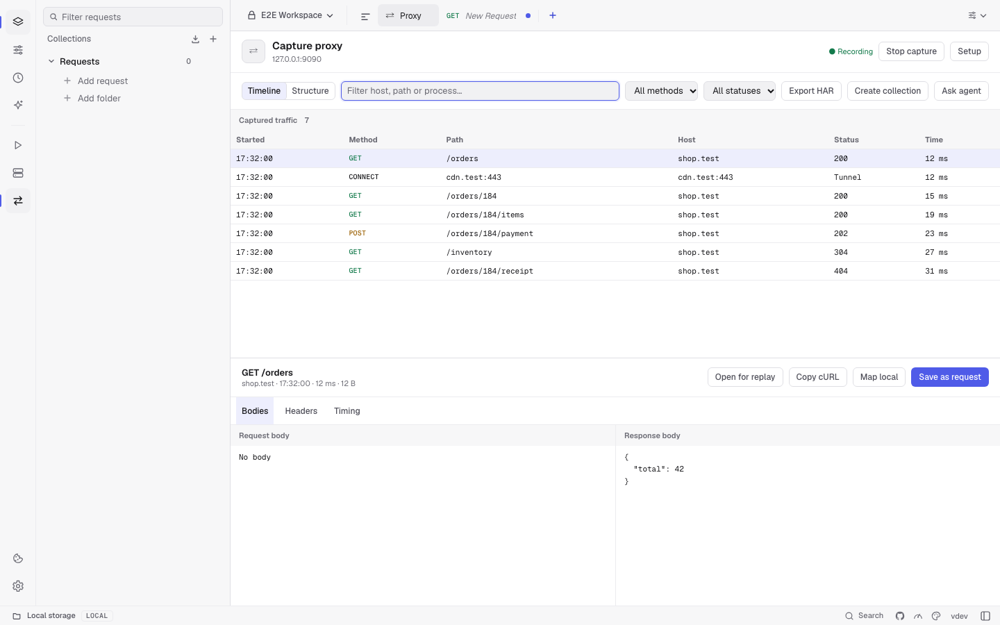

Open **Capture proxy** in the activity rail, then click **Start capture**. Set your client's HTTP and HTTPS proxy to the address shown in Kurlo. The default is `127.0.0.1:9090`. To check the connection, send a request to a development HTTP endpoint from that client.



**Timeline** shows requests in capture order. **Structure** groups them by host. Filter by method, status, host or path, then select a row to inspect the request and response. On macOS, **Setup → Identify local processes** attempts to resolve the client process for local connections. For HTTP/1.1 WebSocket upgrades and SSE responses, open **Frames** while the stream is running. Frame previews sample the first 16 KiB per direction.

## Inspect an HTTPS development service

1. Open **Setup** while the proxy is stopped. Enter the service hostname and port, including `:443` when it uses the default HTTPS port.
2. Choose the PEM certificate and private key that your development server uses. The certificate must be current, cover that hostname and match the certificate the upstream server presents.
3. Start capture and connect with a client that already trusts the development service. Kurlo uses HTTP/1.1 for this connection. Other HTTPS destinations appear as CONNECT tunnels with connection metadata.

For a second device, choose your computer's private LAN interface address in Setup and enter the device's private IPv4 address. Set the device's proxy to the displayed address and port. The QR code contains the proxy address. Clients supporting automatic configuration can use `http://<address>:<port>/proxy.pac`.

## Reuse a request

- **Save as request** saves the request and its response example in the collection and folder you choose. The default folder is **Captured**. You can serve saved examples from the [mock server](/docs/guides/mock-server/).
- **Open for replay** opens an editable draft. Check its URL, environment and authentication before pressing **Send**.
- **Create collection** makes a collection from the filtered HTTP entries and groups repeated method and URL pairs into one request.
- **Export HAR** writes the filtered HTTP exchanges. **Ask agent** prepares a draft with observed endpoints and statuses for your review.

Kurlo retains the latest 1,000 entries. Stopping preserves the session for inspection. Starting another session clears it. Body previews show up to 16 KiB. Larger HTTP bodies can be exported in full up to 8 MiB per body and 64 MiB of temporary file storage per session. When a limit is reached, the HAR marks the preview incomplete. Check bodies and paths before sharing a HAR. They can contain application data.

## Try a local response

Select a recorded HTTP exchange and click **Map local**. Enter a status, content type and body, load a text file, or choose a saved response example. The next request with the same method and full URL receives this local response. A rule can limit bandwidth in KiB/s, add a delay, simulate HTTP 503 at a chosen rate, or pause before sending. Open a paused response, edit it, and click **Release response** within 60 seconds.

Optional JavaScript functions `onRequest(request, response)` and `onResponse(request, response)` run in order for that local rule. Read `request.method` and `request.path`, and set `response.status` or `response.body`. Use **Setup → Clear local responses** to remove all rules for the session.

## Record from a terminal

```sh
kurlo proxy --port 9090 --include api.dev.test --out session.har
```

Point the client at the proxy while the command runs. Press Ctrl+C to stop and write the HAR. Use `--service api.dev.test:443 --cert service.pem --key service-key.pem` to inspect that HTTPS service. Run `kurlo proxy --help` for LAN and process options.

To share endpoint metadata with an MCP client, start `kurlo mcp /path/to/workspace --capture-har /path/to/session.har`. The capture tools expose method, host, path, status and duration. Use `check_captured_openapi` with a synced collection and host to compare observed methods and paths with its saved specification.

With write access, `create_captured_collection` accepts a collection name and host. It saves one request template per observed method and path, with a status assertion from the first matching response. Set the `baseUrl` environment variable to your development service before using those templates.
