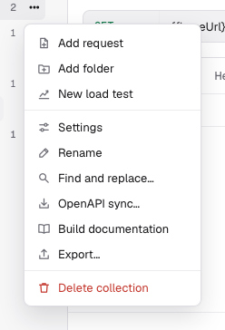
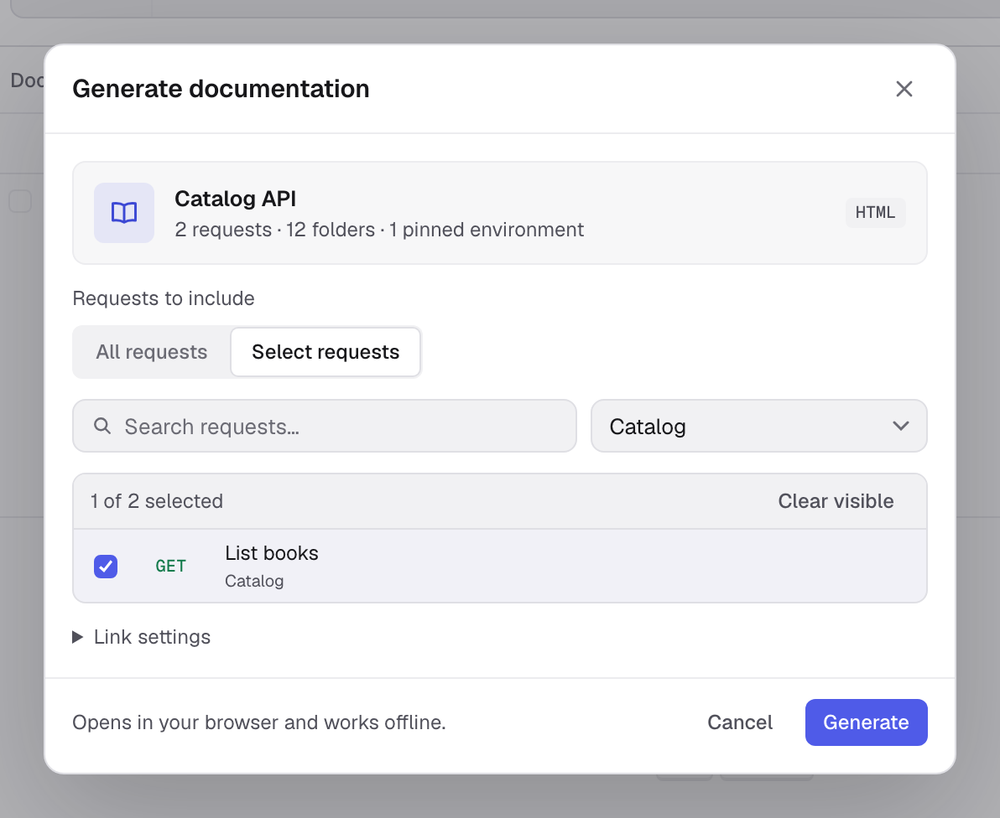
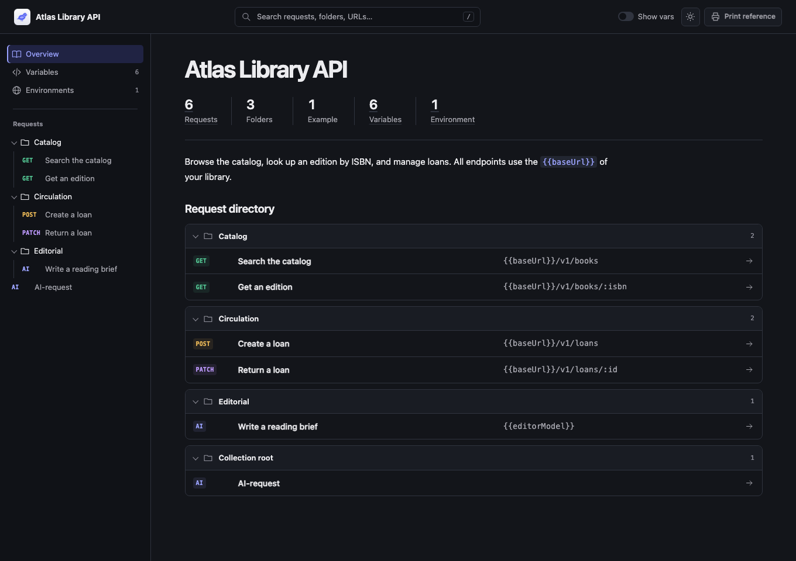
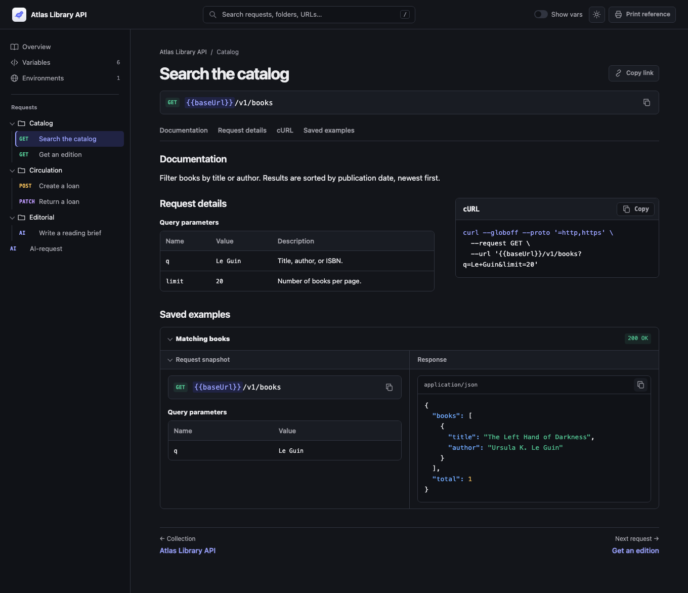
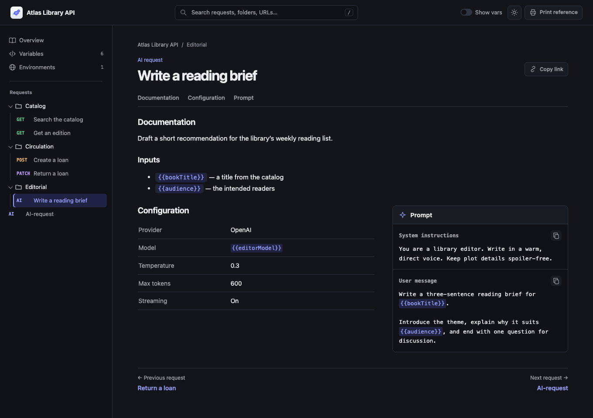
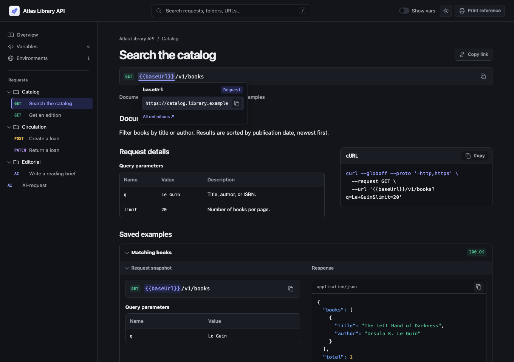
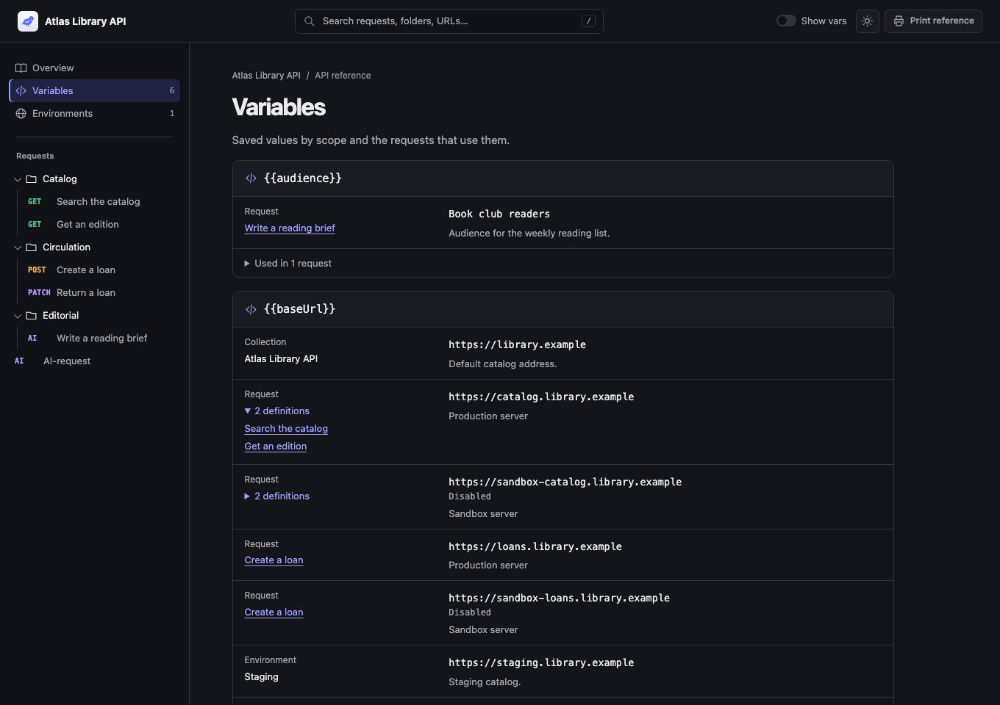

In the sidebar, open the collection’s **⋯** menu and choose **Build documentation**. In **Generate documentation**, keep **All requests** or choose **Select requests**. Search by name, method or URL, or narrow the list with the folder picker, then check individual requests or use **Select visible**. Click **Generate** and choose a folder and filename in the save dialog. Kurlo suggests `<collection>-documentation.html` and opens the saved file in your default browser. You can also use **⋯** on the collection overview. Save any edits you want to include before building.





If your notes use relative paths for links to an external site, such as `/guide/auth`, expand **Link settings** and enter that site’s **Documentation URL**. The export uses it to turn relative links into full URLs. You can also put full URLs directly in your notes. If you publish the export with the linked pages on the same site, you can keep the links relative by leaving **Documentation URL** empty.

The contents follow your collection’s folders. HTTP requests show the saved address, enabled parameters and headers, and body. Open a saved example to compare the request snapshot and response. They appear side by side on a wide screen and stack on smaller screens. Collection descriptions, request documentation, and example notes render as Markdown. Expand a folder to browse its requests, or press `/` to search by name, folder, method or URL. Use **All methods** to filter the results by method or protocol. Use the arrow keys and Enter to open a result.



On an endpoint page, use the links under the request address to jump to documentation, request details or saved examples. Use **Copy link** to link directly to the endpoint. For supported HTTP requests, **Copy cURL** copies the saved template with variable placeholders. Fill in those placeholders before running the command. The copy buttons beside addresses and other code blocks copy what is displayed. The reference follows your browser’s color scheme on first open. Change it in the toolbar, or choose **Print reference** to print the whole collection with its examples. Printed requests show the original variable placeholders.



AI requests show their saved provider, model and generation settings. Use the copy buttons in **Prompt** to copy the system instructions or user message, including line breaks and variable references.



## Build a file to share

```sh
kurlo docs build "Orders API" --workspace ./api --out ./public/reference
```

Point `--workspace` at the directory containing `kurlo.yml`. It defaults to the current directory. Select the collection by name or ID. With a single collection, you can omit the selector.

Pass a filename such as `--out ./public/orders.html` to choose its name. A directory produces `index.html` inside it. The command prints the absolute path to the saved file. The file includes its styles and works offline. Send it as a file or put it on a static host. The default output is `./kurlo-docs/index.html`. Rebuilding to the same destination replaces that HTML file. Add `--open` to open it after building. Use `--docs-base-url https://docs.example.com` to resolve relative links in the notes.

## Read variable values

Hover over a highlighted variable in a request, tap it, or focus it with the keyboard. The popover shows its value and scope and lets you copy it. Request values take precedence over environment, collection and global values. Disabled definitions are skipped. When multiple environments supply a value, their names appear alongside each value. Use the environment selector to choose one.

Turn on **Show vars** to read addresses, request bodies and examples with their values filled in. The copy buttons copy the text as displayed. Turn it off to copy the original template.



Open **Variables** to see each name, its saved values, descriptions and scopes. Repeated request definitions share a row. Expand the definition count to see the requests with that value. Expand **Used in** for links to requests. Collection and request definitions appear even when unused. Disabled rows, empty strings and references without a saved definition have separate labels.

**Environments** shows values for each environment pinned to the collection, including inherited values. With no pins, **Variables** includes matching definitions from environments in the same workspace. The desktop export also includes matching global variables. The Variables directory preserves saved values, so a URL such as `{{origin}}/v1` keeps its template.



Secret rows, credential fields and values from protected environments are hidden. Review ordinary variable values, notes, prompts, request bodies and captured examples before sharing the HTML.
