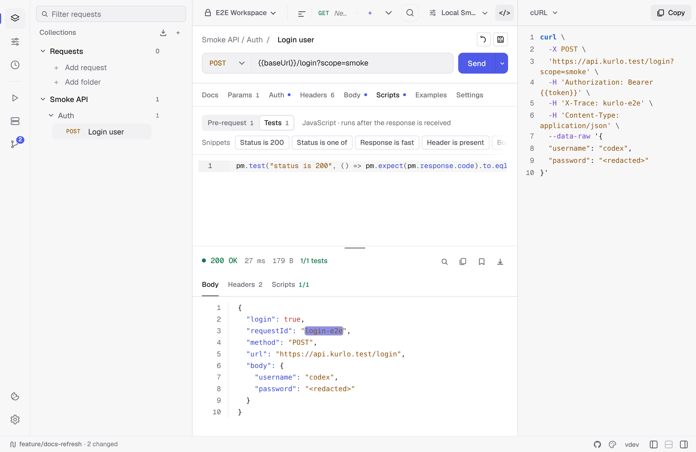

The **Code** side panel turns the currently-open request into a runnable snippet. Open it with the code-snippet icon in the status bar, the workspace overview quick action, or the right-sidebar shortcut from [Keyboard shortcuts](/docs/reference/keyboard-shortcuts/).

## Supported targets

Kurlo currently exposes 14 choices:

| Family | Targets |
|--------|---------|
| Command line | cURL, HTTPie |
| JavaScript | JavaScript `fetch`, Node.js `fetch`, Axios |
| General purpose | Python `requests`, Go `net/http`, Java OkHttp, C# `HttpClient` |
| Additional clients | PHP cURL, Ruby `Net::HTTP`, Swift `URLSession`, Kotlin OkHttp, Rust `reqwest` |

## What gets generated

Snippets are generated from the currently open HTTP, GraphQL or AI request:

- Non-secret variables are expanded from the active environment and collection variables.
- Secret variables stay as `{{name}}` placeholders so copying a snippet does not silently disclose them.
- URL params, enabled headers, and supported bodies are represented.
- Bearer, API key, Basic, and OAuth 2.0 auth are emitted in every language. Basic becomes an `Authorization: Basic …` header; an OAuth 2.0 request carries the access token Kurlo currently holds, and the snippet says so, because that token expires.
- cURL goes further where curl itself can: `-u` for Basic, `--digest` for Digest, and `--aws-sigv4` with the access key for AWS Signature v4, so the copied command signs itself rather than carrying a signature that is already stale.

## AI requests

An [AI request](/docs/guides/request-types/#ai) becomes the HTTP call Kurlo makes for the first message: a `POST` to the full address shown under the base URL, such as `https://openrouter.ai/api/v1/chat/completions` or `https://api.anthropic.com/v1/messages`, with a JSON body that holds the model, the system prompt, the prompt and the settings you set (temperature, Top P, max tokens, streaming, and thinking for Anthropic). Anthropic snippets also carry the `anthropic-version` header. API keys follow the same rules as other requests: a secret `{{openaiApiKey}}` stays a placeholder.

Replies in the chat and MCP tools from the Tools tab are not part of the snippet: tools are listed from their servers when you send, and each step depends on the model's answer.

## What's omitted

- Pre-request scripts. Snippets show the wire-level request, not the steps that produced it. If your auth depends on a token fetched in a script, copy that call separately.
- Test scripts — they're a Kurlo concept, not a client concept.
- Digest and AWS Signature v4 outside cURL. Neither can be written as a fixed header — Digest answers a challenge, SigV4 signs each request — so the snippet opens with a comment saying which scheme it is and what to reach for in that language, rather than looking complete and returning 401.
- Binary and multipart file handling varies by target; cURL has the most complete file-body output.

:::caution
Treat generated snippets as a starting point and review them before sharing. Literal auth values already present in the request, such as a Bearer token or API key, can appear in the output.
:::

## Copy + paste workflow

The button copies to clipboard and shows a toast. There's no "save snippet to file" affordance — by design, snippets are throwaway artefacts for sharing in bug reports and chat threads.
