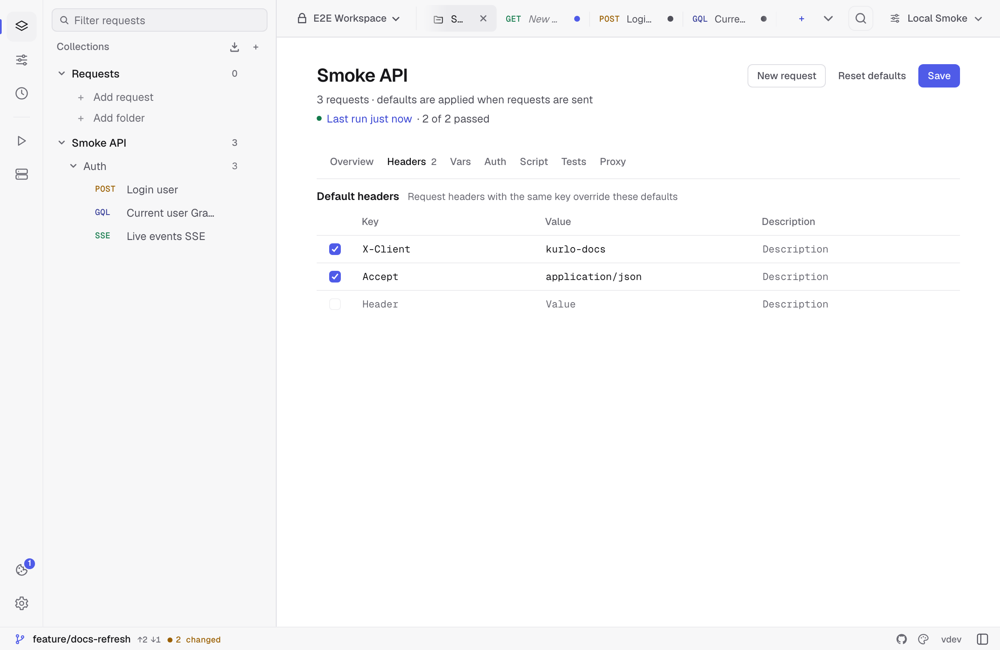
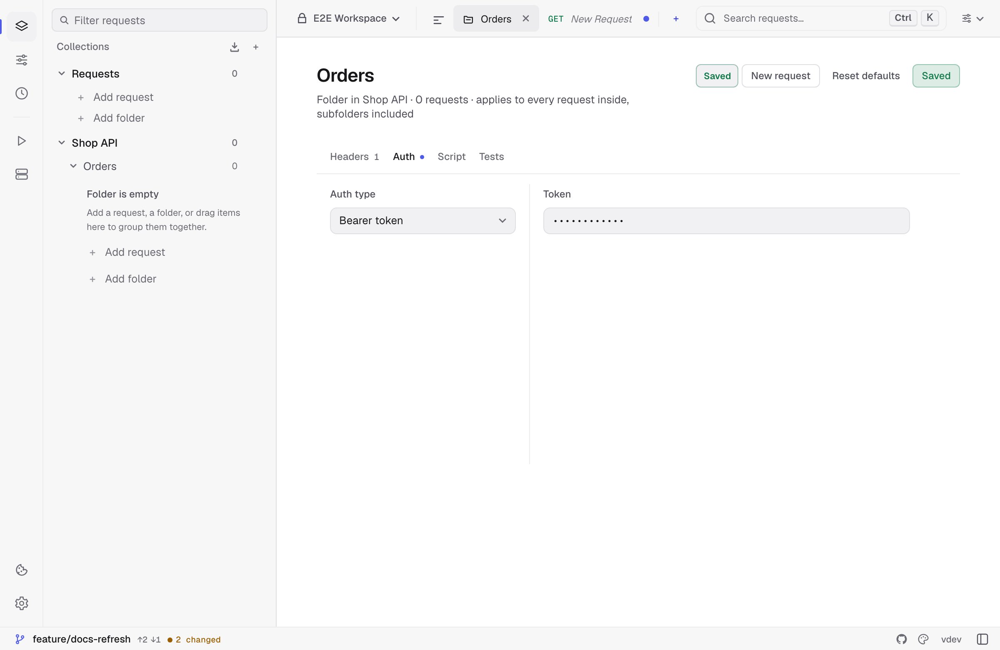

Collection defaults reduce repeated configuration while preserving request-level control. Open a collection's `...` menu, choose **Settings**, and edit the tabs in the collection workspace.



Defaults are applied when a request is sent. Folders can add their own headers, auth, scripts, and tests on top of the collection; see [Folder defaults](#folder-defaults).

## Available defaults

| Tab | What it defines |
|-----|-----------------|
| Overview | Collection name and documentation. |
| Headers | Header rows merged into child requests. |
| Vars | Collection variables, including values marked secret. |
| Auth | Default Bearer, Basic, Digest, API Key, OAuth 2.0, or AWS Signature v4 configuration. |
| Script | Collection pre-request script for the selected JavaScript or Tengo engine. |
| Tests | Collection test script for the selected engine. |
| Proxy | HTTP version, TLS verification, redirects, timeout, proxy URL, browser security, and cookie-jar defaults. |

Use the app-wide script-engine setting to switch between the independently stored JavaScript and Tengo fields.

## Precedence

### Headers

Collection headers are added unless the request contains a row with the same key. Matching is case-insensitive. A request row therefore overrides, or can intentionally suppress, the collection row. Folder headers sit in between: a folder row overrides the collection and the folders above it, and a request row overrides them all.

### Variables

Collection variables are available as `{{name}}`. Active environment values override collection values with the same key:

```text
active environment > collection variable
```

Values marked **Secret** are masked in the UI and participate in Kurlo's local secret handling for Git-backed workspaces.

### Authentication

A request uses inherited auth only when its Auth type is **Inherit auth**. It then takes the auth of the nearest enclosing folder that sets one, or the collection's when no folder does. Selecting **No auth** or another explicit request auth type overrides both.

See [Authentication](/docs/guides/authentication/) for each supported scheme.

### Scripts and tests

Kurlo combines scripts in a defined order:

1. Collection pre-request script.
2. Folder pre-request scripts, outermost folder first.
3. Request pre-request script.
4. The network request.
5. Request test script.
6. Folder test scripts, innermost folder first.
7. Collection test script.

JavaScript and Tengo defaults are kept separately and combined only with request scripts from the active engine.

### Transport settings

Transport settings inherit per field. Editing a field in the request Settings tab marks only that field as overridden. Other fields can continue to inherit from the collection.

The request editor shows the applied collection defaults and labels individual values as inherited or overridden. Clicking **Reset** in the request Settings tab clears all request setting override markers, allowing collection values to apply again when the request is sent.

For proxy precedence beyond the collection, see [Proxy configuration](/docs/guides/proxy/).

## Folder defaults

Open a folder's `...` menu and choose **Settings**. The folder gets the same **Headers**, **Auth**, **Script**, and **Tests** tabs as the collection, and they apply to every request in the folder, subfolders included.



- **Headers** are layered collection → outer folder → inner folder → request, and the nearest one with the same key wins.
- **Auth** starts as **Inherit from parent**, which passes on whatever the parent folder or the collection sets. Choose a scheme to give the folder's requests their own credentials, or **No auth** to send them without auth even when the collection has a token.
- **Script** and **Tests** run in the order listed under [Scripts and tests](#scripts-and-tests).

Variables and transport settings stay at the collection level.

Renaming a folder keeps its settings; deleting it removes them along with its requests. A refreshed OAuth 2.0 token for an inherited auth is saved to the folder or collection that supplies it. Requests in the folder show what they inherit in their Settings tab. The CLI, the collection runner, load tests, and `kurlo mcp` apply folder defaults the same way the app does.

## Saving and resetting

In autosave mode, collection edits are saved after a short delay. In manual-save mode, click **Save**.

**Reset defaults** clears collection headers, variables, auth, scripts, tests, and transport settings after confirmation. It does not delete requests or folders, and folder defaults stay. On a folder's settings, **Reset defaults** clears only that folder's headers, auth, scripts, and tests.

## Storage and export

Collection defaults are saved with the collection:

- Local profile data is inside encrypted `requests.json`.
- Folder and Git workspaces store shareable defaults in YAML.
- Folder defaults are saved in `collection.yml` under `folderDefaults`.
- Kurlo/OpenCollection export preserves supported collection and folder defaults.

Real secret values remain in Kurlo's encrypted local profile when shared YAML uses `{{kurloSecret:...}}` placeholders. See [Kurlo YAML format](/docs/reference/kurlo-yaml-format/) for the storage contract.
