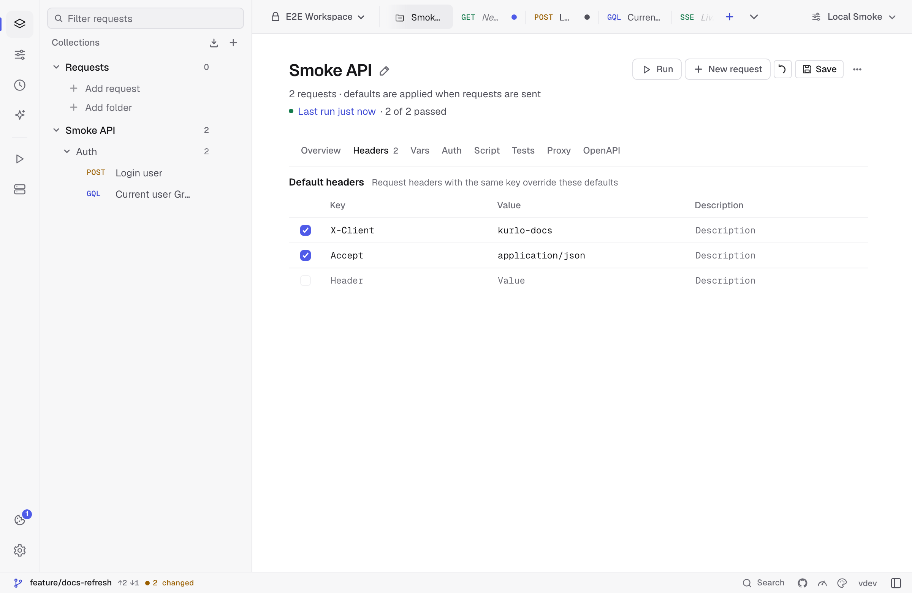

import DocsTopicIndex from "../../../../components/DocsTopicIndex.astro";

Collection defaults reduce repeated configuration while preserving request-level control. Open a collection's `...` menu, choose **Settings**, and edit the tabs in the collection workspace.

Defaults are applied when a request is sent. Folders can add their own headers, auth, scripts, and tests on top of the collection; see [Folder defaults](/docs/guides/collection-defaults/folders/).

<DocsTopicIndex />
