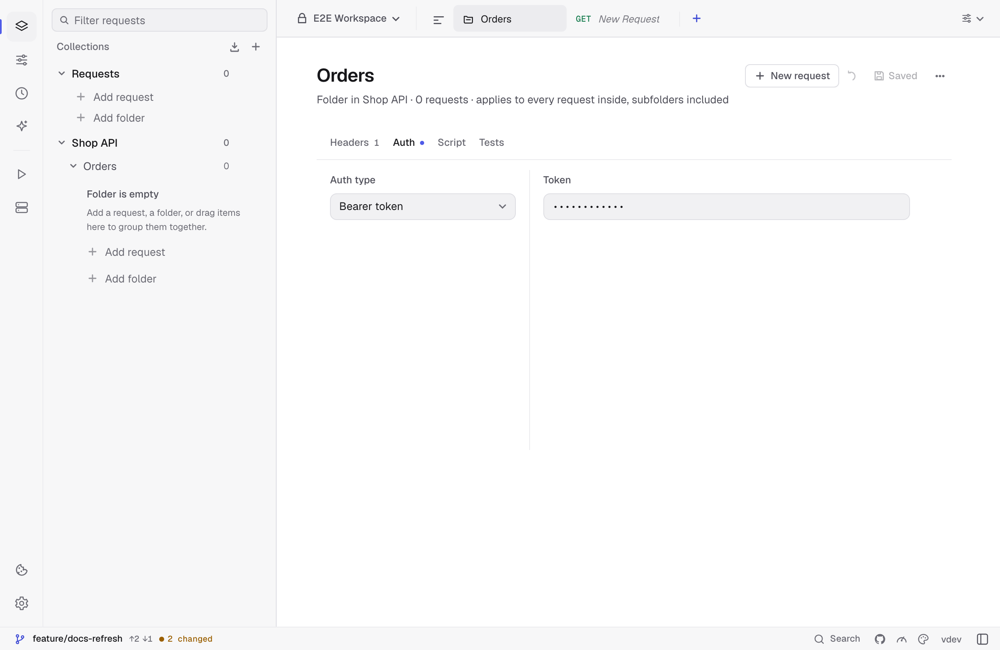

Open a folder's `...` menu and choose **Settings**. The folder gets the same **Headers**, **Auth**, **Script**, and **Tests** tabs as the collection, and they apply to every request in the folder, subfolders included.

- **Headers** are layered collection → outer folder → inner folder → request, and the nearest one with the same key wins.
- **Auth** starts as **Inherit from parent**, which passes on whatever the parent folder or the collection sets. Choose a scheme to give the folder's requests their own credentials, or **No auth** to send them without auth even when the collection has a token.
- **Script** and **Tests** run in the order listed under [Scripts and tests](/docs/guides/collection-defaults/precedence/#scripts-and-tests).

Variables and transport settings stay at the collection level.

Renaming a folder keeps its settings; deleting it removes them along with its requests. A refreshed OAuth 2.0 token for an inherited auth is saved to the folder or collection that supplies it. Requests in the folder show what they inherit in their Settings tab. The CLI, the collection runner, load tests, and `kurlo mcp` apply folder defaults the same way the app does.

## Saving and resetting

In autosave mode, collection edits are saved after a short delay. In manual-save mode, click **Save**.

**Reset defaults**, in the **•••** menu, clears collection headers, variables, auth, scripts, tests, and transport settings after confirmation. It does not delete requests or folders, and folder defaults stay. On a folder's settings, the same menu item clears only that folder's headers, auth, scripts, and tests.

## Storage and export

Collection defaults are saved with the collection:

- Local profile data is inside encrypted `requests.json`.
- Folder and Git workspaces store shareable defaults in YAML.
- Folder defaults are saved in `collection.yml` under `folderDefaults`.
- Kurlo/OpenCollection export preserves supported collection and folder defaults.

Real secret values remain in Kurlo's encrypted local profile when shared YAML uses `{{kurloSecret:...}}` placeholders. See [Kurlo YAML format](/docs/reference/kurlo-yaml-format/) for the storage contract.
