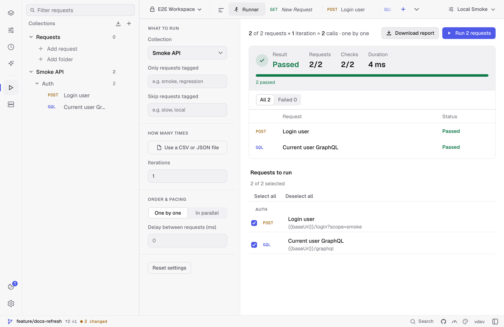

import DocsTopicIndex from "../../../../components/DocsTopicIndex.astro";

The Collection Runner executes saved requests from a collection or folder and turns the result into a pass/fail report. It is designed for local smoke tests: no account, no cloud monitor, no scheduler. To generate sustained traffic with virtual users or iterations per second, use [load testing with k6](/docs/guides/load-testing/).

<DocsTopicIndex />
