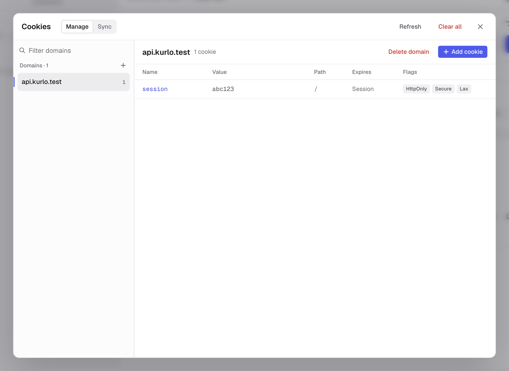
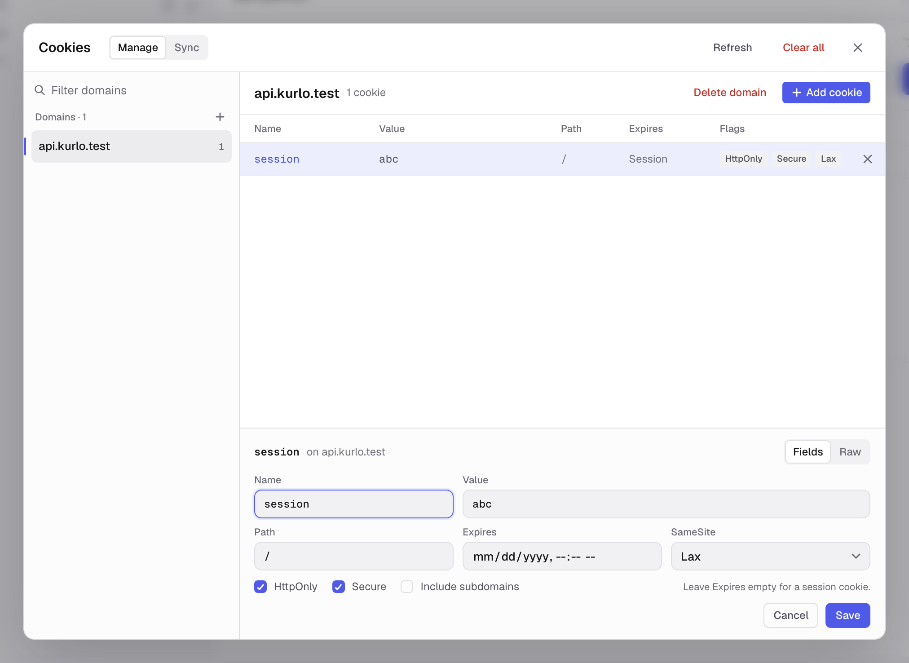
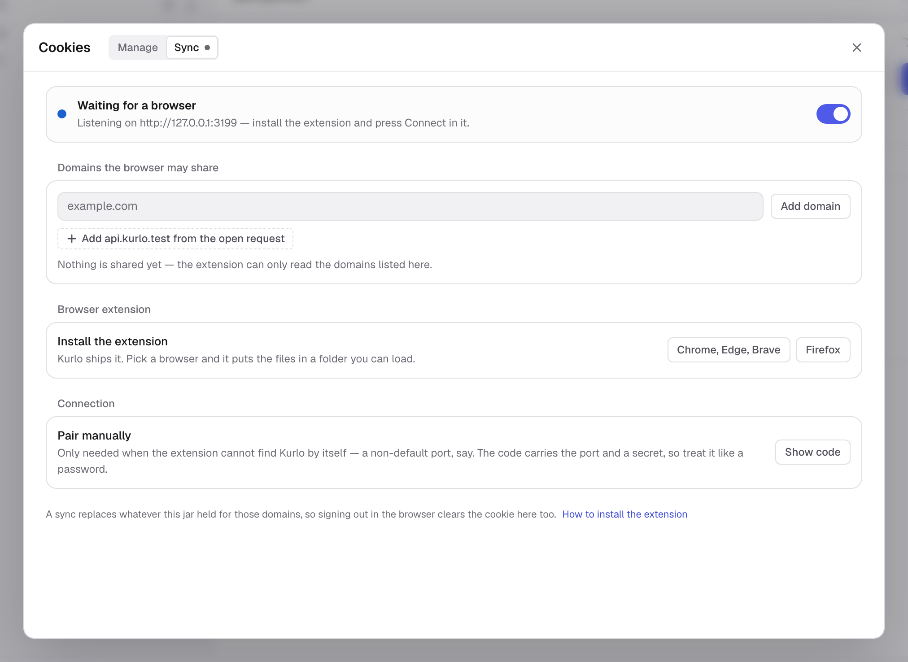
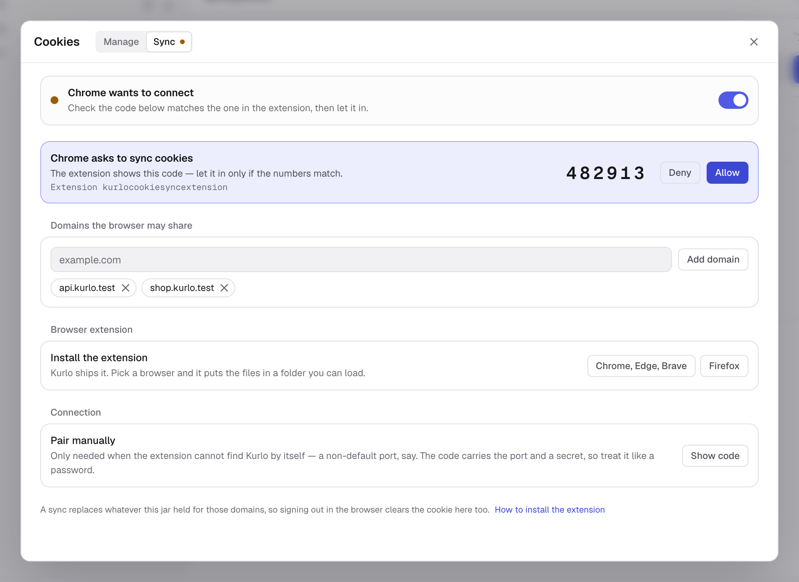
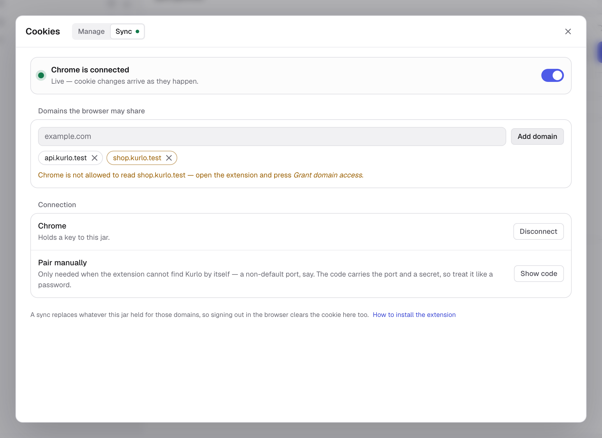

Kurlo keeps a per-workspace cookie jar, similar to a browser. Cookies received from `Set-Cookie` are stored locally and attached to future matching requests unless that request disables the jar.



## How cookies are sent

For HTTP, GraphQL, SSE, WebSocket, and Socket.IO handshakes, Kurlo checks the cookie jar before sending:

- Domain and path must match the request URL.
- Secure cookies are only sent over secure schemes.
- Expired cookies are ignored.
- Host-only cookies stay scoped to their original host.
- Manual `Cookie` headers remain visible in the request preview and are not hidden by the jar.

gRPC does not use the browser-style cookie jar path.

## Reading cookies from responses

When a response includes `Set-Cookie`, Kurlo stores it in the active workspace jar. The jar is encrypted alongside the rest of the request store.

Cookies are refreshed after normal sends and after Collection Runner runs.

## Managing cookies

Open the cookie window from the cookie icon at the bottom of the activity rail, on the far left of the window. The **Manage** tab lists domains on the left and the selected domain's cookies on the right.

- **Find a domain** with the filter above the list. A dot next to a domain means one of its cookies has no value on this computer.
- **Add a domain** with **+** next to the list heading; Kurlo opens a new cookie for it straight away. When the jar is empty, it offers to add a cookie for the domain of the open request.
- **Read cookies at a glance.** The table shows each cookie's value, path, when it expires and its flags: HttpOnly, Secure, SameSite and Subdomains for cookies sent to subdomains as well. Expired cookies are struck through.
- **Edit a cookie** by clicking its row. The editor opens under the table; `Cmd/Ctrl Enter` or **Save** stores the change.
- **Delete** one cookie with the cross at the end of its row, every cookie of a domain with **Delete domain**, or the whole jar with **Clear all**. **Refresh** reloads the jar from disk.



The editor has two modes:

- **Fields** — name, value, path, expiry date, SameSite, HttpOnly, Secure and **Include subdomains**. Leave **Expires** empty for a session cookie.
- **Raw** — the cookie as `Set-Cookie` text, for pasting from DevTools or a server log:

```text
session=abc123; Path=/; Secure; HttpOnly; SameSite=Lax
```

Switching modes carries the cookie across, and both follow the same rules: `SameSite=None` needs **Secure**, and a name cannot contain spaces, `=` or `;`. A `Domain=` attribute in Raw mode moves the cookie to that domain and makes it apply to subdomains.

## Disabling the jar for one request

Open the request **Settings** tab and turn off **Use the cookie jar**. Kurlo will not store cookies from that response and will not attach jar cookies to that request.

You can still send a manual cookie:

```text
Cookie: debug=true; session=manual
```

This is useful when reproducing a production request exactly from a copied cURL command.

## Sync cookies from your browser

The **Sync** tab of the cookie window pairs Kurlo with a browser extension, so a session you already
have in Chrome, Edge, Brave or Firefox is the session Kurlo sends with. It is the local
answer to copying a `Cookie:` header out of DevTools after every login.



Cookies flow one way — browser into Kurlo — and three separate gates stand in front of
them:

1. **The bridge has to be on.** The switch at the top of the tab opens a listener bound to `127.0.0.1` (port 3199
   by default). Nothing listens until you ask for it.
2. **You have to let the browser in.** The extension finds Kurlo by itself and asks to
   connect; Kurlo shows the request with a six-digit code and the extension shows the same
   code. Approve it only if the numbers match — that is what stops anything else on the
   machine from being approved in its place.
3. **The domain has to be allowlisted twice.** Kurlo only accepts cookies for the domains
   listed in the tab, and the browser only lets the extension read the domains you grant in
   its popup. A domain missing from either list is never read and never sent.



A domain that cannot hold cookies of its own — a public suffix like `com` or `co.uk` — is
refused with an explanation rather than accepted and quietly ignored.

### Connecting a browser

1. Turn on the switch at the top of the **Sync** tab in Kurlo.
2. Under **Browser extension** in the same tab, pick **Chrome, Edge, Brave** or **Firefox**.
   Kurlo puts the extension in a folder and opens it. In Chrome, Edge or Brave, open
   `chrome://extensions`, turn on **Developer mode**, press **Load unpacked** and pick that
   folder. In Firefox, open `about:debugging#/runtime/this-firefox`, press
   **Load Temporary Add-on** and pick `manifest.json` in it.
3. Open the extension and press **Connect**. It scans ports 3199–3203 for Kurlo's bridge.
4. Approve the request in Kurlo once the codes match. Kurlo hands the extension a token;
   from then on it reconnects on its own and never asks again.
5. Press **Grant domain access** in the extension and accept the browser's prompt, so it
   may read the allowlisted domains.

The extension has the same version as Kurlo. Kurlo keeps the folder up to date when it
updates, so the browser loads the new version the next time it starts, or when you press
**Reload** on the extension. If a connected extension is older than Kurlo, the tab says so.
Each release on GitHub also has the extension as a zip, `kurlo-cookie-sync-<version>-chromium.zip`
and `-firefox.zip`, for setting it up without the app.

**Pair manually** in both places is the fallback for when discovery cannot work — a
non-default port, say. The code it shows carries the port and the token, so treat it like a
password. In Kurlo it sits under **Connection**, hidden until you press **Show code**.

### What a sync does to the jar

Once connected, the extension holds an open WebSocket to Kurlo, and the two directions of
traffic are:

- **Live changes.** Every cookie the browser sets, updates or clears for an allowlisted
  domain is pushed as it happens, so a fresh login shows up in Kurlo within a second.
- **Reconciliation.** On connect and every five minutes the extension sends a full snapshot
  of the allowlisted domains. A snapshot is authoritative: Kurlo replaces everything the jar
  held for those domains, which is how a cookie you cleared while the browser was closed
  disappears here too. Domains the snapshot does not cover are left alone.
- **Allowlist updates.** Add or remove a domain in Kurlo and the extension is told
  immediately — no polling, and removing a domain stops it being read at once.

A cookie you typed by hand for a synced domain is replaced by the browser's view of it.



Cookies land in the jar of the workspace you have open, and follow you when you switch
workspaces. The bridge closes when Kurlo quits and reopens on the next start if you left it
on; the token is kept, so the browser reconnects on its own.

**Disconnect** mints a new token, which drops the browser immediately. Kurlo tells the
extension that this is what happened, so it drops its own token and asks to connect again
rather than retrying with a key that no longer works. The extension's **Forget** does the
same from the other side.

### When it will not sync

- **Nothing on the allowlist.** The extension is told there is nothing to read.
- **Permission not granted.** The extension reports only the domains it could actually
  read, so a domain it cannot read is left out of the snapshot instead of looking empty and
  clearing the jar. Kurlo marks those domains in the tab and names them, rather than leaving
  you to wonder why nothing arrives.
- **Kurlo is closed or sync is off.** The extension retries with a backoff and reconnects
  when the bridge comes back.

## Browser emulation and CORS

Browser request emulation can apply Origin, user-agent, CORS, and CSP checks, but it does not move cookies into a browser. Cookies remain in Kurlo's local jar and follow Kurlo's request settings.

If **Browser request emulation** and **Use the cookie jar** are both on, the request preview shows which headers come from emulation and which cookie header comes from the jar.

## Backup and privacy

Cookies are included in all-data backups and in the encrypted local request store. Collection exports do not include the runtime cookie jar.

Cookie sync adds one local surface: a loopback-only HTTP listener, off unless you turn it on,
reachable only with the pairing token. The token and the sync allowlist live in
`preferences.json` next to the request store, with the token encrypted by the same key as the
store; no cookie leaves the machine, and the browser extension talks to `127.0.0.1` and nothing else.

If you need to remove sensitive cookies, clear them from the cookie modal or clear request history/all data from Settings.
