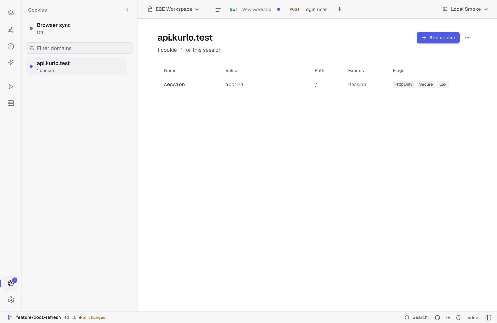

import DocsTopicIndex from "../../../../components/DocsTopicIndex.astro";

Kurlo keeps a per-workspace cookie jar, similar to a browser. Cookies received from `Set-Cookie` are stored locally and attached to future matching requests unless that request disables the jar.

<DocsTopicIndex />
