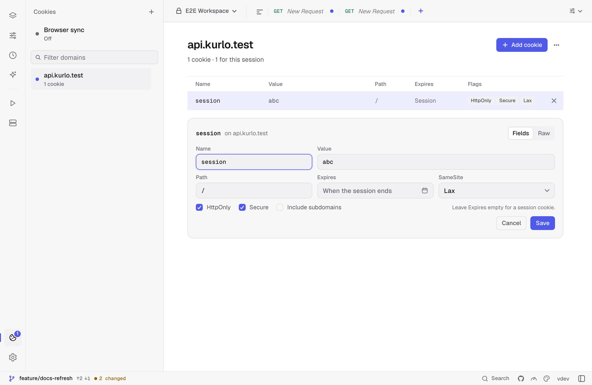

## Managing cookies

Open cookies from the cookie icon at the bottom of the activity rail, on the far left of the window. Cookies work like environments: the sidebar lists **Browser sync** and every domain in the jar, and the main area shows the domain you pick, with its cookie count, how many last only for this session and how many have expired. Click a request tab to go back to your request.

- **Find a domain** with the filter above the list. A yellow dot and *some without a value* under a domain mean one of its cookies has no value on this computer.
- **Add a domain** with **+** next to the **Cookies** heading; Kurlo opens a new cookie for it straight away. When the jar is empty, the main area offers to add a cookie for the domain of the open request or any domain you type.
- **Read cookies at a glance.** The table shows each cookie's value, path, when it expires and its flags: HttpOnly, Secure, SameSite and Subdomains for cookies sent to subdomains as well. Expired cookies are struck through.
- **Cookies from another computer.** A cookie created on another machine keeps its value in that machine's Kurlo profile, and the workspace files only reference it. Kurlo shows such a cookie with an empty value marked *Not on this computer*, in the **Raw** editor too, and does not send it. Type the value and save to use it here; saving without a value keeps the reference.
- **Set when a cookie expires** with the **Expires** field: pick a day in the calendar, type the time, or choose **In 1 hour**, **Tomorrow**, **In 7 days** or **In 30 days**. The arrow keys move between days and `Escape` closes the calendar. **Clear** turns the cookie back into a session cookie.
- **Edit a cookie** by clicking its row. The editor opens under the table; `Cmd/Ctrl Enter` or **Save** stores the change and `Escape` closes the editor without saving.
- **Delete** one cookie with the cross at the end of its row. The **•••** menu next to **Add cookie** deletes every cookie of the domain, clears the whole jar, or reloads the jar from disk.



The editor has two modes:

- **Fields** — name, value, path, expiry date, SameSite, HttpOnly, Secure and **Include subdomains**. Leave **Expires** empty for a session cookie.
- **Raw** — the cookie as `Set-Cookie` text, for pasting from DevTools or a server log:

```text
session=abc123; Path=/; Secure; HttpOnly; SameSite=Lax
```

Switching modes carries the cookie across, and both follow the same rules: `SameSite=None` needs **Secure**, and a name cannot contain spaces, `=` or `;`. A `Domain=` attribute in Raw mode moves the cookie to that domain and makes it apply to subdomains.

## Disabling the jar for one request

Open the request **Settings** tab and turn off **Use the cookie jar**. Kurlo will not store cookies from that response and will not attach jar cookies to that request.

You can still send a manual cookie:

```text
Cookie: debug=true; session=manual
```

This is useful when reproducing a production request exactly from a copied cURL command.
