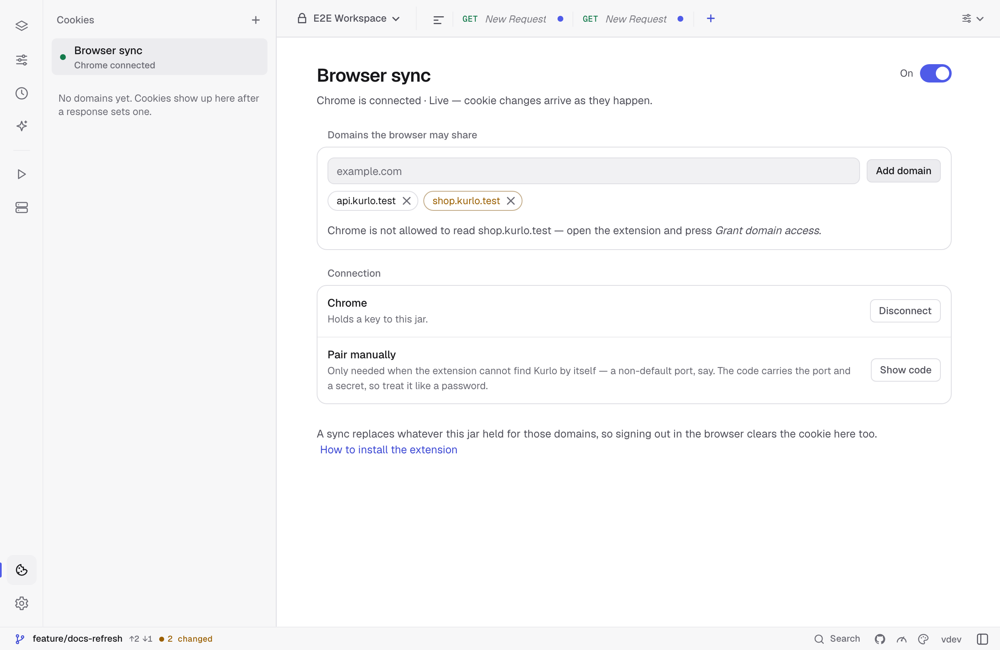

## What a sync does to the jar

Once connected, the extension holds an open WebSocket to Kurlo, and the two directions of
traffic are:

- **Live changes.** Every cookie the browser sets, updates or clears for an allowlisted
  domain is pushed as it happens, so a fresh login shows up in Kurlo within a second.
- **Reconciliation.** On connect and every five minutes the extension sends a full snapshot
  of the allowlisted domains. A snapshot is authoritative: Kurlo replaces everything the jar
  held for those domains, which is how a cookie you cleared while the browser was closed
  disappears here too. Domains the snapshot does not cover are left alone.
- **Allowlist updates.** Add or remove a domain in Kurlo and the extension is told
  immediately — no polling, and removing a domain stops it being read at once.

A cookie you typed by hand for a synced domain is replaced by the browser's view of it.

Cookies land in the jar of the workspace you have open, and follow you when you switch
workspaces. The bridge closes when Kurlo quits and reopens on the next start if you left it
on; the token is kept, so the browser reconnects on its own.

**Disconnect** mints a new token, which drops the browser immediately. Kurlo tells the
extension that this is what happened, so it drops its own token and asks to connect again
rather than retrying with a key that no longer works. The extension's **Forget** does the
same from the other side.

## When it will not sync

- **Nothing on the allowlist.** The extension is told there is nothing to read.
- **Permission not granted.** The extension reports only the domains it could actually
  read, so a domain it cannot read is left out of the snapshot instead of looking empty and
  clearing the jar. Kurlo marks those domains on the page and names them, rather than leaving
  you to wonder why nothing arrives.
- **Kurlo is closed or sync is off.** The extension retries with a backoff and reconnects
  when the bridge comes back.
