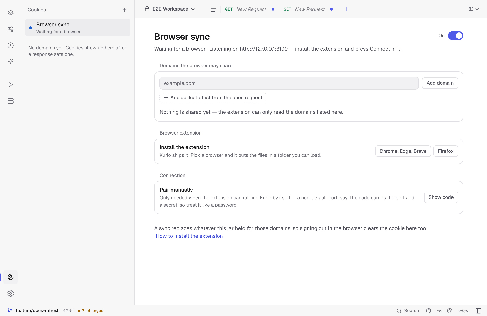
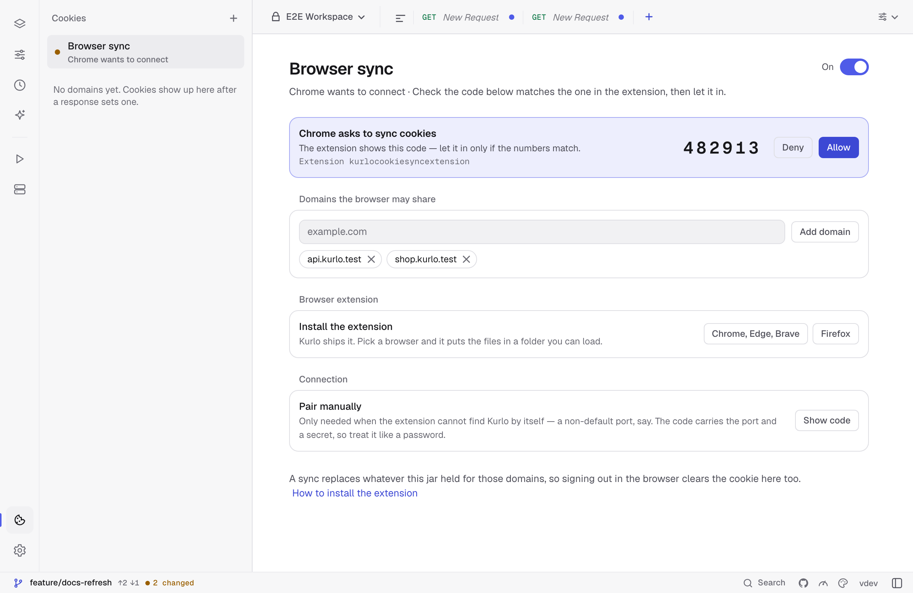

## Sync cookies from your browser

**Browser sync**, at the top of the cookie sidebar, pairs Kurlo with a browser extension, so a session you already
have in Chrome, Edge, Brave or Firefox is the session Kurlo sends with. It is the local
answer to copying a `Cookie:` header out of DevTools after every login.

Cookies flow one way — browser into Kurlo — and three separate gates stand in front of
them:

1. **The bridge has to be on.** The switch at the top of the **Browser sync** page opens a listener bound to `127.0.0.1` (port 3199
   by default). Nothing listens until you ask for it.
2. **You have to let the browser in.** The extension finds Kurlo by itself and asks to
   connect; Kurlo shows the request with a six-digit code and the extension shows the same
   code. Approve it only if the numbers match — that is what stops anything else on the
   machine from being approved in its place.
3. **The domain has to be allowlisted twice.** Kurlo only accepts cookies for the domains
   listed on the page, and the browser only lets the extension read the domains you grant in
   its popup. A domain missing from either list is never read and never sent.

A domain that cannot hold cookies of its own — a public suffix like `com` or `co.uk` — is
refused with an explanation rather than accepted and quietly ignored.
