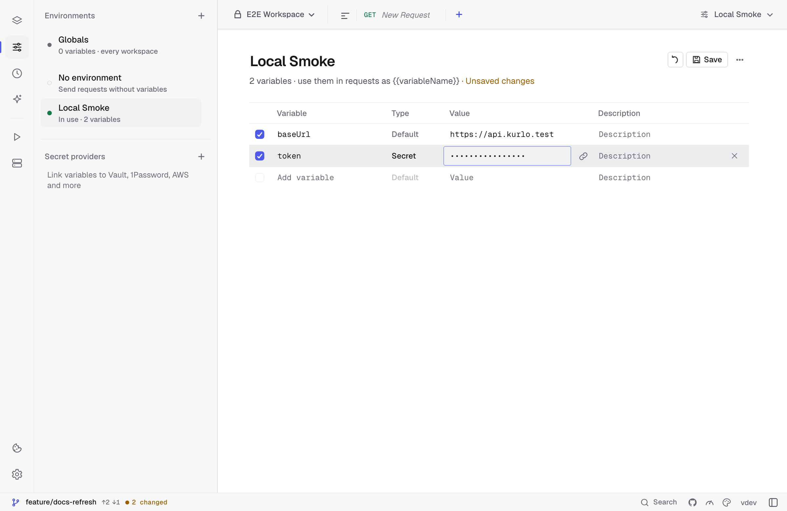

import DocsTopicIndex from "../../../../components/DocsTopicIndex.astro";

Variables in Kurlo use the `{{name}}` template syntax. They expand in URLs, headers, query params, request bodies, and auth fields just before send.

Edit the environment name directly in the editor, or double-click its name in the sidebar. `F2` or **Rename** in the editor’s **•••** menu focuses the name field. Press `Enter` or click elsewhere to apply the name; `Escape` cancels the edit. With [manual save](/docs/guides/environments/global/#manual-save-vs-autosave), the new name is saved with the environment's other edits. A name can be up to 100 characters; a long one is shortened with **…** in the sidebar, the environment picker and the Matrix.

<DocsTopicIndex />
