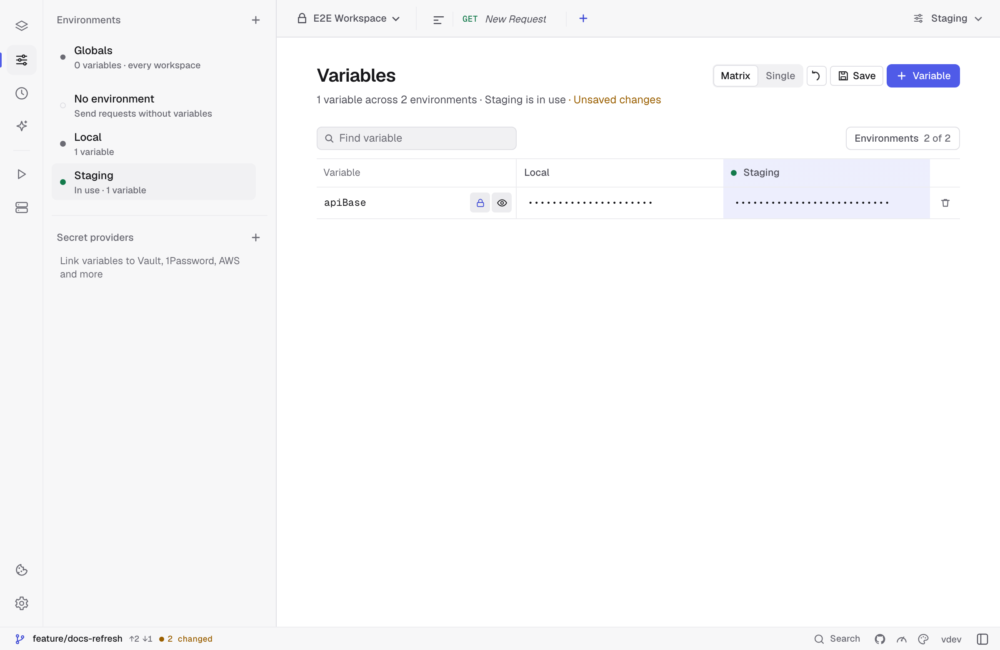
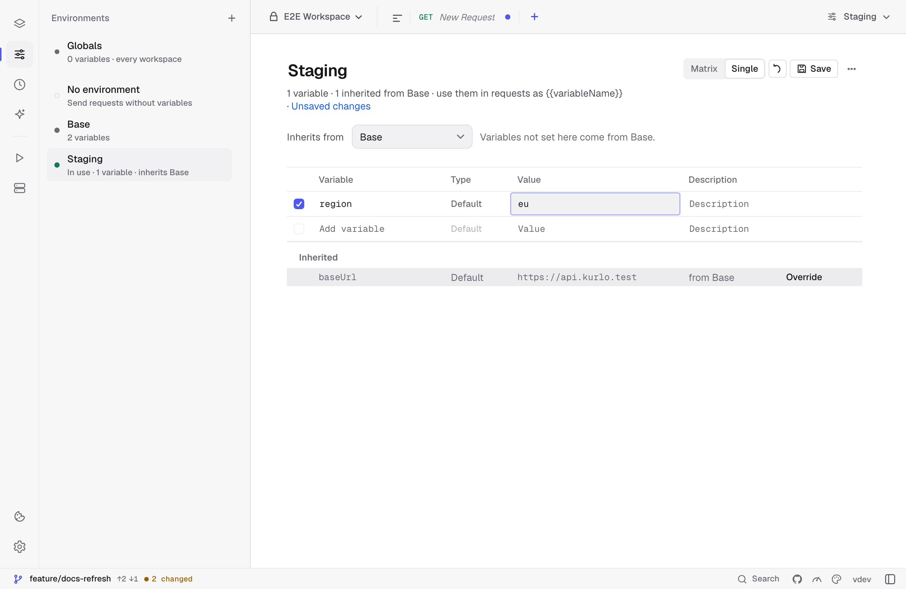

## Comparing environments

An environment opens on its own page with only its variables. With two or more environments, the page also has a **Matrix** view: every variable of the workspace as a row, environments as columns, the one in use highlighted. It answers "what is `baseUrl` in staging?" and "which environment is missing a token?" without opening each environment.

- Type in a cell to change that environment's value. A cell that says *Not set* has no such variable in that environment; click it to set one.
- Rename a variable in its row and it is renamed in every environment.
- The lock marks a variable secret everywhere — masking it in one environment and showing it in another would leak it anyway. The eye shows the values while you look.
- **+ Variable** adds a variable to every environment at once, empty; the bin removes it from all of them.
- **×** in a cell removes the value from that environment only, and the cell goes back to *Not set* or to the inherited value. It shows only while another environment still sets the variable — to delete the last one, use the bin.
- The Matrix shows the environment in use and up to four more. **Environments** above the table picks which ones to compare, with a search for long lists; **Show all** adds every environment and **Reset** goes back to the first five. Kurlo remembers the choice for each workspace.
- The variable names stay on the left while you scroll across the columns.
- Click an environment's name to open it on its own. **Single** switches back to one environment at a time; Kurlo remembers which view you used.

## Inheriting from another environment

Environments often share most of their variables and differ in a few: staging and production use the same paths and client ID but different hosts and tokens. Instead of copying the shared ones into each, keep them in one environment, say *Base*, and let the others inherit from it.

Open an environment and pick its parent under **Inherits from**. A variable the environment does not set itself is taken from its parent, and from the parent's parent after that; the nearest one that sets it wins. Requests, the collection runner, load tests, the CLI and [`kurlo mcp`](/docs/guides/mcp-server/) all resolve variables this way.

- The **Inherited** list under the variables shows what comes from the parent and from where. **Override** copies a value into this environment so you can change it there.
- In the **Matrix**, a cell the environment does not set shows the inherited value in grey with the name of the environment it comes from. Click it to set a value of its own. The column header shows the parent.
- A script that calls `pm.environment.set` writes to the environment in use, never to its parent. `pm.environment.unset` removes the environment's own value, so the inherited one applies again.
- **+ Variable** adds the new variable only to environments that inherit from nothing; the others pick it up from them.
- An environment under a protected one is protected too.
- Deleting a parent moves the environments that inherited from it up to the parent's own parent, or leaves them on their own.
- Postman has no inheritance, so **Export…** writes the environment with the inherited values included.

The parent is saved as `parentId` in the environment's file.

## Importing a .env file

To copy variables from an existing `.env` file, open an environment and choose **Import .env** in its **•••** menu. The file picker shows hidden files, so `.env` and `.env.local` are listed; pick one from any folder.

Each `KEY=value` line becomes a variable in the environment, and a variable that already exists takes the value from the file. `export` prefixes, `#` comments and quoted values are understood. The values are copied once: later edits to the file do not reach Kurlo, so import it again after changing it. Mark the imported tokens and passwords as **Secret** so they stay out of the workspace files.

## Switching environments

Use the environment switcher in the title bar. The active environment is per-workspace — switching to a different workspace remembers its last-used environment.

When a workspace has more than eight environments, the switcher opens with a search field: type part of a name and press Enter to switch to the first match. The list scrolls, and **Manage environments** stays at the bottom.
