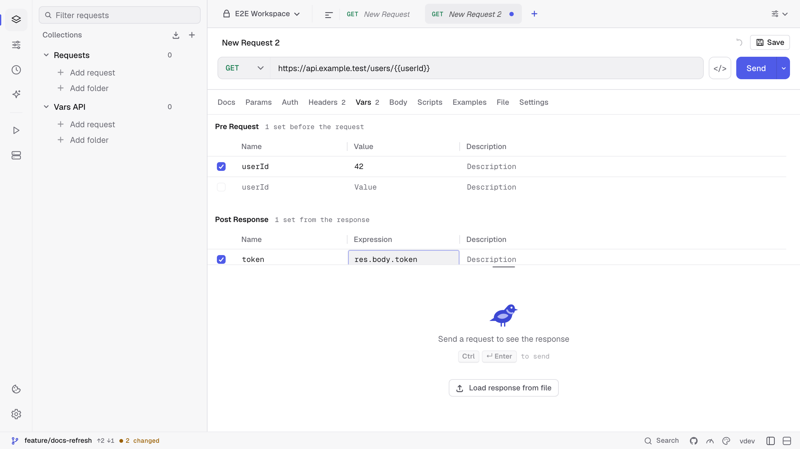

The **Vars** tab of a request holds variables that belong to that request only. It has two tables, as in Bruno.

**Pre Request** variables are set before the request is sent. They win over environment, collection and global values with the same name, so a request can pin `userId` or `page` without touching the shared environment. A value may use other variables: `{{tenant}}-eu` takes `tenant` from the environment, and a variable named after an environment value, such as `region = {{region}}-backup`, extends that value instead of referring to itself. Rows lower in the table can use the rows above them. Scripts read them with `pm.variables.get(...)` and `pm.variables.replaceIn(...)`.

**Post Response** variables are filled from the response once it arrives, before the post-response script and the tests run. The value column holds a JavaScript expression with `res` in scope:

| Expression | Value |
|---|---|
| `res.body.token` | A field of the JSON body. The body is the text when it is not JSON. |
| `res('data.items[0].id')` | The same with a path string. |
| `res.status`, `res.statusText` | The status code and text. |
| `res.getHeader('x-request-id')` | A header; `res.headers` has all of them with lowercase names. |
| `res.responseTime` | The time in milliseconds. |

The result is stored like `pm.variables.set(...)`: a global that later requests and runs can use with `{{token}}`. Strings are stored as they are and other values as JSON. An expression that fails or returns `undefined` leaves the variable unchanged and writes a line to the console. Post Response variables run for HTTP and GraphQL requests, in the app, the [Collection Runner](/docs/guides/collection-runner/), [`kurlo run`](/docs/guides/cli-runner/) and [`kurlo mcp`](/docs/guides/mcp-server/). Other request types show only the Pre Request table.

Both tables are saved in the request's YAML file as `vars` and `postResponseVars`.
