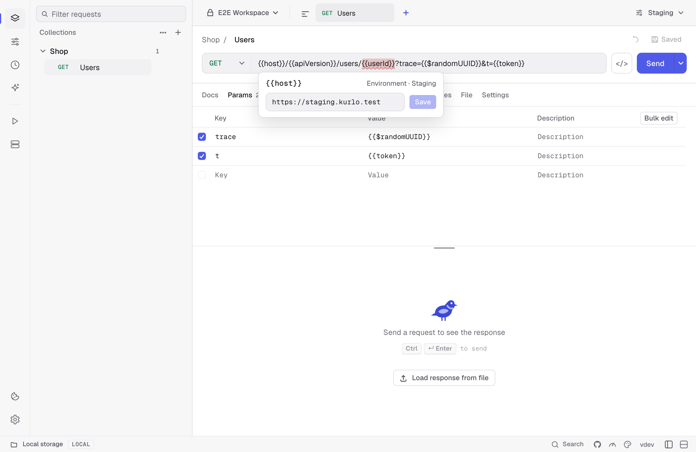

## Scopes

A name is looked up in five scopes; when the same name exists in several, the later one in this list wins:

1. **Globals** — **Environments → Globals**, plus values scripts write with `pm.globals.set(...)` or `pm.variables.set(...)`.
2. **Collection variables** — defaults saved with the collection.
3. **Active environment variables** — the selected environment for the workspace.
4. **Request variables** — the request's [**Vars**](/docs/guides/environments/request-variables/) tab.
5. **Data row** — the current row of a data file in the [Collection Runner](/docs/guides/collection-runner/) or [`kurlo run --data`](/docs/guides/cli-runner/data/#data-driven-runs).

If nothing matches, the literal `{{name}}` is left untouched so the unresolved template is visible.

### Check a variable from a field

Hover over a `{{variable}}` in the URL, a header, a parameter, the body (including the Raw editor) or an auth field to see its value and the scope it comes from, such as **Environment · Staging** or **Collection · Shop**. A variable an environment inherits shows the environment that sets it.



- Change the value in the card and press **Save** or Enter. The new value is saved in that scope. When a scope has several enabled rows with the same name, the card edits the last one, which is the one a request uses. If the change cannot be written, the card says **Not saved**.
- Clear the value and press **Remove** to delete the variable from that scope. If another scope has the same name, the card switches to it.
- A variable no scope defines is underlined in red. Its card has **Add to** with the active environment, or **Globals** when no environment is selected, for any name without spaces.
- Secret values stay masked. Values linked to a [secret manager](/docs/guides/environments/secret-managers/) are read-only in the card.
- [Dynamic variables](/docs/guides/environments/dynamic-variables/) such as `{{$randomUUID}}` show what they generate and an example.

Press Escape or move the pointer away to close the card. Clicking inside a variable opens the list of variable names instead.

A name may contain any character except `{` and `}` — letters from any alphabet, spaces and colons included — and spaces around it are ignored, so `{{токен}}`, `{{api key}}` and `{{ token }}` all work.

### Values written by a pre-request script

A pre-request script runs before the templates are filled in for good. When it stores a value — `pm.environment.set("token", ...)`, `pm.collectionVariables.set(...)`, `pm.globals.set(...)` — every `{{token}}` in the same request already uses the new value. The script itself still sees the request as it was resolved before it ran, and edits it makes through `pm.request` are kept.

### Variables built from other variables

A value may itself contain `{{...}}`, and Kurlo keeps resolving until nothing changes:

```
scheme  = https
host    = api.example.com
baseUrl = {{scheme}}://{{host}}
```

A request pointed at `{{baseUrl}}/users` goes to `https://api.example.com/users`. This is the usual way to keep one place to edit when a whole collection moves to staging.

Resolution stops after 20 rounds. A chain that refers back to itself — `a = {{b}}`, `b = {{a}}` — keeps its braces rather than looping, so the send fails with an unresolved-variable message pointing at the real culprit.
