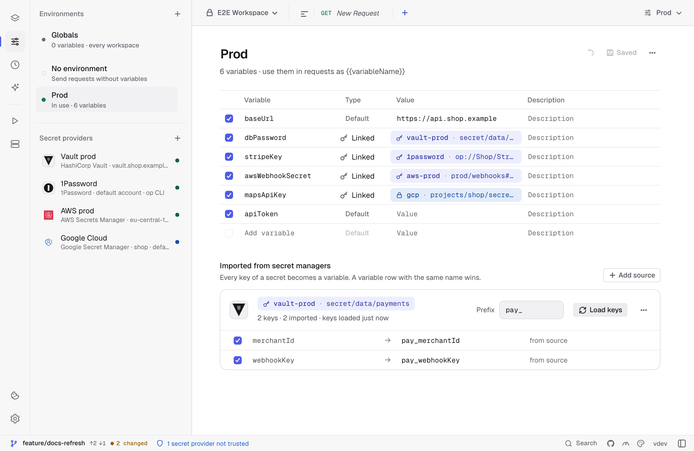
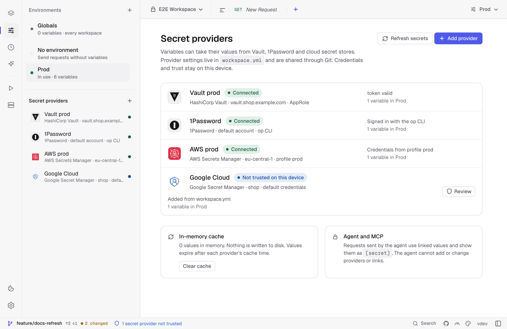
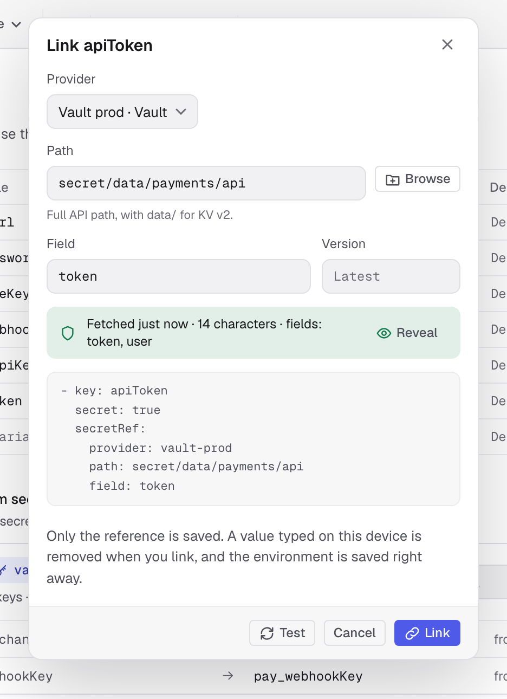

An environment variable can take its value from a secret manager instead of storing it. The environment file keeps only a reference. Kurlo fetches the value when you send a request, keeps it in memory and shows it as `[secret]` in responses, history, script logs and test names.



Supported providers:

| Provider | How Kurlo reads it | Where credentials come from |
|---|---|---|
| HashiCorp Vault and OpenBao | HTTP API: KV v1 and v2, dynamic secrets | A token saved on this device, `VAULT_TOKEN` or `~/.vault-token`; AppRole with a `secret_id` saved on this device or in `VAULT_SECRET_ID`; LDAP or userpass with a password saved on this device or in `VAULT_PASSWORD`; Kubernetes auth with the pod's service account; or OIDC sign-in in the browser |
| 1Password | The `op` CLI | The 1Password app on this computer, or a service account token saved on this device |
| AWS Secrets Manager and Parameter Store | AWS API | Keys saved on this device, `AWS_ACCESS_KEY_ID`, the profile in `~/.aws/credentials`, or `aws configure export-credentials` for SSO profiles; optionally an assumed role with MFA |
| Google Secret Manager | Google Cloud API | A service account key saved on this device or in `KURLO_GCP_SERVICE_ACCOUNT_KEY`, `GOOGLE_APPLICATION_CREDENTIALS`, application default credentials, or `gcloud auth print-access-token` |
| Azure Key Vault | Azure API | The Azure CLI (`az login`), or an app registration with a client secret saved on this device or in `AZURE_CLIENT_SECRET` |
| Bitwarden Secrets Manager | The `bws` CLI | A machine account access token saved on this device or in `BWS_ACCESS_TOKEN` |
| Doppler | Doppler API | A token saved on this device, `DOPPLER_TOKEN`, or the signed-in `doppler` CLI |
| Infisical | Infisical API | A token saved on this device or in `INFISICAL_TOKEN`, or a machine identity (universal auth) with its client secret saved on this device or in `INFISICAL_UNIVERSAL_AUTH_CLIENT_SECRET` |
| Command | Any program you choose, such as `pass` | Whatever the program uses |
| Environment variables | The environment of the Kurlo process | Nothing to sign in to |

Kurlo calls the services over their HTTP APIs or their official CLIs. It finds the CLIs in `PATH` and in the usual install folders, such as `/opt/homebrew/bin` on macOS and `Program Files`, `AppData\Local` and the WinGet links folder on Windows, so `op`, `aws`, `az` and `gcloud` work even when Kurlo was started before they were added to `PATH`. Google application default credentials are read from `CLOUDSDK_CONFIG` when it is set, otherwise from `%APPDATA%\gcloud` on Windows and `~/.config/gcloud` elsewhere. Paths in provider settings may start with `~/`, or `~\` on Windows.

## Add a provider

1. Open **Environments** in the sidebar and click **+** next to **Secret providers**.
2. Choose the provider type and fill in its address, account, region or project.
3. Click **Save**, then **Test connection**.

The form checks each field before saving and shows what to fix under it: a missing address or region, a URL without `https://` or with a user name and password in it, an AWS region or Google Cloud project in the wrong form, an Azure client ID that is not a GUID, an ID another provider already uses, or a timeout outside 1 second to 10 minutes. Credentials are checked too: tokens cannot contain spaces, and a Google Cloud key must be the whole JSON key file.

Provider settings are saved in `workspace.yml`, so a Git workspace shares them with your team. Tokens and keys you enter under **On this device** are stored only on this computer, encrypted like other local secrets. Each person signs in on their own device.



## Link a variable

Hover a variable row in an environment and click the link icon next to its value. Choose the provider and enter the path:

- Vault: the API path, for example `secret/data/app` for KV v2, and the key in **Field**.
- 1Password: `op://Vault/Item/field`, or `op://Vault/Item` with the field label in **Field**. When several sections use the same label, choose the section-qualified field in **Browse**.
- AWS: the secret name or ARN, or the parameter name. For a JSON secret, put the key in **Field**. AWS Secrets Manager accepts a version ID or staging label such as `blue-green` in **Version**.
- Google Secret Manager: the secret name, or `projects/<project>/secrets/<name>` for another project. **Version** is a version number; without it Kurlo reads `latest`.
- Azure Key Vault: the secret name. **Version** is a version id.
- Bitwarden: the secret id or its name. For `projects/<project id>`, put the secret name in **Field**.
- Doppler: `project/config` with the secret name in **Field**, or `project/config/NAME`.
- Infisical: the environment slug and an optional folder, such as `prod/backend`, with the secret name in **Field**.
- Command: the path the command receives as `{path}`.
- Environment variables: the variable name.

For a JSON value, put the key in **Field** with any provider.

You can also paste a reference copied from the provider into **Path**. Kurlo recognizes it, picks the matching provider and fills in the path, field and version:

| Paste | Becomes |
|---|---|
| `op://Payments/Stripe/credential` | 1Password reference |
| `arn:aws:secretsmanager:eu-central-1:123456789012:secret:prod/db-AbCdEf` | AWS Secrets Manager secret, on the provider in that region |
| `arn:aws:ssm:eu-central-1:123456789012:parameter/prod/api-key` | Parameter `/prod/api-key` |
| `projects/my-project/secrets/db/versions/3` | Google secret `projects/my-project/secrets/db`, version `3` |
| `https://team.vault.azure.net/secrets/db-password/0b1c…` | Azure secret `db-password` and its version, on the provider for that vault |
| `https://vault.example.com/v1/secret/data/app` or a Vault UI link | Vault path `secret/data/app`, on the provider with that address |

Add `#key` to the end of any of them to fill **Field**. If no provider matches, Kurlo says which one to add.

**Browse** lists what the provider can show you: Vault mounts, folders and secrets, 1Password vaults, items and fields, AWS secrets and parameters, Google and Azure secrets, Bitwarden projects and secrets, Doppler projects, configs and secret names, and Infisical environments, folders and secret names. Click an entry to use it, or **Open** to go inside. Browsing shows names only, and needs the provider to be trusted. Vault lists the paths its policy permits. Google Cloud and Azure check the permission to list secrets when you click **Test connection**. If listing is forbidden, enter a known path and click **Test** on the link to check read access.

Click **Test** to fetch the secret without showing it. Kurlo reports its length and the fields it has. **Reveal** shows the value for 30 seconds. **Link** replaces the value with the reference and saves the environment right away.



A linked row shows **Linked** and the reference instead of a value. Click the reference to change or unlink it. Inherited environments and `{{name}}` suggestions show where the value comes from.

## Import a whole secret

To turn every key of a secret into variables, open the environment and click **Add source** under **Imported from secret managers**. Choose the provider and the secret: a Vault KV secret, a 1Password item (`op://Vault/Item`), a JSON secret in AWS, Google Cloud or Azure, a Bitwarden project (`projects/<project id>`), a Doppler config (`project/config`) or an Infisical folder (`prod/backend`). **Browse** helps you find it. **Prefix** is added before each key, so `db_` turns `password` into `db_password`. **Load keys** reads the current field names from the provider each time you click it.

The source lists each key and the variable it becomes. Clear a key's checkbox to skip it. A key is marked when something else wins:

- **The variable row wins:** the environment, or one it inherits from, has a row with that name.
- **… wins:** a later source in the same environment imports the same name.
- **Not in the secret:** the key is listed in the file but the secret no longer has it.

Kurlo keeps the key names, not the values, on this device so `{{name}}` suggestions and sends work before you open the provider again. Another person sees **Keys are not loaded on this device yet** until they click **Load keys**. Sources are saved in the environment file as `secretSources`; see the [environment reference](/docs/reference/kurlo-yaml-format/environment/).

A value a script sets for an imported variable lasts for the session and is not saved.

## Trust on this device

A provider from a cloned or pulled workspace is not trusted until you review it. Until then, Kurlo sends no credentials to it, and requests that use its variables are not sent. Kurlo asks again when the address, namespace, account, region, profile, project, command or sign-in method changes. Providers you add or edit in Kurlo are trusted on your device right away.

Open the provider and click **Review and trust**, or **Revoke trust** to stop using it on this device.

## Vault sign-in methods

- **Token** reads a token saved on this device, then `VAULT_TOKEN`, then `~/.vault-token`.
- **AppRole** logs in with the role ID from `workspace.yml` and a `secret_id` from this device or `VAULT_SECRET_ID`.
- **Kubernetes** logs in with the service account token of the pod Kurlo runs in, by default `/var/run/secrets/kubernetes.io/serviceaccount/token`. Use it for `kurlo run` inside a cluster.
- **LDAP** and **Userpass** log in with a user name and password. Leave **User name** empty in the form so each person saves their own under **On this device**; the CLI reads `VAULT_USERNAME` and `VAULT_PASSWORD`.
- **OIDC** opens your browser to sign in with your identity provider. Add the redirect URI, `http://localhost:8250/oidc/callback` by default, to `allowed_redirect_uris` of the Vault role. The token stays in memory until Kurlo quits or you clear the secret cache. The CLI cannot sign in this way.

## AWS roles and MFA

To read secrets as another role, enter its **Role ARN**. Kurlo signs in with your usual AWS credentials, calls `AssumeRole` and uses the role for one hour. Add an **External ID** if the role's trust policy asks for one.

If the role requires MFA, enter your **MFA device** ARN. Kurlo then shows an **MFA code** field under **On this device**: type the six digits and click **Save**. The code is used once to start the session and is never stored. When the hour ends, or after **Refresh secrets**, Kurlo asks for a new code. In the CLI, set `AWS_MFA_CODE`.

```yaml
secretProviders:
  - id: payments
    type: aws-secrets-manager
    region: eu-central-1
    roleArn: arn:aws:iam::123456789012:role/payments-read
    mfaSerial: arn:aws:iam::123456789012:mfa/ada
```

## Permissions each provider needs

Give Kurlo read access only. **Test connection** and **Browse** need the listing rights; reading linked values needs only the read rights.

| Provider | Read a value | Browse |
|---|---|---|
| Vault | `read` on the secret path, for KV v2 `<mount>/data/<path>` | `list` on `<mount>/metadata/*`, `read` on `sys/internal/ui/mounts` |
| 1Password | Read access to the vault, for a service account | The same |
| AWS Secrets Manager | `secretsmanager:GetSecretValue`, and `kms:Decrypt` for a customer-managed key | `secretsmanager:ListSecrets` |
| AWS Parameter Store | `ssm:GetParameter`, and `kms:Decrypt` for `SecureString` | `ssm:DescribeParameters` |
| AWS role | `sts:AssumeRole` on the role for your base credentials | — |
| Google Secret Manager | `roles/secretmanager.secretAccessor` | `roles/secretmanager.viewer` |
| Azure Key Vault | `Key Vault Secrets User` role, or a `get` secret access policy | `list` secret access policy |
| Bitwarden | Read access to the project for the machine account | The same |
| Doppler | A read-only service token for the config, or a personal token | A personal or workplace token |
| Infisical | Viewer role on the project for the machine identity | The same |

## Command provider

A `command` provider runs a program and uses what it prints as the value, without the trailing newline. Use it for `pass`, `gopass`, `security` on macOS or a helper your company provides. `{path}` and `{version}` in the arguments are replaced with the reference; without `{path}`, the path is added as the last argument. Kurlo starts the program directly, without a shell. If the program prints JSON, pick a key with **Field**.

```yaml
secretProviders:
  - id: pass
    type: command
    command: [pass, show, "{path}"]
```

Because it runs a program on your computer, a command provider from a cloned workspace never runs until you trust it, and the CLI runs it only with `--allow-secret-commands`.

## When a value cannot be fetched

Kurlo never sends a request with an empty secret. If a linked variable the request uses cannot be resolved, the response area lists each one with the reason and a button that fixes it: **Sign in**, **Review**, **Open provider** or **Edit link**. **Retry** clears the cache and sends again. Linked variables the request does not use do not block it.

The **Response time** breakdown shows how long Kurlo spent fetching linked secrets.

## Cache

Fetched values stay in memory for five minutes by default. Change it per provider under **Cache**: 1 minute, 5 minutes, 15 minutes, the whole session, or **Custom** with any duration up to 24 hours, such as `2h`. A longer time means fewer calls to the provider; it does not use more memory, because Kurlo keeps one copy of each value either way. Vault dynamic secrets expire earlier when their lease ends. **Refresh secrets** on the providers page or in the command palette clears the cache.

## Scripts

Scripts read a linked value with `pm.environment.get("name")`. Kurlo fetches it only when the name appears in the script as a string. A linked value a script copies into another variable is stored as `[secret]`.

Scripts written for Postman Vault work too: `await pm.vault.get("name")` returns the value of the variable `name`, linked or not, and `await` can be used at the top level of a script. `pm.vault.set` and `pm.vault.unset` fail with a message, because Kurlo changes secrets only in the secret manager.

## In the Collection Runner

The Runner checks linked secrets for the selected requests before sending the first one. If a required link fails or returns an empty value, the run stops before sending any request. Correct the link or update the value at the provider, then start the run again.

## In the CLI and CI

`kurlo run` fetches the linked variables that the selected requests use before it sends the first request. Values are masked as `[secret]` in the terminal output and in JSON and JUnit reports, and `--export-environment` leaves them out.

The CLI uses the credentials of the machine it runs on: `VAULT_TOKEN` or `~/.vault-token`, `VAULT_SECRET_ID` for AppRole, `VAULT_USERNAME` and `VAULT_PASSWORD` for LDAP and userpass, the pod's service account for Vault Kubernetes auth, `OP_SERVICE_ACCOUNT_TOKEN` or the signed-in `op` CLI, the standard AWS variables, profiles and SSO, with `AWS_MFA_CODE` for a role that needs MFA, `KURLO_GCP_SERVICE_ACCOUNT_KEY` with the key file contents, `GOOGLE_APPLICATION_CREDENTIALS` or `gcloud`, `az login` or `AZURE_CLIENT_SECRET`, `BWS_ACCESS_TOKEN`, `DOPPLER_TOKEN`, and `INFISICAL_TOKEN` or `INFISICAL_UNIVERSAL_AUTH_CLIENT_SECRET`. Tokens saved in the app are not read. The CLI does not ask you to trust providers: running it is the decision. The one exception is a `command` provider, which runs only with `--allow-secret-commands`.

To move credentials you already saved in the app to CI, open the provider, click **•••** and choose **Export for CI…**. Kurlo lists the variables the CLI reads for this provider and saves them to a `.env` file that only you can read. Credentials you did not save in the app are left empty for you to fill in. The file holds secrets in plain text: add each line as a CI secret, or load the file in the job with `set -a; . ./vault.ci.env; set +a`, and delete it afterwards. Keep it out of Git.

If a value cannot be fetched, the run stops with exit code `2` and lists each variable, its reference and the reason. Nothing is sent.

When you import a whole secret, a template such as `{{db_token}}` or a script lookup such as `pm.environment.get('db_token')` makes the CLI look up the matching field. Explicit environment variables and CLI overrides take precedence. With `--secret-providers=off`, supply any referenced name that matches the import prefix using `--var` or `--env-file`. Selecting individual keys tells the CLI exactly which names the source provides.

| Flag | Meaning |
|---|---|
| `--var name=value`, `--env-file` | Use this value and skip the provider for this variable. |
| `--secret-providers=off` | Do not contact providers. Every linked variable the run uses needs `--var` or `--env-file`. |
| `--secret-timeout 30s` | Time limit for each provider call, instead of the provider's own setting. |
| `--allow-secret-commands` | Let `command` providers run their program. Without it, variables linked to them stop the run. |

In GitHub Actions, sign in to the provider in an earlier step and Kurlo picks up the credentials:

```yaml
- uses: hashicorp/vault-action@v3
  with:
    url: https://vault.example.com
    method: jwt
    role: ci
    exportToken: true
- run: npx -y @kurlo/cli run ./workspace --env Prod --reporter junit > results.xml
```

For AWS, use `aws-actions/configure-aws-credentials`; for Google Cloud, `google-github-actions/auth`; for Azure, `azure/login`. For 1Password, Bitwarden, Doppler and Infisical, set `OP_SERVICE_ACCOUNT_TOKEN`, `BWS_ACCESS_TOKEN`, `DOPPLER_TOKEN` or `INFISICAL_TOKEN` from a repository secret, and install the `op` or `bws` CLI where needed.

## Load tests

A load test run from Kurlo or with `kurlo load run` fetches linked values before it starts k6 and passes them through the process environment, as it does for other secrets. An exported k6 script never contains them, even with **Include secrets** or `--inline-secrets`: it reads them from `__ENV`, so pass them with `k6 run -e name=…`.

## AI agents and MCP

Requests that AI agents send through Kurlo use linked values and get `[secret]` in their place. `list_environments` shows a linked variable as `[secret from <provider>]` and lists imported secrets under `importedFrom`. Agents cannot add or change providers, links, sources or linked variables: `set_variable`, `patch_environment` and `apply_changes` refuse them.

`kurlo mcp` fetches linked values only for the workspace the app has open, with the trust and tokens you set up in the app. For any other workspace folder it stops with an error, and the agent can pass the value in `variables`.

## Postman Vault

Postman collections and environments can refer to Postman Vault as `{{vault:name}}`. Kurlo reads `{{vault:name}}` as the variable `name`, with any provider, everywhere a `{{variable}}` works: URL, params, headers, body, auth, scripts' `pm.variables.replaceIn`, the Collection Runner, `kurlo run`, load tests and AI agents. An imported collection keeps these references and lists them after the import: add a variable with each name to an environment and link it to a provider. Scripts that call `pm.vault.get("name")` keep working without changes.

Type `{{` and Kurlo offers `vault:` when the environment has secret variables. After `{{vault:`, the list shows only linked and secret variables, linked ones first, with the provider they come from. A `{{vault:name}}` that no variable matches is underlined like any undefined variable. If a variable is itself named `vault:name`, it wins.

Exported environments contain linked variables as secrets with empty values.
