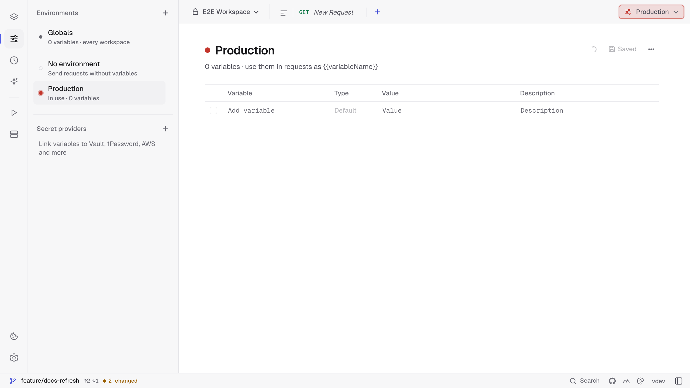

## Secret variables

Mark a variable as **secret** in the environment editor — its value is masked in the UI and excluded from collection exports. Useful for tokens and keys.

## Deleting an environment

Choose **Delete** in the environment's **•••** menu. Children that inherit from it move to its parent, and collections unpin it. Click **Undo** in the message that follows, or use the trash button in the **Environments** header until you quit Kurlo, to bring it back with its children and pins. See [Restoring deleted items](/docs/guides/workspaces/starred/#restoring-deleted-items).

## Coloring an environment

Give an environment a color so you notice which one is in use, for example red for production. Open the environment, click **•••** and pick a color under **Color**: red, amber, green, blue or gray. **No color** removes it.

The color tints the environment switcher in the title bar while that environment is in use and marks it in the environment list, the switcher menu and the **Matrix** column header. The colors follow the active theme. The color is saved in the environment file as `color`, so a Git-backed workspace shares it with your team, and `kurlo mcp` lists it, so a connected assistant can tell which environment is marked.

## Protecting an environment from AI agents

Choose **Protect from AI agents** in an environment's ⋯ menu to keep assistants connected through [`kurlo mcp`](/docs/guides/mcp-server/permissions/#protected-environments) away from it. They can still see that it exists, but they cannot send requests with it or change its variables. The environment shows a **Protected** badge, and the mark is saved in its file, so a Git-backed workspace shares it with your team. Use it for production.

## Sandbox environments for the agent

Choose **Sandbox for the agent** in an environment's ⋯ menu for an environment that points at disposable data, such as a local stack or a test tenant. The Kurlo agent then sends every request with it without asking, including `POST`, `PUT`, `PATCH` and `DELETE`. The environment shows a **Sandbox** badge and the mark is saved in its file. A protected environment cannot be a sandbox. See [What the agent may do without asking](/docs/guides/agent/approvals/#what-it-may-do-without-asking).
