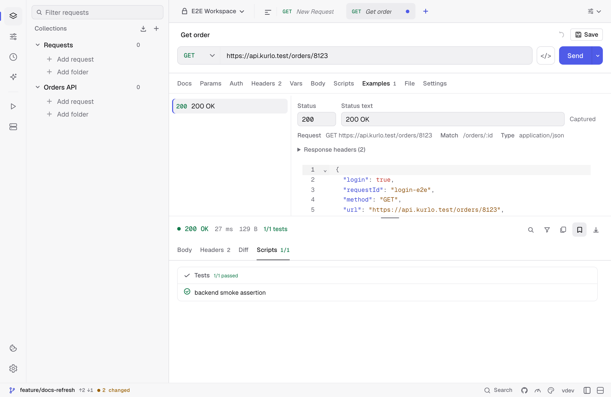

## Saving an example

Send a request, then in the response panel use **Save as example**. The name defaults to the status code; rename it to what the case actually is — `Empty list`, `Expired token`, `422 missing name`.

You can also save one from [request history](/docs/guides/history/): open a row's ••• menu and pick **Save as example**. This is the usual way to capture a failure you have already stopped being able to reproduce.

The request's **Examples** tab lists everything saved against it. From there you can rename, reorder, edit the status and body by hand, or delete.

Each example records the request it came from and the **match** template Kurlo derived from that URL — `/orders/8123` captured as `/orders/:id`. That template is what the [mock server](/docs/guides/mock-server/) routes on.

## Secrets are redacted on capture

A response body is the single most likely place for a token to end up in a commit, so capture redacts in three passes:

1. **Exact values.** Anything held by an environment variable you marked *secret* is replaced with `[secret]`, wherever it appears — including inside a `Location` URL or a message string, where a key-based rule would never look.
2. **A key sweep.** The same rule the export paths use blanks values under credential-shaped keys: `authorization`, `token`, `access_token`, `api_key`, `password`, `set-cookie`, and their relatives.
3. **A warning.** Anything credential-shaped that survived both passes is flagged when the example is saved, so you can look before it reaches a commit.

A body with nothing to redact is stored byte for byte. Kurlo does not reformat it: an id larger than JavaScript's safe integer range would come back a different number if it were reserialized, and an example that silently changed its own data would be worse than no example.
