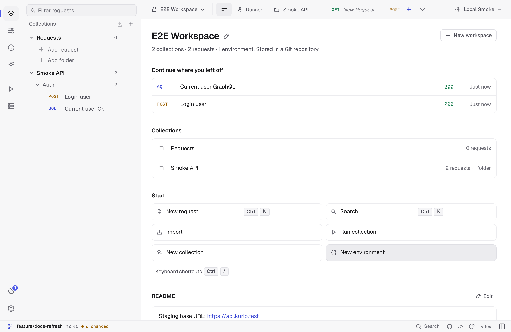

import DocsTopicIndex from "../../../../components/DocsTopicIndex.astro";

Kurlo can store workspace data in a folder instead of only inside the encrypted app profile. When that folder is a Git repository, the workspace becomes reviewable, branchable, and shareable with a team.

<DocsTopicIndex />
