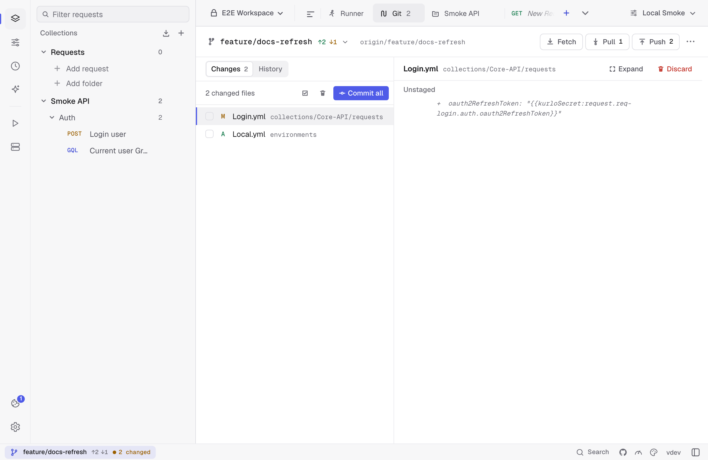

Open the Git workspace screen from the branch at the left of the status bar. The status bar also shows commits to push and pull (↑ ↓), how many Kurlo files changed, and a flag while a merge or rebase is in progress or when the tracked remote branch is gone. The screen covers the common loop:

1. **Fetch** to update remote refs.
2. **Pull** using fast-forward, merge, or rebase strategy.
3. Edit requests, environments, folders, and collection defaults in Kurlo.
4. Review changed YAML files and diffs.
5. Stage selected files or all Kurlo files.
6. Commit with a message.
7. Push to the configured upstream.

Kurlo shows ahead/behind counts, current branch, upstream status, remotes, stashes, changed files, commit history, and outgoing commits.

A diff of more than 1,500 lines, such as a commit that imports a large collection, renders only the lines near the screen as you scroll, so it opens and scrolls without freezing. In such a diff the file names scroll with the lines instead of staying pinned at the top.

The **History** tab loads older commits by itself as you scroll toward the end of the list, so long histories read as one list. If loading fails, the end of the list says so and offers **Retry**.

Once a branch is pushed and has nothing left to push, **Create PR** appears next to **Push**. It opens the page that starts a pull request on GitHub, or a merge request on GitLab and Bitbucket, from the current branch into the remote's default branch. Kurlo builds the link from the remote URL and sends nothing itself; for other hosts it says it cannot build one.

## Branches and stashes

Branch tools include:

- Checkout local or remote branches.
- Create a branch from current HEAD or from a remote branch.
- Rename and delete branches.
- Pull a specific branch.
- Set tracking/upstream where needed.

Stash tools are available when local changes would block a pull or branch operation. You can stash, pop a stash, or let Kurlo offer an autostash-style flow before pulling.
