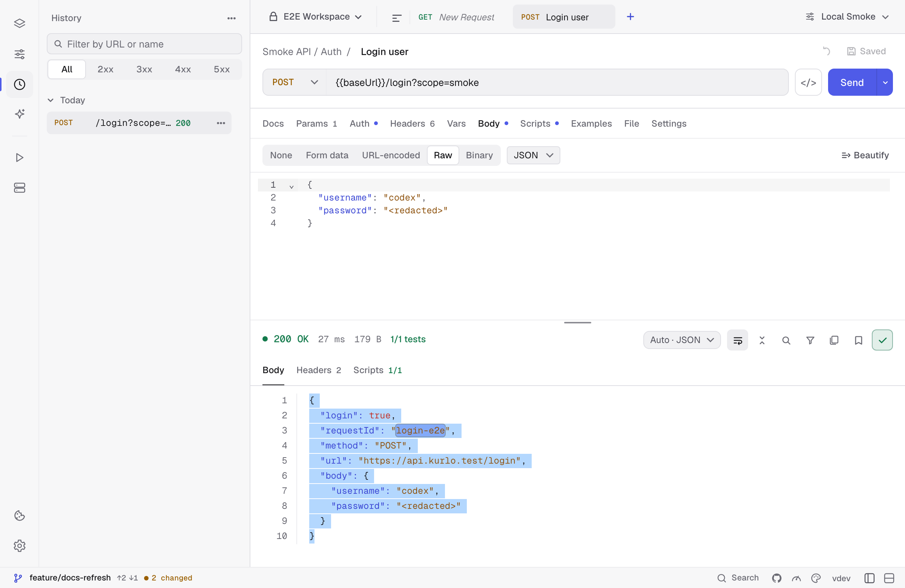

## Opening history

In the sidebar, switch from *Collections* to *History* via the toggle at the top. The list groups entries by **day**:

```
Today
  10:42  GET    200  /v1/users
  10:41  POST   201  /v1/users
  10:38  GET    404  /v1/users/missing
Yesterday
  18:11  GET    500  /v1/billing
  …
```

Each row shows the time, method, status, and URL. The status is color-coded with the same palette as the response panel (green 2xx, orange 4xx, red 5xx).

Toggle a day open or closed with the chevron. Days collapse independently — you can keep "Today" open and the rest minimized.


