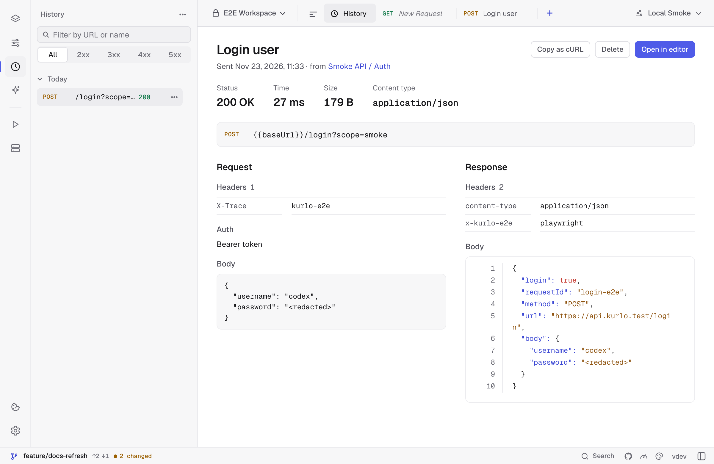

## The entry view

Click an entry to open it on its own page — a *History* tab in the title bar, closed like any other tab. It shows what was sent and what came back, side by side:

- **Request** — the method and full URL, the header rows the request carried (secret values stay masked), the auth type, and the body. Headers Kurlo adds on the wire, such as `Host` and `User-Agent`, are not part of the entry.
- **Response** — status, time, size and content type, then the stored response headers and body in the same viewer as the response panel, with syntax highlighting and line numbers.

If the request it was sent from still exists, the page says where it lives, and the link opens it. **Copy as cURL** copies the request as it was sent, **Delete** removes the entry, and **Open in editor** brings it back as a request you can change and send again.

### Open in editor

**Open in editor** copies the entry into the collection you are working in as a new request, opens it, and restores the stored response into the response panel — no need to re-send just to look at what you got. Re-sending would answer a different question anyway: the server may not reply the same way it did an hour ago. The new send becomes a fresh history entry.

### Stored responses

Kurlo keeps the response of each entry — status, headers and body — in the encrypted profile, up to 2 MB per entry. A larger body is cut to fit and the page says so; a binary body is not kept. A row whose response was kept shows a small dot next to its status code.
