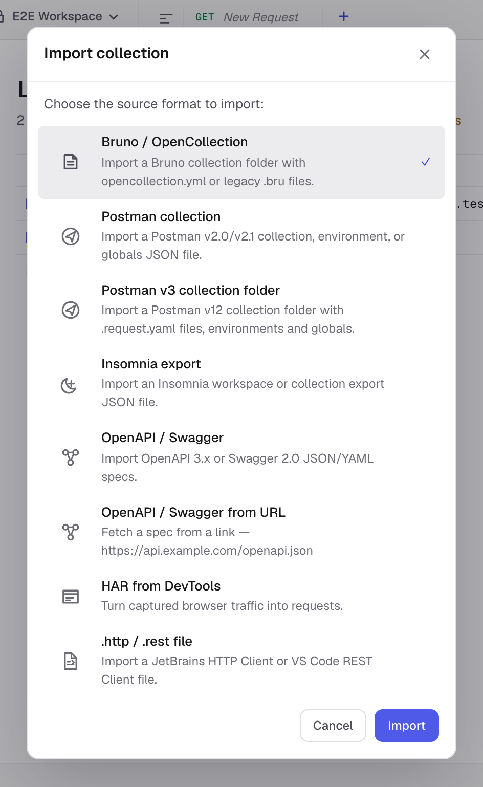

import DocsTopicIndex from "../../../../components/DocsTopicIndex.astro";

Kurlo supports both one-off interchange formats and full Kurlo backups. Imports are non-destructive unless you explicitly choose the all-data restore path.

<DocsTopicIndex />

## Supported sources

| Source | What Kurlo imports |
|--------|--------------------|
| Postman Collection v2.0 / v2.1 | Collections, nested folders, requests, auth, bodies, GraphQL, scripts, collection variables, and request documentation. Environment and globals exports import through the same picker. |
| Postman Collection v3 (folder) | Postman v12 Native Git folders of `.request.yaml` files: collections, folders and their order, HTTP, GraphQL, gRPC, WebSocket, Socket.IO and MCP requests, auth, bodies, scripts, settings, examples, environments and globals. |
| Insomnia v4 JSON | One collection per file with requests, their folder paths, and supported auth, bodies, and scripts. Folder environment values become request variables. |
| Bruno/OpenCollection | Collections, explicit empty folders, supported request types, and metadata. See [protocol support by format](/docs/guides/request-types/portability/). |
| OpenAPI/Swagger | From a file or a URL. HTTP/SSE requests generated from operations, plus the collection defaults that make them sendable: the server becomes a `{{baseUrl}}` variable, path parameters become the request's path variables seeded from the spec's examples, and declared security schemes become the request's auth. |
| AsyncAPI 2.x / 3.x | Kafka producers and consumers for each operation, with example values, keys and headers, a `{{brokers}}` variable from the servers, SASL auth and the document linked as the message schema. MQTT servers give one MQTT session with a subscription per channel the service writes and a saved message per channel it reads. See [Import AsyncAPI](/docs/guides/import-export/asyncapi/). |
| WSDL 1.1 | From a file or a URL. A SOAP 1.1 or 1.2 request for each operation of each SOAP port, with the `SOAPAction` or `action` header and a sample envelope built from the schema. See [Import WSDL](/docs/guides/import-export/wsdl/). |
| HAR | Captured HTTP requests. |
| `.http` / `.rest` | JetBrains HTTP Client and VS Code REST Client files: requests, names, headers, bodies, and file variables. |
| cURL | A single request pasted into the URL bar, including the flags that map onto a request setting — `-k`, `--max-time`, `--proxy` — and a form part's `;type=`. |
| Kurlo all-data backup | Workspaces, collections, environments, requests, history, cookies, and selected UI/request preferences. |
| Kurlo Git/YAML workspace | Reviewable workspace files with local-only secrets. |

