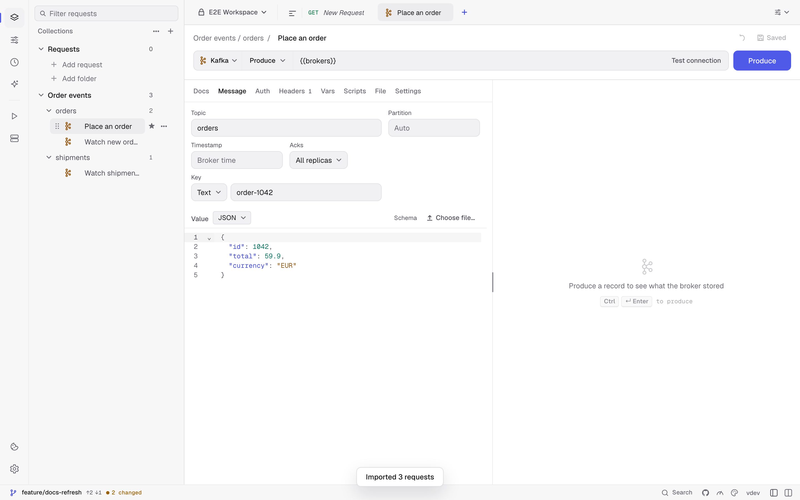
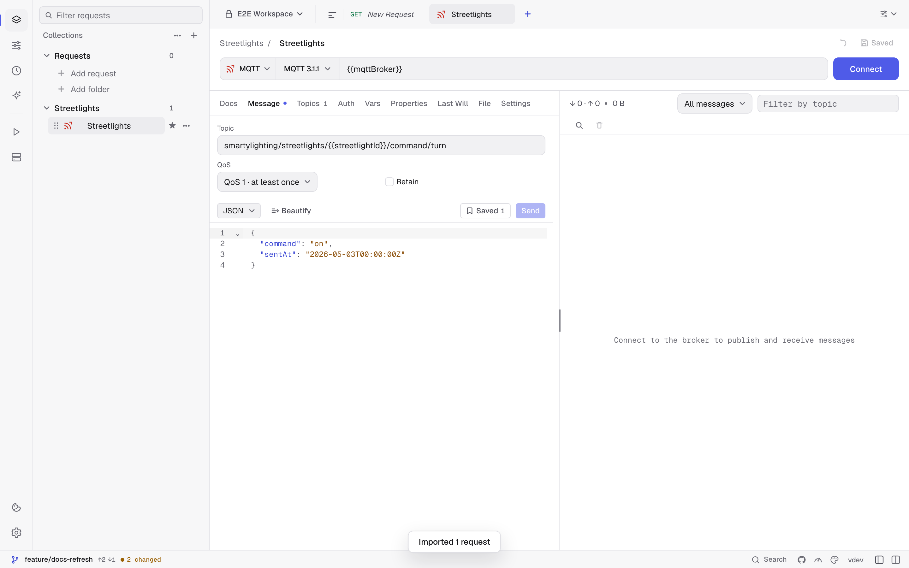

Select **AsyncAPI** in **Import collection**, click **Import**, and choose a JSON or YAML AsyncAPI 2.x or 3.x document. You can also drop the file onto the window. Kurlo builds a collection named after `info.title` with [Kafka requests](/docs/guides/request-types/kafka/) for Kafka servers and an [MQTT request](/docs/guides/request-types/mqtt/) for MQTT servers.

Servers with the `kafka` or `kafka-secure` protocol make Kafka requests; `mqtt`, `mqtt5`, `secure-mqtt`, `ws` and `wss` make MQTT. When a document has both, each channel goes to the protocol of the servers it lists, or to both when it lists none. A document without servers uses MQTT when its bindings are MQTT only, and Kafka otherwise.

## Kafka producers and consumers

Kafka requests get one folder per channel when the document has more than one. Kurlo takes the other side of each operation the document describes:

| Operation | Request |
|---|---|
| AsyncAPI 3 `action: receive` (the service reads the channel) | **Produce** to the topic |
| AsyncAPI 3 `action: send` (the service writes to the channel) | **Consume** the topic |
| AsyncAPI 2 `publish` | **Produce** |
| AsyncAPI 2 `subscribe` | **Consume** |
| A channel with no operation | One **Produce** and one **Consume** request |

An operation with several messages becomes one producer per message. A consumer starts at the latest offset and stops after 10 records; change it in **Topics**.

The topic is the channel `address` in AsyncAPI 3, the channel name in AsyncAPI 2, or the topic in the channel's Kafka binding. A parameter such as `orders.{region}` becomes `orders.{{region}}`, with a collection variable seeded from the parameter's default or first enum value.

## Example messages

Each producer is ready to send:

- **Value**: the message's first example, or a value built from its payload schema. JSON content types use the **JSON** format, others **Text**.
- **Key**: from the Kafka message binding's `key` schema.
- **Headers**: one row per property of the message's `headers` schema, with its example.
- **Docs**: the operation and message descriptions.

## Kafka brokers, TLS and sign-in

Servers with the `kafka` or `kafka-secure` protocol become a `brokers` collection variable, and every request connects to `{{brokers}}`. The first server is switched on; the others are switched-off rows named after their server, so you can switch clusters in the collection's **Vars**. Server variables use their defaults. A document without servers gets `localhost:9092`.

When a document has several Kafka servers and a channel lists the servers it lives on, that channel's requests connect to the first of them through its own variable, such as `{{brokers_east}}` for a server named `east`, and take TLS and sign-in from that server. Channels that list no servers keep `{{brokers}}`.

`kafka-secure` and X.509 security turn on TLS. SASL schemes become auth on each request: `plain` and `userPassword` use PLAIN, `scramSha256` and `scramSha512` use SCRAM, both reading `{{kafkaUsername}}` and `{{kafkaPassword}}`; `oauth2` sends `{{kafkaToken}}` as an OAUTHBEARER token. Fill these collection variables in before sending.

A document whose servers all use another protocol, such as AMQP, is not imported.

## Kafka schema validation

When you import from a file on disk, Kurlo links that file as the [message schema](/docs/guides/request-types/kafka/#connections-schemas-and-scripts) of each producer and consumer whose topic matches a channel address. A producer then refuses a message that breaks the schema, and consumed records show whether they match. A file inside the workspace folder is linked by a relative path. Payloads in Avro or Protobuf (`schemaFormat`) get no generated example or validation.

## MQTT session

One MQTT connection both subscribes and publishes, so the MQTT part of a document becomes a single request: connect once and see every channel.

- **Topics**: a subscription for every channel the service writes to (AsyncAPI 3 `send`, AsyncAPI 2 `subscribe`). Each `{parameter}` level becomes the `+` wildcard, so `light/{id}/measured` subscribes to `light/+/measured`. The QoS comes from the operation's MQTT binding.
- **Message** and **Saved**: a saved message for every message of the channels the service reads (AsyncAPI 3 `receive`, AsyncAPI 2 `publish`), with its example or a value built from the payload schema, and the QoS and retain flag of the operation's binding. The first one is loaded into the editor. Parameters in a publish topic become `{{variables}}` seeded from their default, first enum value or example.
- **Broker**: each MQTT server becomes a `mqttBroker` collection variable with its scheme — `mqtt://`, `mqtts://` for `secure-mqtt`, `ws://` or `wss://` — and the first one switched on. `protocolVersion` picks MQTT 5, 3.1.1 or 3.1; without one Kurlo uses 3.1.1.
- **Settings and Last Will**: the server's MQTT binding sets the client ID, clean session, keep alive and last will.
- **Auth**: a `userPassword` security scheme sends `{{mqttUsername}}` and `{{mqttPassword}}`.
- **Docs** lists every publish topic and subscription with its description.

The request is named after the document, or **MQTT session** when the document also has Kafka requests.
