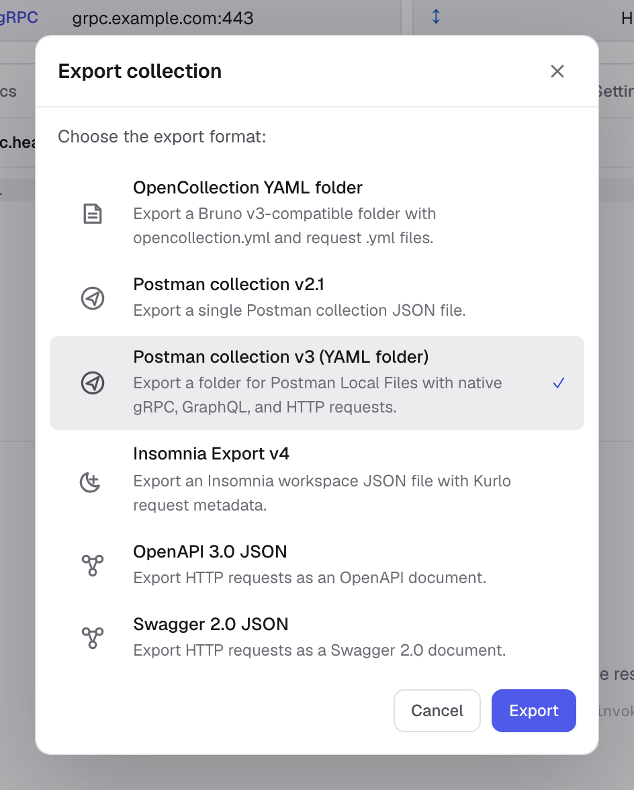

## From Postman

Kurlo reads both Postman formats and tells them apart on its own:

- **v2.0 / v2.1** — the single JSON file Postman exports. Both versions go through the same **Postman collection** option, so there is no version to choose.
- **v3** — the folder of YAML files Postman v12 uses for local collections (Native Git). Use it to import native gRPC, WebSocket, Socket.IO, and MCP requests. See [Postman v3 folders](#postman-v3-folders).

1. In Postman: right-click the collection → **Export** → choose v2.1.
2. In Kurlo, click **Import collection** in the sidebar. Select **Postman collection**, click **Import**, then pick the JSON file. You can also drop the file into the window.
3. Kurlo creates a new collection in the current workspace, preserving the folder tree.

What carries over:

- Folder hierarchy — including folders that hold no requests — request names, methods, URLs.
- Headers, query params, path variables (`:id` and its value), body (JSON, form-data, raw, urlencoded).
- Pre-request and test scripts. They always go to Kurlo's JavaScript fields, even when Tengo is the selected [script engine](/docs/guides/settings/script-engine/): switch to JavaScript to run them.
- Request descriptions, which become the request's **Docs** tab.
- Collection-level variables, auth, and scripts, which become the collection's [defaults](/docs/guides/collection-defaults/). A request that declared no auth of its own is set to **Inherit auth**, so the collection's auth applies exactly as it did in Postman.
- The whole OAuth 2.0 configuration, not just a stored access token: grant type, authorization and token URLs, client id and secret, scope, audience, and refresh token.

Postman folders can carry their own auth and scripts. They become the folder's [defaults](/docs/guides/collection-defaults/folders/), so every request in the folder still runs them, and you change them in one place. Exporting to Postman writes them back to the folder. In a v3 export, inherited headers are applied to the individual HTTP and GraphQL requests. The v2.1 export leaves inherited headers out.

### Environments and globals

Postman exports environments and globals as separate JSON files. Pick **Postman collection** in the import dialog and choose one of those files — Kurlo recognises it and imports it as an environment (made active) or merges it into **Globals**. Values Postman marked as secrets stay marked as secrets.

### Postman v3 folders

Postman v12 stores a collection as a folder: each request is a `*.request.yaml` file, folder and collection settings live in `.resources/definition.yaml`, and saved responses in `.resources/<request>.resources/examples/`. In the import dialog, select **Postman v3 collection folder**, click **Import**, and choose the folder. You can also drop the folder into the Kurlo window. Dropping a single `.request.yaml` file imports just that request.

You can pick a single collection folder or the whole `postman/` folder of a repository. Kurlo finds every collection inside it, imports each one as its own collection, and also imports the environments (`*.environment.yaml`) and globals (`*.globals.yaml`) next to them. A folder with no `definition.yaml` at all becomes one collection named after the folder.

What the v3 folder import keeps:

- The `order` of folders and requests. Items without one go last, sorted by name.
- Headers, query parameters, path variables and collection variables written either as a list or as a `key: value` map.
- Request settings: SSL verification, redirects, HTTP version, URL encoding and the cookie jar.
- gRPC requests with their method, message, metadata and TLS settings; WebSocket requests with their saved messages; Socket.IO requests with their events, the first message to send and every saved message; MCP requests over HTTP with the JSON-RPC call split into method, name and arguments.
- Saved examples of HTTP and GraphQL requests.
- Scripts written for HTTP requests at collection and folder level. Collection and folder scripts that Postman runs only for gRPC or Kafka are left out, so they cannot run on your HTTP requests.

The importer skips Postman MQTT, Kafka, LLM, data, and stdio MCP items and reports the count. Secrets that Postman keeps in a vault import as empty secret variables for you to fill in.

What doesn't carry over:

- Postman cloud Monitors. Cloud **Mock Servers** do not come across as such, but the saved responses they were built from import as [examples](/docs/guides/examples/), which Kurlo's own [mock server](/docs/guides/mock-server/) serves locally.
- Visualizer scripts.
- Variable types beyond string/secret.

## Export to Postman v3

1. In Kurlo, open the collection's **⋯** menu and choose **Export…**. Select **Postman collection v3 (YAML folder)** and click **Export**.
2. Name the new folder and select its parent directory. Kurlo writes the collection under `postman/collections/` inside the new folder.
3. In Postman Desktop, go to **Workspaces → Local Files → Open Folder** and select the new folder itself. The collection appears under **Local Files**. See [Postman's local folder instructions](https://learning.postman.com/latest-v-12/docs/use/native-git/sync#connect-a-project-folder).

HTTP, GraphQL and gRPC open as native requests. SSE uses an HTTP GET request with `Accept: text/event-stream` by default. If the collection contains other request types, Kurlo shows how many will be skipped before writing the folder.

gRPC exports include the method, JSON message, metadata, TLS settings, and server reflection setting. If reflection is unavailable, add the service's `.proto` files in Postman before invoking the method. Files from your machine, including protobuf sources and client certificates, are outside the export. For a GraphQL document with several operations, choose the operation in Postman.

The export includes collection variables and supported auth and JavaScript hooks. Environments, globals and saved response examples are outside the v3 export. If Kurlo detects secret values, the export dialog lets you choose whether to include them.

## Export to Postman v2.1

Choose **Postman collection v2.1** to export a single JSON file. The file stores a gRPC request's method, message and metadata in `x-kurlo` for re-import into Kurlo. Use the v3 folder to open gRPC as a native request in Postman.
