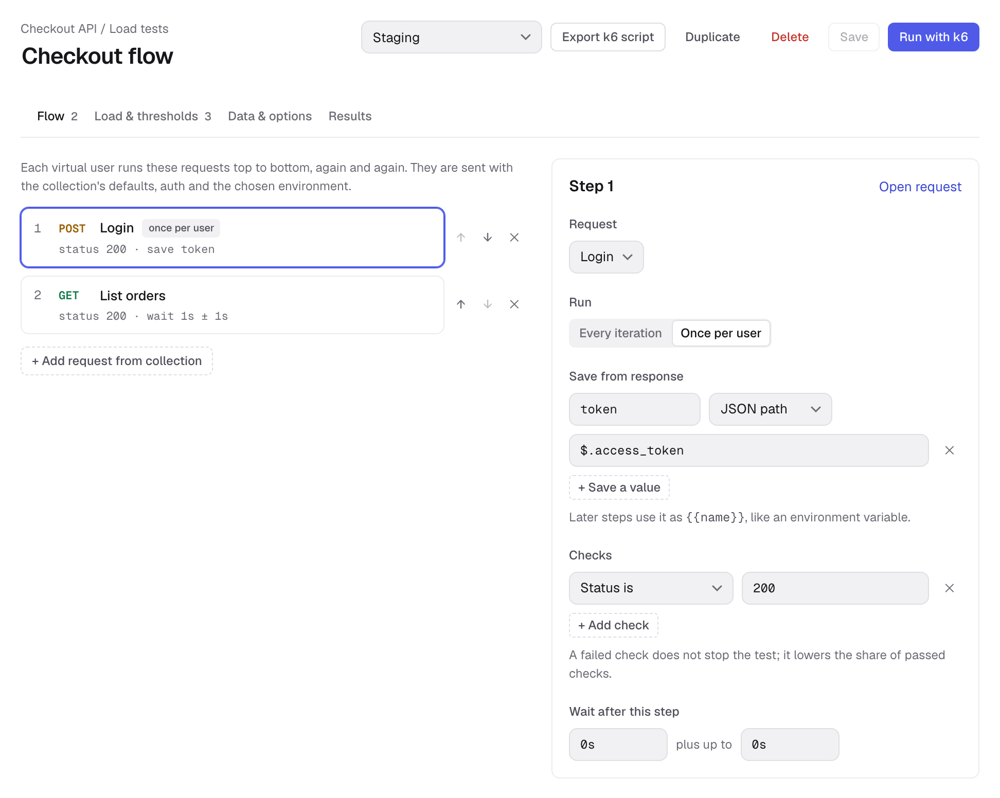
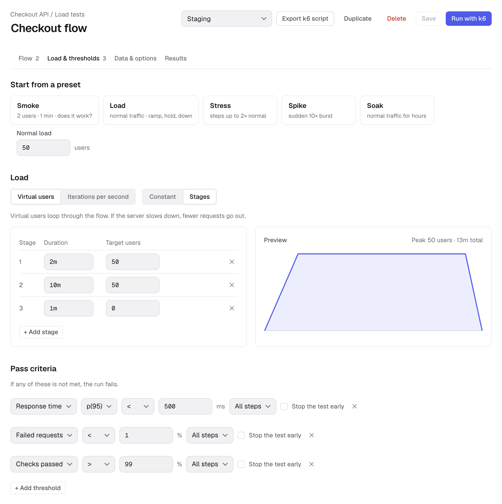
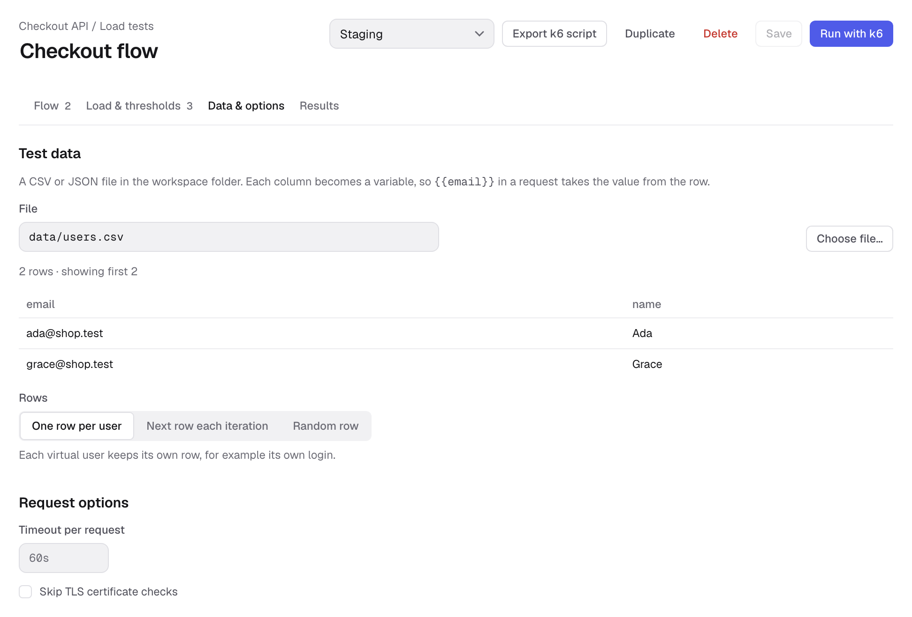
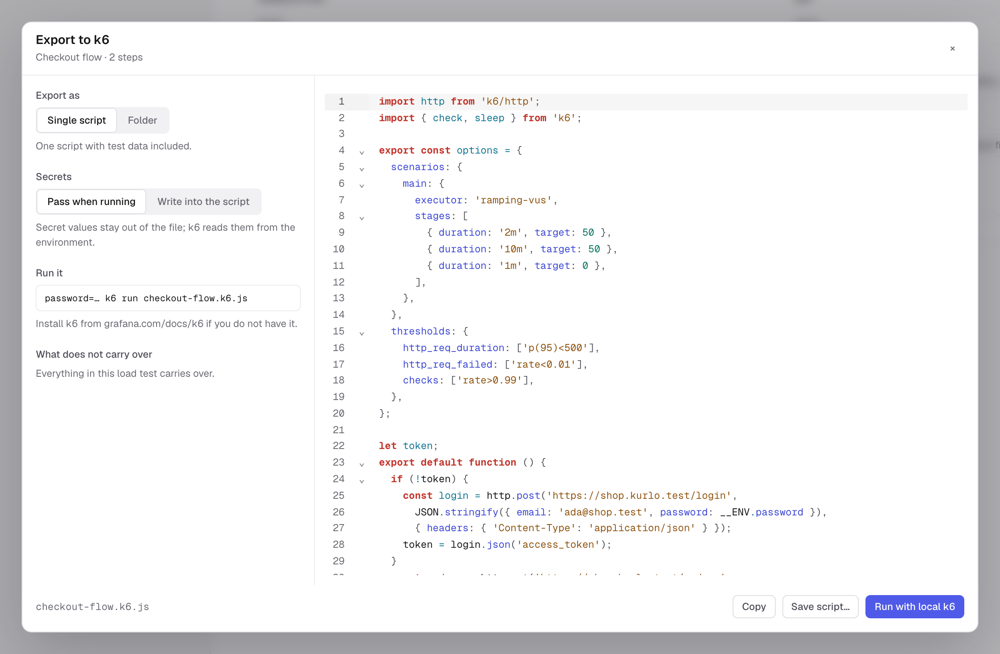
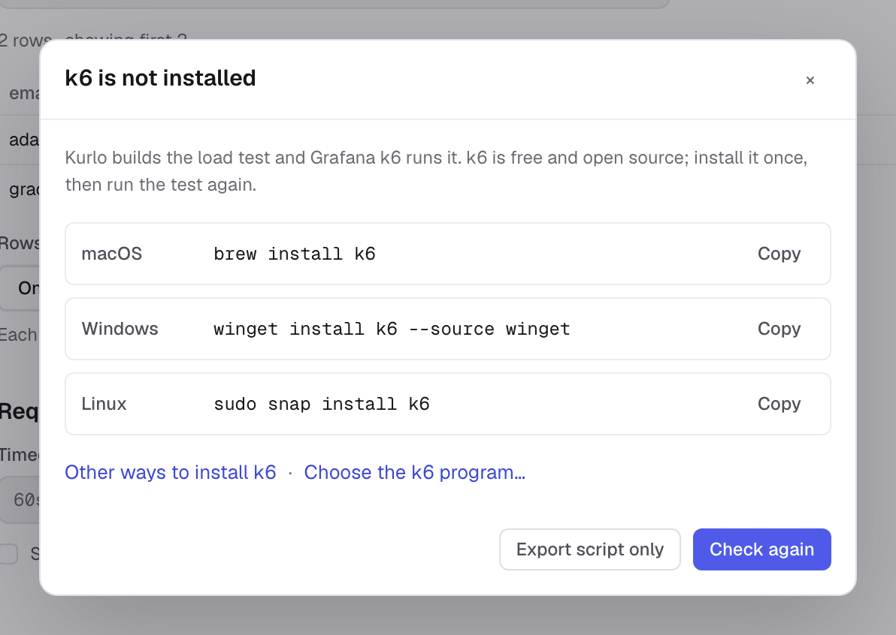
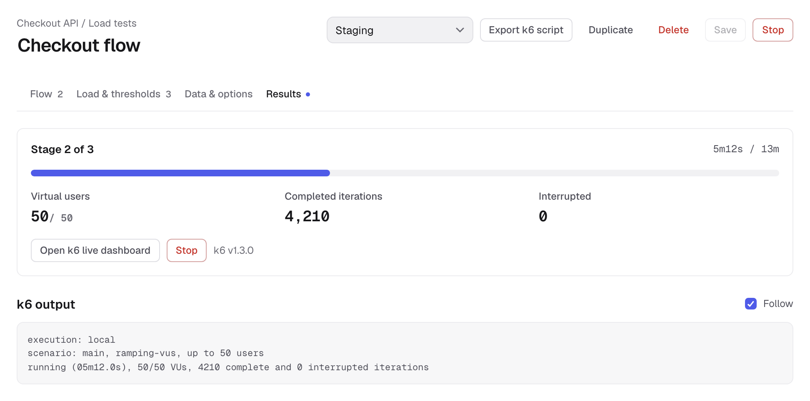
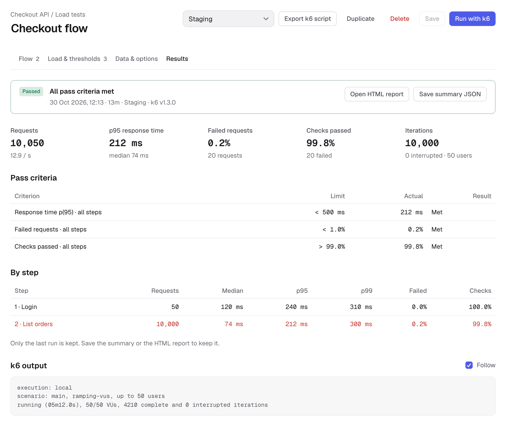

Load tests turn requests from a collection into a repeatable flow for [Grafana k6](https://grafana.com/docs/k6/). Kurlo edits the flow, generates the script and shows the last result. Your installed k6 generates the traffic. You can export a script without installing k6.

Use the [Collection Runner](/docs/guides/collection-runner/) to execute requests and their test scripts as functional checks. Use a load test to repeat a flow with virtual users or a target iteration rate and judge its response times, errors and checks against thresholds.

## Create your first test

1. Save an HTTP or GraphQL request in a collection.
2. Open its menu and choose **Load test this request**. Kurlo creates a one-step **Smoke** test: two virtual users for one minute. You can also choose **New load test** from the collection menu and add requests yourself.
3. Give the test a name and choose its environment. **Active environment** follows the workspace's current selection; choosing a named environment stores that choice with the test.
4. Review **Flow**, **Load & thresholds** and **Data & options**.
5. Click **Save** when autosave is off. The test appears under its collection in the sidebar.
6. Choose **Export k6 script**, or install k6 and click **Run with k6**.

A test has one flow. Its steps can use saved HTTP and GraphQL requests from the same collection. Requests remain linked to the collection, so changes to a request are picked up by the next export or run. The collection's defaults, headers, auth and environment variables feed the generated script.



## Build a flow

Each virtual user, or **VU**, runs the steps from top to bottom. One pass through the flow is an **iteration**. Add a request with **+ Add request from collection**, select a step to edit it, and use its move buttons to change the order. **Open request** opens the linked request itself.

### Run once per user

Steps normally run on **Every iteration**. Choose **Once per user** for setup that each VU should do only once, such as logging in. Each VU has its own saved values; a token extracted by one user is not shared with the others.

### Save values from a response

In **Save from response**, click **+ Save a value**, name the variable and choose its source:

| Source | Path example | Saved value |
| --- | --- | --- |
| JSON path | `$.access_token` | The response's `access_token` field |
| JSON path | `$.items[0].id` | The first item's `id` |
| JSON path | `$['x-request-id']` | A field whose name needs brackets |
| Header | `X-Request-Id` | The response header value |
| Regex | `orderId=(\w+)` | The first capture group |

Use simple property paths and array indices for JSON extraction; JSONPath filters, recursive searches and wildcards are not supported. Variable names can contain letters, digits and underscores, must not start with a digit, and must be unique across extraction rules in the flow.

For a login → orders flow:

1. Save a **Login** request whose JSON body uses `{{email}}` and `{{password}}`.
2. Add it as the first step, choose **Once per user**, and save `token` from JSON path `$.access_token`.
3. Set the **List orders** request's bearer token to `{{token}}` and add it as the next step.

Extracted variables take precedence over data-row variables, then the chosen environment and collection/global defaults. A value saved by a step becomes available to subsequent steps and later iterations of that VU.

### Check responses

Click **+ Add check** to check the status, the presence of a JSON field, or whether the body contains text. For example, check **Status is** `200` on Login and **JSON field exists** `$.items` on List orders.

A failed check lowers the **Checks passed** rate; it does not stop the flow or make the run fail by itself. Add a threshold for **Checks passed** when those checks should decide whether the run passes.

### Wait between requests

**Wait after this step** is a minimum delay. **Random extra wait** adds a random amount on top. A wait of `500ms` plus up to `1s` pauses for between half a second and one and a half seconds. For a once-per-user step, the wait happens only when that step runs.

## Choose the load

Open **Load & thresholds**. Set **Normal load** and pick a preset, then adjust its duration or stages. Applying a preset replaces the load profile; it keeps your flow, checks, data and thresholds.

| Preset | Starting profile |
| --- | --- |
| Smoke | 2 users for 1 minute |
| Load | Ramp to normal load over 2 minutes, hold for 10 minutes, ramp down over 1 minute |
| Stress | Four 3-minute stages at 50%, 100%, 150% and 200% of normal load, then a 2-minute ramp down |
| Spike | Ramp to 10× normal load over 10 seconds, hold for 1 minute, ramp down over 10 seconds |
| Soak | Ramp up over 5 minutes, hold for 2 hours, ramp down over 5 minutes |



### Users or iterations per second

**Virtual users** keeps a chosen number of VUs busy. Each user starts its next iteration after finishing the previous one, including waits. Slower responses mean fewer completed iterations per second.

**Iterations per second** starts whole flow iterations at the target rate. This is not a request-per-second target: one iteration may send several requests. The **Smoke** preset in this model starts two iterations per second for one minute.

Both models support a constant load or stages. Their k6 executors are `constant-vus`, `ramping-vus`, `constant-arrival-rate` and `ramping-arrival-rate`. For arrival-rate tests, set the preallocated users and maximum users high enough to sustain the target rate; k6 may need more users when responses slow down. The preview shows the planned profile, not measured traffic.

### Decide whether a run passes

Add thresholds under the load profile. Each threshold applies to **All steps** or one selected step:

| Metric | Example | Meaning |
| --- | --- | --- |
| Response time | `p(95) < 500 ms` | The 95th-percentile request duration stays below 500 ms |
| Failed requests | `< 1%` | Fewer than 1% of requests are counted as failed by k6 |
| Checks passed | `> 99%` | More than 99% of checks pass |

Response-time statistics include median, average, minimum, maximum, p90, p95 and p99. The UI uses milliseconds for durations and percentages for rates. In YAML and k6 scripts, rates use fractions: `1%` becomes `0.01`.

A failed threshold makes the run **Failed**, even if the process finishes normally. Enable **Stop the test early** to let k6 stop a run when that threshold fails. A failed check and a failed HTTP request are separate metrics; set thresholds for both when both matter to your test.

## Use CSV or JSON data

Put a data file inside the workspace folder and open **Data & options**. Click **Choose file…**, or enter a path such as `data/users.csv`. Kurlo stores a path relative to the workspace root and previews the first five rows.

```csv
email,name
ada@shop.test,Ada
grace@shop.test,Grace
```

JSON can be an array of objects:

```json
[
  { "email": "ada@shop.test", "name": "Ada" },
  { "email": "grace@shop.test", "name": "Grace" }
]
```

Each column or object key becomes a variable such as `{{email}}`. Select how rows are assigned:

- **One row per user** keeps a row for that VU. Users wrap around when there are more users than rows. This works well with a once-per-user login step.
- **Next row each iteration** cycles through rows using the scenario's iteration index across users.
- **Random row** chooses a row each iteration; rows can be reused.



The same tab has a timeout per request and **Skip TLS certificate checks**. Leave the timeout empty to keep the request's timeout; fill it to override it for the load test.

## Export to k6

Click **Export k6 script** to inspect the generated JavaScript and see what carries over. Choose:

- **Single script** for one self-contained `.k6.js` file, including test data.
- **Folder** for `script.k6.js` and a separate `data.json` when data is configured. **Save folder…** asks for a parent directory and creates a folder named after the test. It preserves any existing export folder.



**Pass when running** keeps secret variable values out of the script. Supply them in the environment when running an exported script, for example in a macOS or Linux shell:

```bash
password='your-test-password' k6 run checkout-flow.k6.js
```

For a folder export, run `k6 run script.k6.js` from that folder. When Kurlo starts k6 itself, it supplies the selected secret variable values through the child process's environment.

**Write into the script** includes secret values in the exported file. Do not commit or share that file. Data files are also included in exports, so use test data you intend to share.

You can edit the exported JavaScript to add k6 behavior beyond the editor. Changes to the exported script do not update the saved load test. **Run with local k6** in the export dialog runs the current flow through the same launch path as the editor's run button.

### What carries over

HTTP and GraphQL requests carry their supported bodies, headers, collection defaults, variables, checks, extractions, waits, load profile and thresholds. Bearer, basic, API key and digest auth are supported. OAuth 2.0 client credentials and password grants can fetch a token once before the flow starts. A saved OAuth token can be exported with a warning that it may expire.

Review the export warnings before running:

- Pre-request and test scripts are not translated. Add load-test checks and extraction rules for the behavior you need.
- OAuth 1.0, AWS signing, interactive OAuth grants without a usable saved token, and client certificates do not carry over as equivalent auth flows.
- File uploads and binary bodies are not exported. Text multipart fields are sent URL-encoded, with a warning.
- Unknown dynamic variables are left as written with a warning. Supported dynamic variables are generated in the script.

The flow picker excludes WebSocket, gRPC, SSE, Socket.IO, MCP and AI requests. A load test runs one sequential flow; parallel flows and batch requests are not part of this editor.

## Install and run k6

Kurlo uses an independently installed k6 program. On macOS with Homebrew:

```bash
brew install k6
```

On Windows with Windows Package Manager:

```powershell
winget install k6 --source winget
```

For Linux packages, standalone binaries and other installation options, follow the [official k6 installation guide](https://grafana.com/docs/k6/latest/set-up/install-k6/).

If Kurlo cannot find k6, it opens an installation dialog. Use **Choose the k6 program…** to select the binary yourself, **Check again** after installation, or **Export script only** to continue without a local runtime.



Click **Run with k6**. For targets outside this computer's loopback addresses, Kurlo shows the hosts and asks you to confirm before sending traffic. For a protected environment, type the requested host name. Only one load test can run in the app at a time.

### Watch and stop a run

The **Results** tab shows the planned stage, elapsed time, users, completed and interrupted iterations, and the k6 log. **Open k6 live dashboard** opens k6's own dashboard while the run is active.



**Stop** asks k6 to finish on macOS and Linux; after ten seconds Kurlo kills it if it has not exited. On Windows it is killed immediately. A stopped run keeps the summary when k6 produced one. Its status is **Stopped** unless k6 had already completed and returned its final result.

### Read the result

When the run finishes, Kurlo shows **Passed**, **Failed**, **Stopped** or **Did not finish**. The result includes each threshold's actual value, total requests and throughput, response times, failed requests, checks and a table per step.



Use **Open HTML report** for k6's exported dashboard report and **Save summary JSON** for the raw k6 summary. The HTML report is available when k6 generated it; very short runs may not collect enough dashboard samples.

Kurlo keeps only the last result for each test, on this device. A new run replaces it. The result, summary and HTML report are local app data, not part of the workspace YAML. There is no run history or baseline comparison.

## Save, share and run in CI

The load-test definition lives alongside its collection's requests:

```text
workspaces/<workspace>/collections/<collection>/loadtests/<test>.yml
```

Commit that definition and any shared data files with the workspace. Secret variable values belong in environment configuration rather than the test definition. See the [YAML reference](/docs/reference/kurlo-yaml-format/#load-test-file) for the file format.

The headless CLI reads the same tests:

```bash
kurlo load list --workspace ./api
kurlo load export "Checkout flow" --workspace ./api --dir ./k6-export
kurlo load run "Checkout flow" --workspace ./api --env CI --env-file ./ci.env --json summary.json --report report.html
```

The CLI can select a test by name, ID or YAML path. Threshold failures exit with code `99`; runtime errors use `1`, usage errors use `2`, and interrupted runs use `130`. See [CLI load testing](/docs/guides/cli-runner/#load-tests-with-k6) for variable precedence, all flags and report handling.
