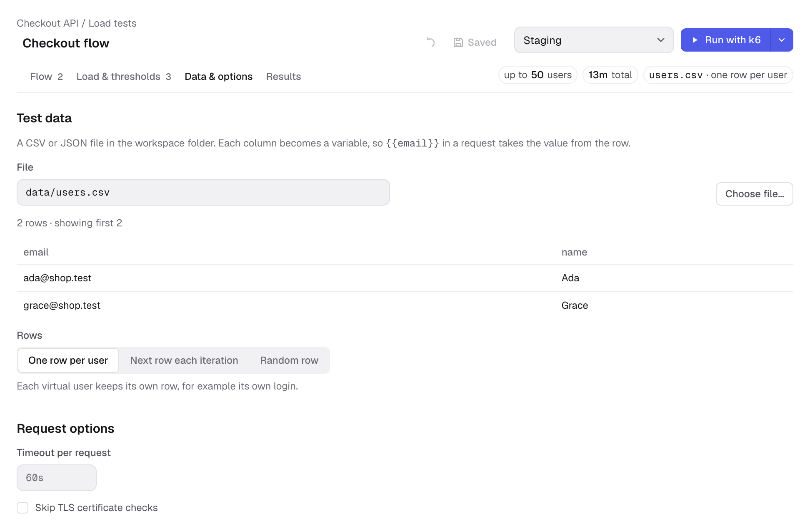

Put a data file inside the workspace folder and open **Data & options**. Click **Choose file…**, or enter a path such as `data/users.csv`. Kurlo stores a path relative to the workspace root and previews the first five rows.

```csv
email,name
ada@shop.test,Ada
grace@shop.test,Grace
```

JSON can be an array of objects:

```json
[
  { "email": "ada@shop.test", "name": "Ada" },
  { "email": "grace@shop.test", "name": "Grace" }
]
```

Each column or object key becomes a variable such as `{{email}}`. Select how rows are assigned:

- **One row per user** keeps a row for that VU. Users wrap around when there are more users than rows. This works well with a once-per-user login step.
- **Next row each iteration** cycles through rows using the scenario's iteration index across users.
- **Random row** chooses a row each iteration; rows can be reused.



The same tab has a timeout per request and **Skip TLS certificate checks**. Leave the timeout empty to keep the request's timeout; fill it to override it for the load test.
