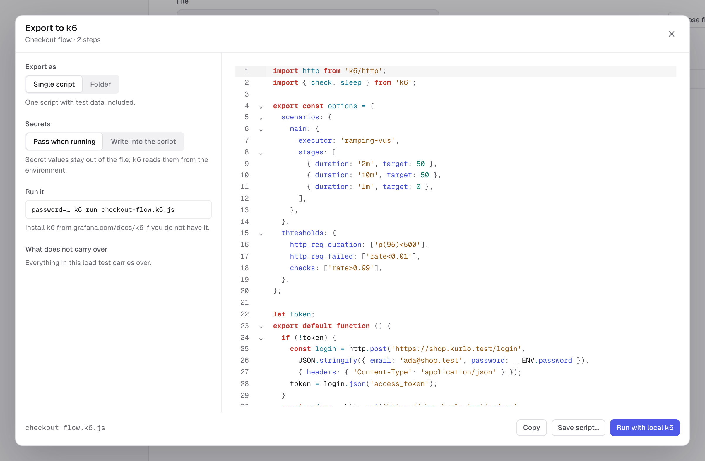

Click **Export k6 script** to inspect the generated JavaScript and see what carries over. Choose:

- **Single script** for one self-contained `.k6.js` file, including test data.
- **Folder** for `script.k6.js` and a separate `data.json` when data is configured. **Save folder…** asks for a parent directory and creates a folder named after the test. It preserves any existing export folder.



**Pass when running** keeps secret variable values out of the script. Supply them in the environment when running an exported script, for example in a macOS or Linux shell:

```bash
password='your-test-password' k6 run checkout-flow.k6.js
```

For a folder export, run `k6 run script.k6.js` from that folder. When Kurlo starts k6 itself, it supplies the selected secret variable values through the child process's environment.

**Write into the script** includes secret values in the exported file. Do not commit or share that file. Data files are also included in exports, so use test data you intend to share.

You can edit the exported JavaScript to add k6 behavior beyond the editor. Changes to the exported script do not update the saved load test. **Run with local k6** in the export dialog runs the current flow through the same launch path as the editor's run button.

## What carries over

HTTP and GraphQL requests carry their supported bodies, headers, collection defaults, variables, checks, extractions, waits, load profile and thresholds. Bearer, basic, API key and digest auth are supported. OAuth 2.0 client credentials and password grants can fetch a token once before the flow starts. A saved OAuth token can be exported with a warning that it may expire.

Review the export warnings before running:

- Pre-request and test scripts are not translated. Add load-test checks and extraction rules for the behavior you need.
- OAuth 1.0, AWS signing, interactive OAuth grants without a usable saved token, and client certificates do not carry over as equivalent auth flows.
- File uploads and binary bodies are not exported. Text multipart fields are sent URL-encoded, with a warning.
- Unknown dynamic variables are left as written with a warning. Supported dynamic variables are generated in the script.

The flow picker excludes WebSocket, gRPC, SSE, Socket.IO, MCP and AI requests. A load test runs one sequential flow; parallel flows and batch requests are not part of this editor.
