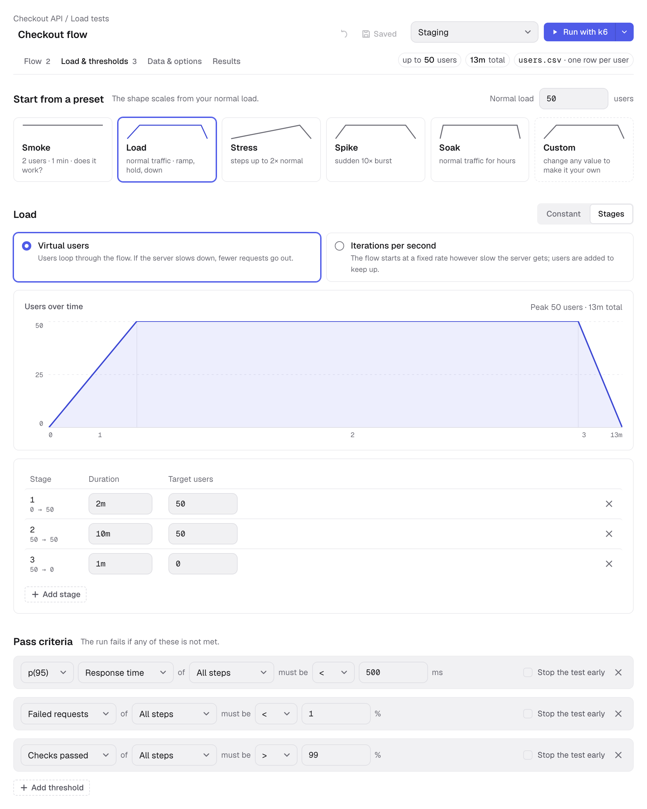

Open **Load & thresholds**. Set **Normal load** and pick a preset — each card shows the shape it applies — then adjust its duration or stages. The test stores only the resulting load, not the preset's name: a card stays highlighted while the settings match that preset exactly, and **Custom** is highlighted as soon as you change a value. The chart shows the planned load over time; hovering or editing a stage highlights its part of the chart. Applying a preset replaces the load profile; it keeps your flow, checks, data and thresholds.

| Preset | Starting profile |
| --- | --- |
| Smoke | 2 users for 1 minute |
| Load | Ramp to normal load over 2 minutes, hold for 10 minutes, ramp down over 1 minute |
| Stress | Four 3-minute stages at 50%, 100%, 150% and 200% of normal load, then a 2-minute ramp down |
| Spike | Ramp to 10× normal load over 10 seconds, hold for 1 minute, ramp down over 10 seconds |
| Soak | Ramp up over 5 minutes, hold for 2 hours, ramp down over 5 minutes |

## Users or iterations per second

**Virtual users** keeps a chosen number of VUs busy. Each user starts its next iteration after finishing the previous one, including waits. Slower responses mean fewer completed iterations per second.

**Iterations per second** starts whole flow iterations at the target rate. This is not a request-per-second target: one iteration may send several requests. The **Smoke** preset in this model starts two iterations per second for one minute.

Both models support a constant load or stages. Their k6 executors are `constant-vus`, `ramping-vus`, `constant-arrival-rate` and `ramping-arrival-rate`. For arrival-rate tests, set the preallocated users and maximum users high enough to sustain the target rate; k6 may need more users when responses slow down. The preview shows the planned profile, not measured traffic.

## Decide whether a run passes

Add thresholds under the load profile. Each reads as a sentence, such as *p(95) Response time of All steps must be < 500 ms*, and applies to **All steps** or one selected step:

| Metric | Example | Meaning |
| --- | --- | --- |
| Response time | `p(95) < 500 ms` | The 95th-percentile request duration stays below 500 ms |
| Failed requests | `< 1%` | Fewer than 1% of requests are counted as failed by k6 |
| Checks passed | `> 99%` | More than 99% of checks pass |

Response-time statistics include median, average, minimum, maximum, p90, p95 and p99. The UI uses milliseconds for durations and percentages for rates. In YAML and k6 scripts, rates use fractions: `1%` becomes `0.01`.

A failed threshold makes the run **Failed**, even if the process finishes normally. Enable **Stop the test early** to let k6 stop a run when that threshold fails. A failed check and a failed HTTP request are separate metrics; set thresholds for both when both matter to your test.
