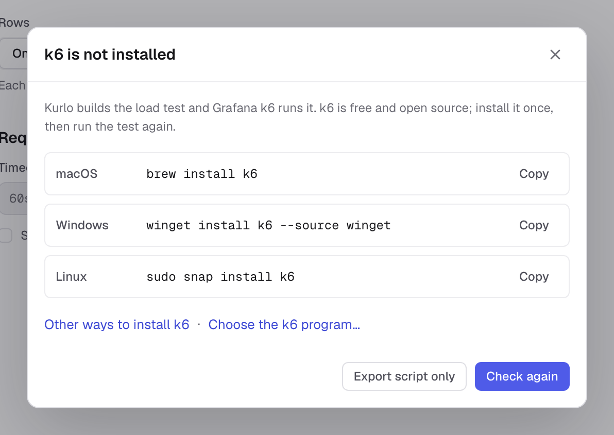
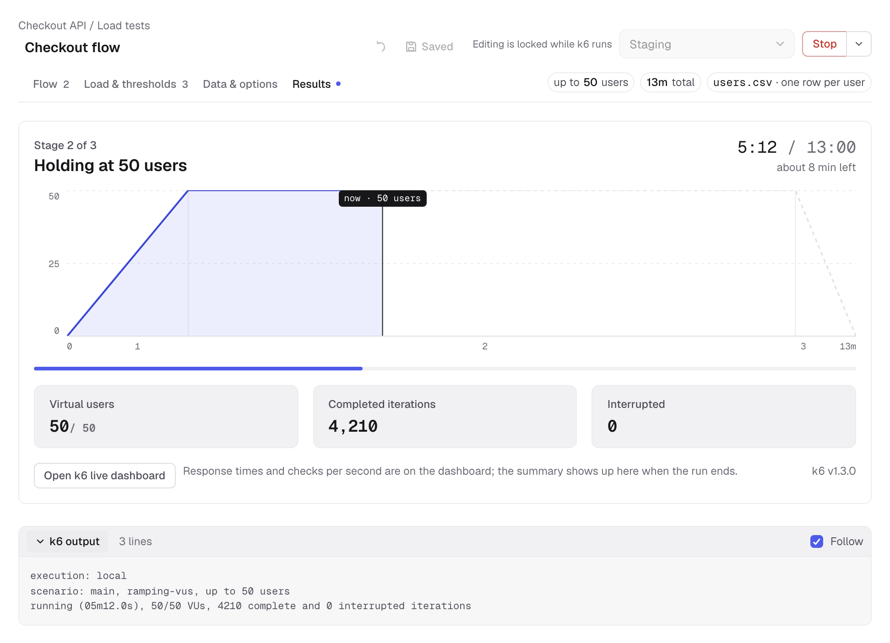
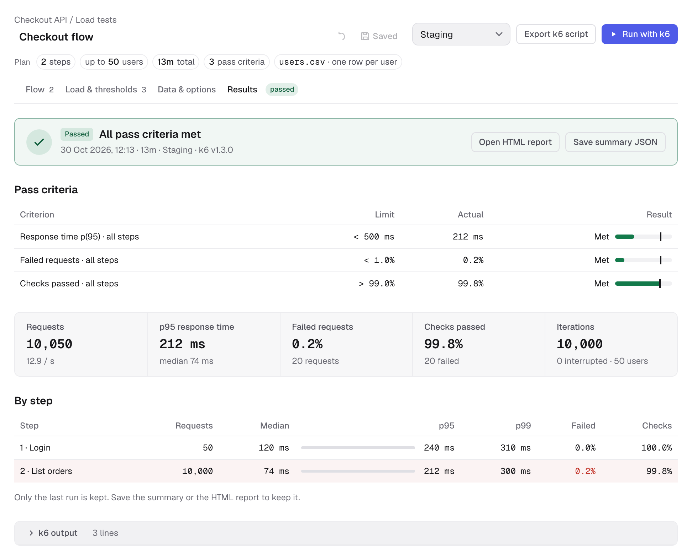

Kurlo uses an independently installed k6 program. On macOS with Homebrew:

```bash
brew install k6
```

On Windows with Windows Package Manager:

```powershell
winget install k6 --source winget
```

For Linux packages, standalone binaries and other installation options, follow the [official k6 installation guide](https://grafana.com/docs/k6/latest/set-up/install-k6/).

If Kurlo cannot find k6, it opens an installation dialog. Use **Choose the k6 program…** to select the binary yourself, **Check again** after installation, or **Export script only** to continue without a local runtime.



Click **Run with k6**. For targets outside this computer's loopback addresses, Kurlo shows the hosts and asks you to confirm before sending traffic. For a protected environment, type the requested host name. Only one load test can run in the app at a time.

## Watch and stop a run

The **Results** tab shows the current stage and what it is doing, elapsed time as a clock such as `0:15 / 1:00` and the approximate time left, the planned load with a marker at the current moment, users, completed and interrupted iterations, and the k6 log, which you can collapse. **Open k6 live dashboard** opens k6's own dashboard while the run is active.



**Stop** asks k6 to finish on macOS and Linux; after ten seconds Kurlo kills it if it has not exited. On Windows it is killed immediately. A stopped run keeps the summary when k6 produced one. Its status is **Stopped** unless k6 had already completed and returned its final result.

## Read the result

When the run finishes, Kurlo shows **Passed**, **Failed**, **Stopped** or **Did not finish**. The result includes each threshold's actual value with a bar against its limit, total requests and throughput, response times, failed requests, checks and a table per step with a bar for each step's p95. The **Results** tab label also shows the last status.



Use **Open HTML report** for k6's exported dashboard report and **Save summary JSON** for the raw k6 summary. The HTML report is available when k6 generated it; very short runs may not collect enough dashboard samples.

Kurlo keeps only the last result for each test, on this device. A new run replaces it. The result, summary and HTML report are local app data, not part of the workspace YAML. There is no run history or baseline comparison.
